---
tags:
  - теория-вероятностей
  - лекция
  - итмо
курс: Теория вероятностей (ИТМО)
лекция: 3
---

# Лекция 3. Случайные величины и распределения

> [!info] О методичке
> Это конспект к лекции 3 курса «Теория вероятностей» для студентов ИТМО. В нём полностью разобраны все темы лекции: определения, свойства с пояснениями, примеры с решениями и короткие фрагменты кода на Python. Презентация лекции лежит рядом: `03_random-variables-distributions-itmo.pptx`. Практика по этой теме будет на семинаре 3 (ноутбук `attachments/03-seminar-random-variables-itmo.ipynb`).

**План.**

1. [[#1. Зачем нужны случайные величины|Зачем нужны случайные величины]]
2. [[#2. Случайная величина как функция исхода|Случайная величина как функция исхода]]
3. [[#3. Дискретные случайные величины|Дискретные случайные величины]]
4. [[#4. Функция распределения|Функция распределения]]
5. [[#5. Непрерывные случайные величины и плотность|Непрерывные случайные величины и плотность]]
6. [[#6. Квантили|Квантили]]
7. [[#7. Эмпирическая функция распределения|Эмпирическая функция распределения]]
8. [[#8. Основные дискретные распределения|Основные дискретные распределения]]
9. [[#9. Основные непрерывные распределения|Основные непрерывные распределения]]
10. [[#10. Распределения в задачах анализа данных|Распределения в задачах анализа данных]]
11. [[#11. Шпаргалка|Шпаргалка]]
12. [[#12. Вопросы для самопроверки|Вопросы для самопроверки]]

---

## 1. Зачем нужны случайные величины

На прошлых лекциях мы спрашивали, **произошло ли событие**: выпал ли орёл, отказал ли сервер, оказался ли пользователь в тестовой группе. Но в анализе данных результат наблюдения почти всегда **число**:

- сколько запросов пришло на сервер за минуту;
- сколько миллисекунд занял ответ;
- кликнул пользователь по баннеру (1) или нет (0);
- насколько предсказание модели отличается от истинного значения.

Каждая числовая колонка таблицы с данными — это наблюдённые значения некоторой случайной величины. Если мы знаем, **как распределены** её значения, мы можем отвечать на практические вопросы: с какой вероятностью сервер перегрузится, какое время ответа гарантировать в 95 % случаев, является ли наблюдение аномалией.

> [!tip] Главная мысль лекции
> Случайная величина превращает исход эксперимента в число, а **распределение** описывает, как вероятность «разложена» по возможным значениям этого числа. Модель данных в статистике и машинном обучении — это, по сути, выбор распределения.

---

## 2. Случайная величина как функция исхода

### 2.1. Определение

Пусть $(\Omega, \mathcal{F}, P)$ — вероятностное пространство: $\Omega$ — множество элементарных исходов, $\mathcal{F}$ — события, $P$ — вероятность.

> [!note] Определение
> **Случайной величиной** называется функция $X\colon \Omega \to \mathbb{R}$, которая каждому элементарному исходу $\omega$ ставит в соответствие число $X(\omega)$, причём для любого $x\in\mathbb{R}$ множество $\{\omega : X(\omega)\le x\}$ является событием (то есть для него определена вероятность).

Второе условие называется **измеримостью**. В конечных и счётных моделях оно выполняется автоматически, а в курсе мы будем считать его выполненным всегда. Важно другое: случайная величина — это **не число и не «случайность»**, а **функция**. Случайным является исход $\omega$, а $X$ — это правило, по которому из исхода получается число. В книге «Математика для машинного обучения» есть меткое замечание: термин «случайная величина» вносит путаницу, потому что это не величина и она не случайна — это функция.

Случайные величины принято обозначать заглавными латинскими буквами $X, Y, Z$, а их возможные значения — строчными $x, y, z$.

### 2.2. Пример: две монеты

Бросаем две монеты. $\Omega = \{\text{ОО}, \text{ОР}, \text{РО}, \text{РР}\}$, все исходы равновероятны. Пусть $X$ — число орлов:

| $\omega$ | ОО | ОР | РО | РР |
|---|---|---|---|---|
| $X(\omega)$ | 2 | 1 | 1 | 0 |

Событие «$X=1$» — это множество исходов $\{\text{ОР}, \text{РО}\}$, поэтому $P(X=1)=2/4=1/2$. Аналогично $P(X=0)=P(X=2)=1/4$.

Обратите внимание: разные исходы могут давать одно и то же значение $X$. Случайная величина «сжимает» информацию об исходе до того, что нас интересует.

### 2.3. События, порождённые случайной величиной

Записи $\{X = x\}$, $\{X \le x\}$, $\{a < X \le b\}$, $\{X \in B\}$ — это сокращения для событий
$$
\{X\in B\} = \{\omega\in\Omega : X(\omega)\in B\}.
$$
Поэтому к ним применимы все правила работы с вероятностями из прошлых лекций: сложение для несовместных событий, переход к противоположному событию и т. д.

### 2.4. Распределение случайной величины

> [!note] Определение
> **Распределением** (законом распределения) случайной величины $X$ называется правило, которое каждому множеству $B\subseteq\mathbb{R}$ сопоставляет вероятность $P(X\in B)$.

Закон распределения можно задавать разными способами: таблицей (рядом распределения), функцией распределения, плотностью. Это три «языка» одного и того же объекта, и лекция в основном о том, как между ними переходить.

Две разные случайные величины могут иметь **одинаковое распределение**. Например, «число орлов при броске монеты» и «индикатор того, что на кубике выпало чётное число» обе принимают значения 0 и 1 с вероятностями $1/2$. Для анализа данных важно именно распределение, а не конкретное устройство $\Omega$: обычно мы его даже не выписываем.

### 2.5. Дискретные и непрерывные величины

| | Дискретная | Непрерывная |
|---|---|---|
| Множество значений | конечное или счётное: $x_1, x_2, \dots$ | заполняет промежуток или всю прямую |
| Как задаётся | ряд распределения $p_i = P(X=x_i)$ | плотность $f(x)$ |
| Вероятность точки | может быть положительной | $P(X=x)=0$ для любого $x$ |
| Вероятность множества | сумма $\sum_{x_i\in B} p_i$ | интеграл $\int_B f(x)\,dx$ |
| Примеры из данных | число запросов, число ошибок, клик (0/1) | время ответа, температура, ошибка регрессии |

Бывают и **смешанные** величины. Например, время ожидания в очереди равно нулю с положительной вероятностью (очередь пуста), а при непустой очереди принимает любые положительные значения. Общий инструмент, который работает для любых величин, — функция распределения (раздел 4).

---

## 3. Дискретные случайные величины

### 3.1. Ряд распределения

> [!note] Определение
> Случайная величина называется **дискретной**, если множество её значений конечно или счётно. Её **ряд распределения** — это таблица значений $x_i$ и вероятностей $p_i = P(X=x_i)$:
>
> | $X$ | $x_1$ | $x_2$ | $\dots$ | $x_n$ | $\dots$ |
> |---|---|---|---|---|---|
> | $P$ | $p_1$ | $p_2$ | $\dots$ | $p_n$ | $\dots$ |

В англоязычной литературе (Мёрфи, «Вероятностное машинное обучение») функцию $p(x)=P(X=x)$ называют **функцией вероятности** (probability mass function, **pmf**).

**Условия корректности ряда:**
$$
p_i \ge 0, \qquad \sum_i p_i = 1.
$$
Второе условие называется **условием нормировки**. Оно следует из того, что события $\{X=x_i\}$ попарно несовместны и образуют полную группу.

Вероятность любого события вычисляется суммированием:
$$
P(X\in B) = \sum_{i:\ x_i\in B} p_i.
$$

### 3.2. Пример: сумма очков на двух кубиках

Бросаем два правильных кубика, $X$ — сумма очков. Всего $36$ равновероятных исходов. Сумма $x$ получается $6-|7-x|$ способами:

| $x$ | 2 | 3 | 4 | 5 | 6 | 7 | 8 | 9 | 10 | 11 | 12 |
|---|---|---|---|---|---|---|---|---|---|---|---|
| $36\cdot P(X=x)$ | 1 | 2 | 3 | 4 | 5 | 6 | 5 | 4 | 3 | 2 | 1 |

Проверка нормировки: $1+2+3+4+5+6+5+4+3+2+1 = 36$, то есть сумма вероятностей равна 1.

Например, $P(X\ge 10) = (3+2+1)/36 = 1/6$.

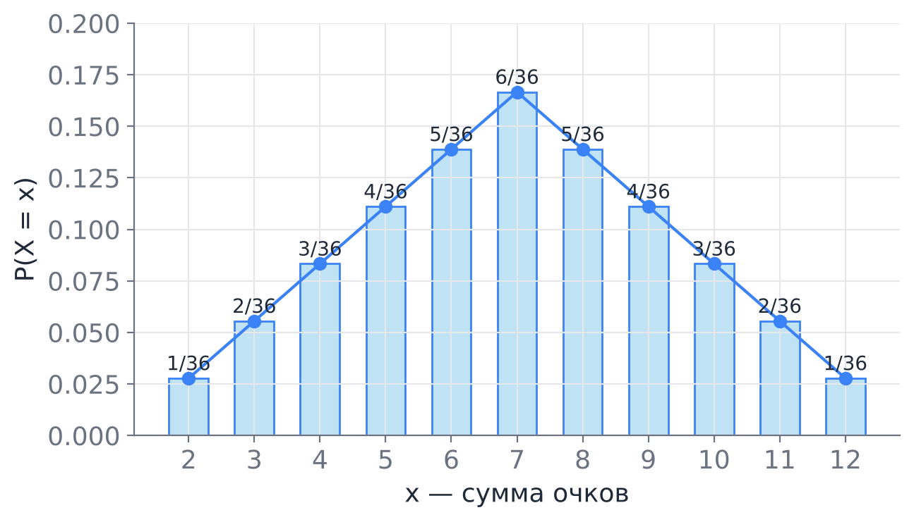

Графическое изображение ряда — **многоугольник распределения**: точки $(x_i, p_i)$, соединённые отрезками, или столбики высоты $p_i$.

### 3.3. Пример: отказы серверов

В кластере 3 независимых сервера, каждый за сутки отказывает с вероятностью $0{,}1$. Пусть $X$ — число отказавших серверов. По формуле Бернулли $P(X=k) = C_3^k\, 0{,}1^k\, 0{,}9^{3-k}$:

| $X$ | 0 | 1 | 2 | 3 |
|---|---|---|---|---|
| $P$ | 0,729 | 0,243 | 0,027 | 0,001 |

Сумма: $0{,}729+0{,}243+0{,}027+0{,}001=1$. Вероятность, что откажет хотя бы один сервер: $1-0{,}729 = 0{,}271$.

> [!example] Проверка в Python
> ```python
> from scipy import stats
> X = stats.binom(n=3, p=0.1)
> print(X.pmf([0, 1, 2, 3]))   # [0.729 0.243 0.027 0.001]
> print(1 - X.pmf(0))          # 0.271
> ```

---

## 4. Функция распределения

### 4.1. Определение

> [!note] Определение
> **Функцией распределения** случайной величины $X$ называется функция
> $$
> F(x) = P(X \le x), \qquad x\in\mathbb{R}.
> $$

Функция распределения определена для **любой** случайной величины — дискретной, непрерывной или смешанной — и полностью задаёт её распределение.

> [!warning] Два соглашения: $\le$ или $<$
> В русской учебной традиции (Гмурман, многие методички) функцию распределения определяют как $F(x)=P(X<x)$, со строгим неравенством. В современной литературе по анализу данных (Мёрфи, «Математика для машинного обучения»), а также в библиотеках `scipy`, `numpy`, `R` используется $F(x)=P(X\le x)$. **В нашем курсе принято $F(x)=P(X\le x)$**, чтобы формулы совпадали с кодом.
>
> Для непрерывных величин разницы нет, потому что $P(X=x)=0$. Для дискретных величин разница видна только в точках скачков: значение $F$ в точке скачка берётся сверху (при $\le$) или снизу (при $<$). Читая задачник, проверяйте, какое соглашение принято.

### 4.2. Свойства функции распределения

1. **Ограниченность:** $0\le F(x)\le 1$, так как $F(x)$ — вероятность.
2. **Монотонность:** если $x_1<x_2$, то $F(x_1)\le F(x_2)$.
   *Почему:* $\{X\le x_1\}\subseteq\{X\le x_2\}$, а у вложенного события вероятность не больше.
3. **Пределы на бесконечности:** $\lim_{x\to-\infty}F(x)=0$, $\lim_{x\to+\infty}F(x)=1$.
   *Почему:* событие $\{X\le x\}$ при $x\to-\infty$ «сжимается» до невозможного, а при $x\to+\infty$ «расширяется» до достоверного.
4. **Непрерывность справа:** $\lim_{x\to x_0+0}F(x) = F(x_0)$.
5. **Вероятность попадания в полуинтервал:**
   $$
   P(a < X \le b) = F(b) - F(a).
   $$
   *Почему:* $\{X\le b\} = \{X\le a\} + \{a<X\le b\}$, слагаемые несовместны, поэтому $F(b)=F(a)+P(a<X\le b)$.
6. **Вероятность точки — это скачок:**
   $$
   P(X=a) = F(a) - F(a-0),
   $$
   где $F(a-0)=\lim_{x\to a-0}F(x)$. Если $F$ непрерывна в точке $a$, то $P(X=a)=0$.

Верно и обратное: любая функция со свойствами 1–4 (неубывающая, непрерывная справа, с пределами 0 и 1) является функцией распределения некоторой случайной величины. Это позволяет **моделировать** величины, задавая только $F$.

### 4.3. Функция распределения дискретной величины

Для дискретной величины
$$
F(x) = \sum_{i:\ x_i\le x} p_i.
$$
Это **ступенчатая** функция: она постоянна между соседними значениями и в каждой точке $x_i$ делает скачок высоты $p_i$.

**Пример (отказы серверов).** По ряду из раздела 3.3:
$$
F(x) = \begin{cases}
0, & x<0,\\
0{,}729, & 0\le x<1,\\
0{,}972, & 1\le x<2,\\
0{,}999, & 2\le x<3,\\
1, & x\ge 3.
\end{cases}
$$
Например, $P(X\le 1) = F(1) = 0{,}972$, $P(0<X\le 2) = F(2)-F(0) = 0{,}999-0{,}729 = 0{,}27$.

**Пример (два кубика).** $F(7) = (1+2+3+4+5+6)/36 = 21/36$, $F(4)=6/36$, поэтому $P(4<X\le 7) = 15/36$.

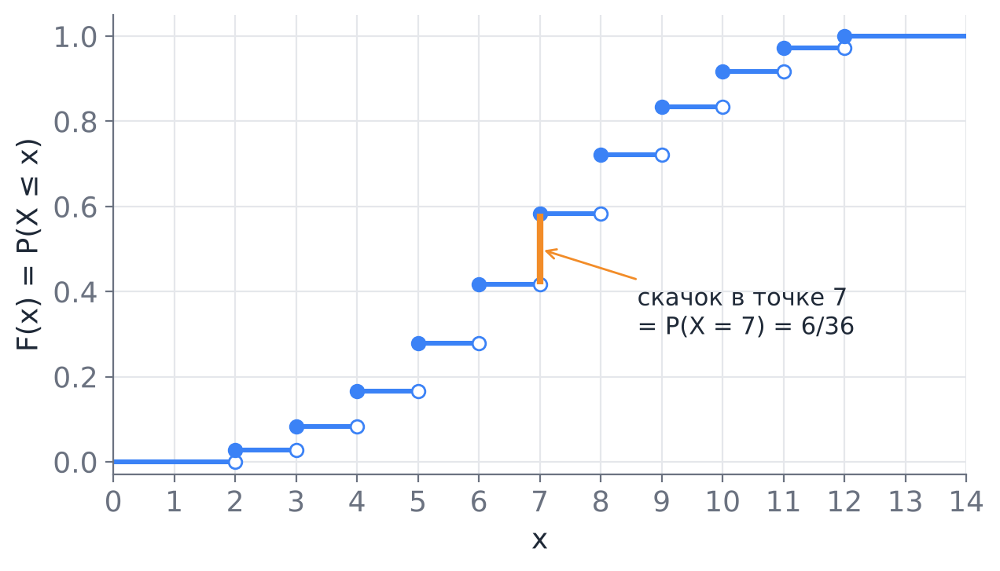

> [!warning] Типичная ошибка
> Для дискретных величин $P(a\le X\le b)\ne F(b)-F(a)$: формула $F(b)-F(a)$ не учитывает точку $a$. Правильно: $P(a\le X\le b) = F(b) - F(a-0)$. Для целочисленной $X$ это $F(b)-F(a-1)$. Например, для суммы двух кубиков $P(4\le X\le 7) = F(7)-F(3) = 21/36 - 3/36 = 18/36$.

---

## 5. Непрерывные случайные величины и плотность

### 5.1. Определение плотности

> [!note] Определение
> Случайная величина $X$ называется **непрерывной** (абсолютно непрерывной), если существует неотрицательная функция $f(x)$, такая что для любого $x$
> $$
> F(x) = \int_{-\infty}^{x} f(t)\,dt.
> $$
> Функция $f$ называется **плотностью распределения** (probability density function, **pdf**).

Если $F$ дифференцируема, то плотность — это её производная:
$$
f(x) = F'(x).
$$

### 5.2. Свойства плотности

1. **Неотрицательность:** $f(x)\ge 0$.
2. **Нормировка:** $\displaystyle\int_{-\infty}^{+\infty} f(x)\,dx = 1$.
3. **Вероятность — это площадь:**
   $$
   P(a < X < b) = \int_a^b f(x)\,dx = F(b) - F(a).
   $$
4. **Вероятность любой точки равна нулю:** $P(X=a) = \int_a^a f(x)\,dx = 0$. Поэтому для непрерывной величины
   $$
   P(a<X<b) = P(a\le X<b) = P(a<X\le b) = P(a\le X\le b).
   $$

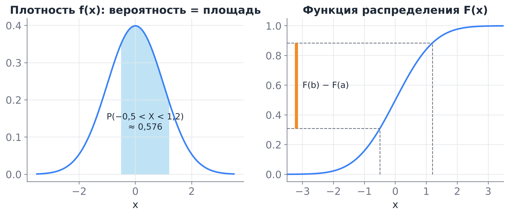

### 5.3. Смысл плотности

Значение плотности **не является вероятностью**. Смысл плотности виден из приближения для малого $\Delta x$:
$$
P(x < X \le x+\Delta x) = F(x+\Delta x)-F(x) \approx f(x)\,\Delta x.
$$
Плотность — это «вероятность на единицу длины». Отсюда два следствия.

- Плотность может быть **больше единицы**. Например, у равномерного распределения на $[0;\,0{,}5]$ плотность равна $2$ на всём отрезке, а площадь под ней $0{,}5\cdot 2 = 1$.
- Плотность имеет **размерность**, обратную размерности $X$. Если $X$ измеряется в миллисекундах, то $f$ — в «1/мс». Поэтому сравнивать значения плотностей величин в разных единицах бессмысленно.

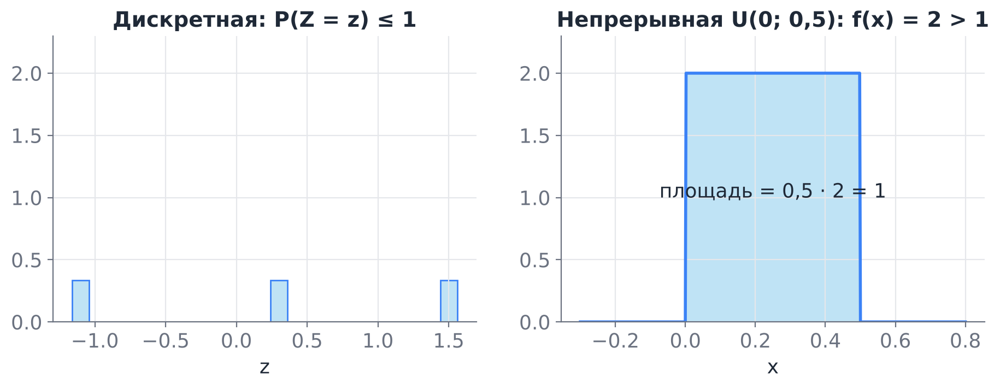

> [!tip] Почему $P(X=x)=0$ — это не парадокс
> «Событие вероятности ноль» не значит «невозможное». Время ответа сервера ровно $123{,}456789\ldots$ мс имеет вероятность ноль, но какое-то конкретное значение всё равно реализуется. Положительную вероятность в непрерывной модели имеют только **интервалы**. На практике данные всегда округлены, и вопрос «какова вероятность значения 123 мс» означает $P(122{,}5\le X<123{,}5)\approx f(123)\cdot 1$.

### 5.4. Разобранный пример

**Задача.** Плотность случайной величины равна $f(x) = c\,x$ при $x\in[0;1]$ и $0$ вне отрезка. Найдите $c$, функцию распределения, $P(X>0{,}5)$ и медиану.

**Решение.**

1. *Нормировка:* $\int_0^1 c\,x\,dx = c/2 = 1$, откуда $c=2$.
2. *Функция распределения:* для $x\in[0;1]$ имеем $F(x)=\int_0^x 2t\,dt = x^2$, поэтому
   $$
   F(x) = \begin{cases} 0, & x<0,\\ x^2, & 0\le x\le 1,\\ 1, & x>1.\end{cases}
   $$
3. *Вероятность:* $P(X>0{,}5) = 1-F(0{,}5) = 1-0{,}25 = 0{,}75$. Хотя отрезок $(0{,}5;1]$ — половина носителя, вероятность попасть в него втрое больше, чем в левую половину, потому что плотность растёт.
4. *Медиана* $m$ — решение уравнения $F(m)=0{,}5$: $m^2 = 0{,}5$, $m = 1/\sqrt2\approx 0{,}707$.

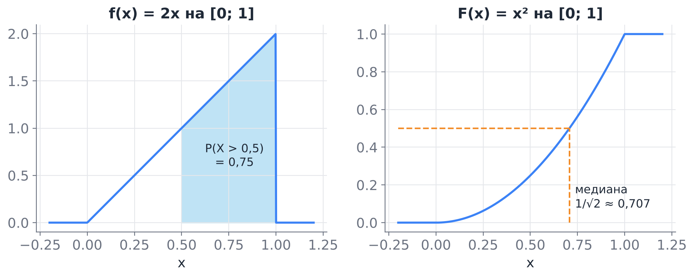

### 5.5. Как перейти от одного описания к другому

| Есть | Нужно | Как |
|---|---|---|
| ряд $p_i$ | $F(x)$ | $F(x)=\sum_{x_i\le x}p_i$ |
| $F(x)$ дискретной | ряд | $p_i$ — высоты скачков $F$ |
| плотность $f$ | $F(x)$ | $F(x)=\int_{-\infty}^x f(t)\,dt$ |
| $F(x)$ непрерывной | плотность | $f(x)=F'(x)$ |
| $f$ или $F$ | $P(a<X\le b)$ | $F(b)-F(a)=\int_a^b f$ |

---

## 6. Квантили

> [!note] Определение
> **Квантилем уровня** $q\in(0;1)$ называется число $x_q$, для которого $F(x_q) = q$, то есть $P(X\le x_q)=q$. Если $F$ строго возрастает и непрерывна, то $x_q = F^{-1}(q)$; функцию $F^{-1}$ называют **квантильной функцией**.

В общем случае (например, для дискретных величин, у которых $F$ ступенчатая и уравнение $F(x)=q$ может не иметь решения) квантиль определяют как
$$
x_q = \inf\{x : F(x)\ge q\}.
$$

**Важные частные случаи:**

- **медиана** $x_{0{,}5}$: половина вероятности слева, половина справа;
- **квартили** $x_{0{,}25}$, $x_{0{,}75}$; разность $x_{0{,}75}-x_{0{,}25}$ называется межквартильным размахом;
- **процентили** $x_{0{,}95}$, $x_{0{,}99}$ — в мониторинге их называют p95, p99.

Для стандартного нормального распределения $x_{0{,}975}\approx 1{,}96$, поэтому в интервале $(-1{,}96;\ 1{,}96)$ лежит $95\%$ вероятности, а для $N(\mu,\sigma^2)$ — в интервале $\mu\pm1{,}96\sigma$.

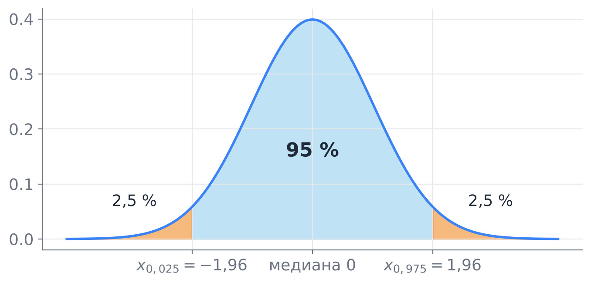

> [!example] Где это в работе с данными
> SLA сервиса формулируют через квантили: «p99 времени ответа не больше 300 мс» означает $F(300)\ge 0{,}99$. Квантили устойчивы к выбросам, поэтому для скошенных данных (время ответа, доход, цена квартиры) медиану и p95 используют чаще, чем среднее.
>
> ```python
> from scipy import stats
> stats.norm.ppf(0.975)        # 1.959..., ppf = percent point function = F^{-1}
> stats.expon(scale=1/4).ppf(0.5)  # медиана Exp(λ=4) = ln2/4 ≈ 0.173
> ```

---

## 7. Эмпирическая функция распределения

На практике распределение неизвестно, зато есть **выборка** $x_1,\dots,x_n$ — наблюдённые значения величины $X$. Мост от данных к теории — эмпирическая функция распределения.

> [!note] Определение
> **Эмпирической функцией распределения** (ECDF) называется
> $$
> F_n(x) = \frac{\#\{i : x_i\le x\}}{n},
> $$
> то есть доля наблюдений, не превосходящих $x$.

$F_n$ — ступенчатая функция распределения дискретной величины, которая принимает каждое из наблюдённых значений с вероятностью $1/n$. По закону больших чисел при каждом $x$ доля $F_n(x)$ стремится к вероятности $F(x)$. Более того, **теорема Гливенко–Кантелли** утверждает, что сходимость равномерная:
$$
\sup_x |F_n(x)-F(x)|\xrightarrow[n\to\infty]{} 0 \quad\text{с вероятностью 1.}
$$

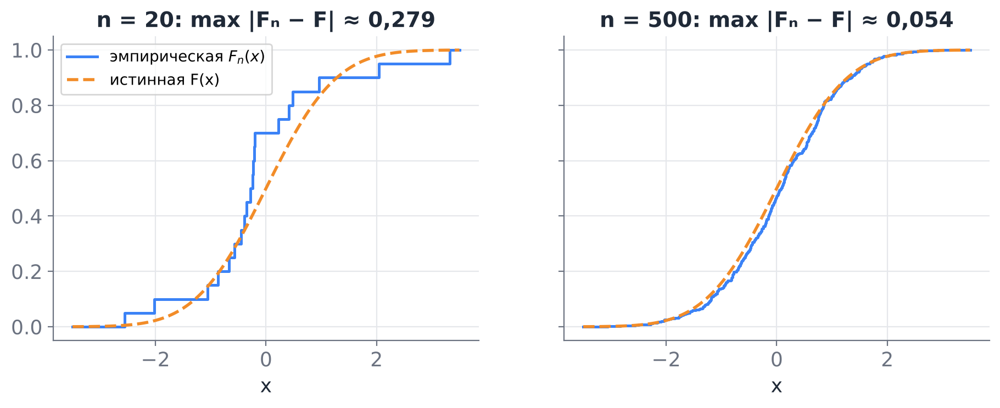

Отсюда практическое правило: **ECDF — лучший первый взгляд на распределение данных**. В отличие от гистограммы, у неё нет параметра «число столбиков», и её легко сравнить с теоретической $F$. Тест Колмогорова–Смирнова, о котором пойдёт речь в курсе математической статистики, основан ровно на величине $\sup|F_n-F|$.

Аналогично, **гистограмма** с нормировкой на площадь (`density=True`) — это эмпирическая оценка плотности: высота столбика равна доле наблюдений в нём, делённой на ширину столбика.

---

## 8. Основные дискретные распределения

Ниже для каждого распределения указаны: модель (когда возникает), ряд распределения, математическое ожидание $E X$ и дисперсия $D X$, вызов в `scipy.stats`. Математическое ожидание и дисперсию подробно разберём на следующей лекции; пока достаточно понимать $EX$ как «центр тяжести» распределения, а $\sqrt{DX}$ — как типичный разброс вокруг него.

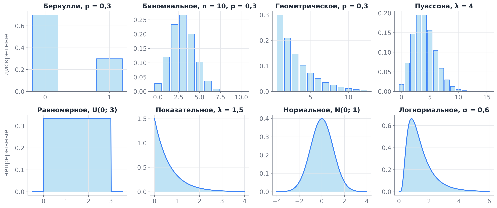

### 8.1. Распределение Бернулли $\mathrm{Bern}(p)$

**Модель.** Один опыт с двумя исходами: «успех» (1) с вероятностью $p$ и «неудача» (0) с вероятностью $q=1-p$.

$$
P(X=1)=p,\quad P(X=0)=1-p;\qquad EX = p,\quad DX=p(1-p).
$$

**В данных:** клик / не клик, спам / не спам, отток клиента, правильный / неправильный ответ классификатора. Бинарная колонка таблицы — выборка из распределения Бернулли.

**В машинном обучении.** Логистическая регрессия предсказывает параметр распределения Бернулли $p=\sigma(w^\top x)$ для каждого объекта, а функция потерь «бинарная кросс-энтропия» — это минус логарифм вероятности наблюдённой метки по распределению Бернулли (Мёрфи, разд. 2.4).

`scipy.stats.bernoulli(p)`

### 8.2. Биномиальное распределение $B(n,p)$

**Модель.** Число успехов в $n$ независимых испытаниях Бернулли с одной и той же вероятностью успеха $p$ (схема Бернулли из прошлой лекции).

$$
P(X=k) = C_n^k\,p^k(1-p)^{n-k},\quad k=0,1,\dots,n;\qquad EX=np,\quad DX=np(1-p).
$$

Биномиальная величина — сумма $n$ независимых бернуллиевских: $X = X_1+\dots+X_n$.

**Пример (A/B-тест).** Конверсия страницы $p=0{,}05$, за день пришло $n=200$ посетителей. Число покупок $X\sim B(200;\,0{,}05)$, $EX=10$. Вероятность того, что покупок будет 15 или больше: $P(X\ge 15)\approx 0{,}078$. Значит, 15 покупок за день — не повод сразу объявлять, что новая версия страницы лучше: при старой конверсии такое случается примерно раз в 13 дней.

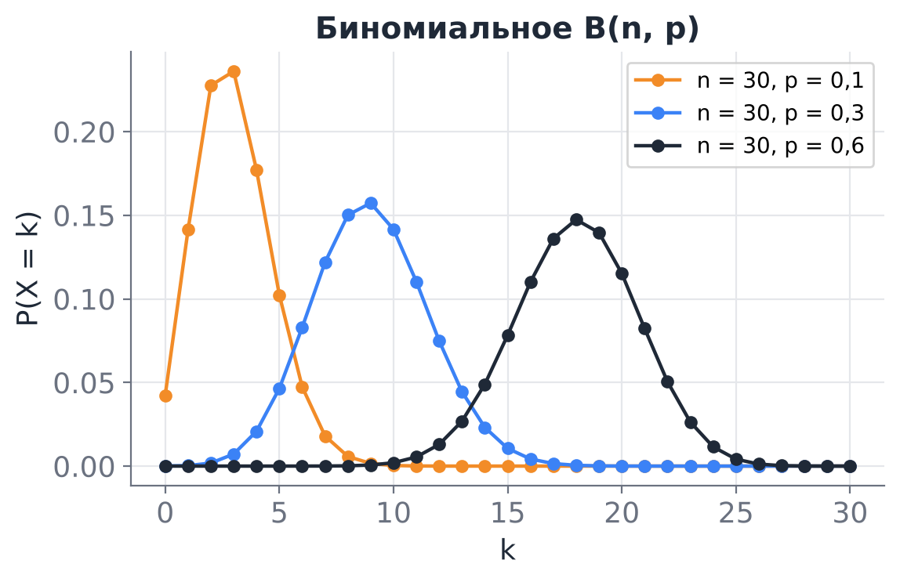

`scipy.stats.binom(n, p)`

### 8.3. Геометрическое распределение $\mathrm{Geom}(p)$

**Модель.** Номер первого успешного испытания в последовательности независимых испытаний Бернулли.

$$
P(X=k) = (1-p)^{k-1}p,\quad k=1,2,\dots;\qquad EX=\frac1p,\quad DX=\frac{1-p}{p^2}.
$$

Хвост распределения: $P(X>k)=(1-p)^k$ — первые $k$ попыток неудачны.

**Отсутствие памяти:** $P(X>m+k\mid X>m) = P(X>k)$. Если уже было $m$ неудач, число оставшихся попыток распределено так же, как в самом начале.

**Пример (повторные запросы).** Запрос к ненадёжному API проходит с вероятностью $p=0{,}8$, клиент повторяет его до успеха. Число попыток $X\sim\mathrm{Geom}(0{,}8)$, в среднем $EX=1{,}25$ попытки. Вероятность, что понадобится больше трёх попыток: $0{,}2^3=0{,}008$.

> [!warning] Две версии геометрического распределения
> Иногда геометрическим называют **число неудач до первого успеха** $Y = X-1$ со значениями $0,1,2,\dots$. В `scipy.stats.geom` используется версия с $k\ge 1$ (как у нас), в `numpy.random.Generator.geometric` — тоже. Проверяйте документацию.

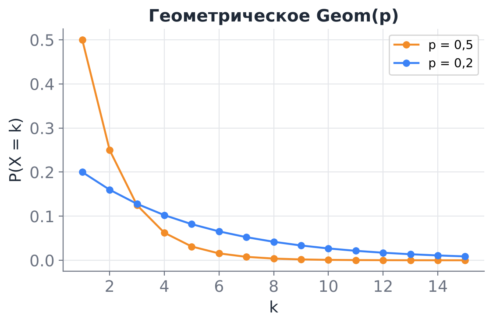

### 8.4. Распределение Пуассона $\mathrm{Pois}(\lambda)$

**Модель.** Число редких независимых событий за фиксированный промежуток времени (или на фиксированной площади), если события происходят с постоянной средней интенсивностью $\lambda$ событий на промежуток.

$$
P(X=k) = \frac{\lambda^k}{k!}e^{-\lambda},\quad k=0,1,2,\dots;\qquad EX = DX = \lambda.
$$

Нормировка следует из ряда Тейлора: $\sum_{k\ge0}\lambda^k/k! = e^{\lambda}$.

**Связь с биномиальным (теорема Пуассона).** Если $n\to\infty$, $p\to0$ и $np=\lambda$ фиксировано, то
$$
C_n^k p^k(1-p)^{n-k}\to\frac{\lambda^k}{k!}e^{-\lambda}.
$$
Поэтому распределение Пуассона — модель для «много попыток, у каждой маленький шанс»: много пользователей, каждый с малой вероятностью отправляет запрос в данную минуту.

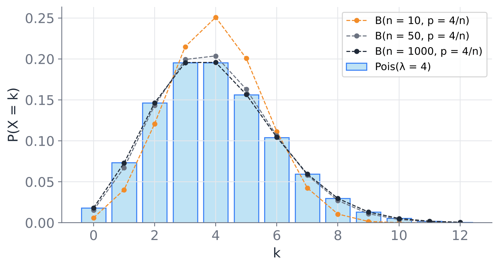

**Пример (нагрузка на сервер).** В среднем на сервер приходит $\lambda=4$ запроса в минуту, сервер справляется не более чем с 7 запросами в минуту. Вероятность перегрузки за минуту:
$$
P(X\ge 8) = 1-\sum_{k=0}^{7}\frac{4^k}{k!}e^{-4}\approx 0{,}051.
$$
Примерно каждую двадцатую минуту сервер будет перегружен; за сутки это около 74 минут.

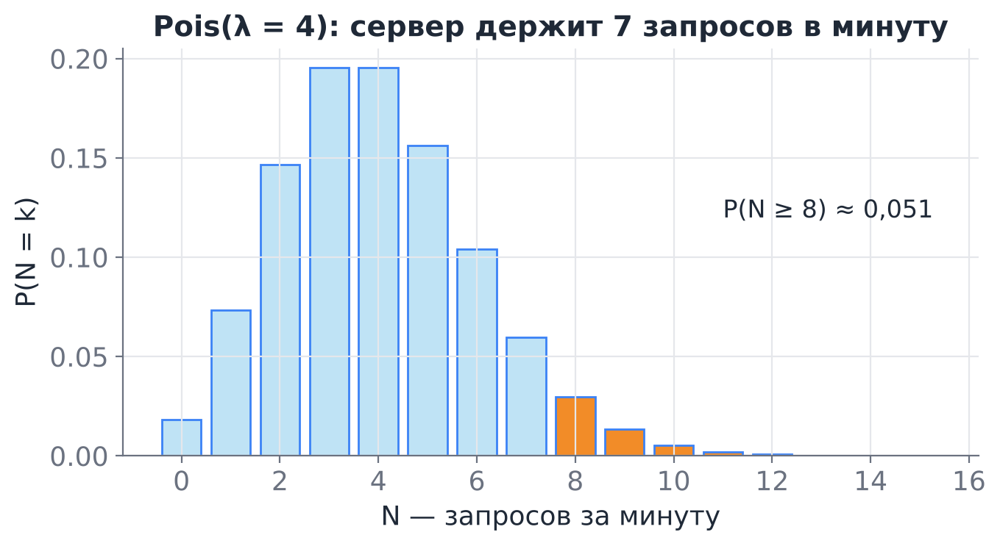

**Признак в данных:** выборочное среднее и выборочная дисперсия числа событий близки. Если дисперсия заметно больше среднего (так называемая сверхдисперсия), события не независимы или интенсивность меняется (час пик), и чистый Пуассон не подходит.

`scipy.stats.poisson(mu=λ)`

---

## 9. Основные непрерывные распределения

### 9.1. Равномерное распределение $U(a,b)$

**Модель.** Все точки отрезка $[a;b]$ «равноправны»: вероятность попасть в подотрезок пропорциональна его длине.

$$
f(x)=\frac{1}{b-a},\ x\in[a;b];\qquad F(x)=\frac{x-a}{b-a},\ x\in[a;b];\qquad EX=\frac{a+b}2,\quad DX=\frac{(b-a)^2}{12}.
$$

**В данных и вычислениях:**

- ошибка округления до целого — $U(-0{,}5;\,0{,}5)$; например, $P(|X|>0{,}3)=0{,}4$;
- генератор случайных чисел `rng.random()` выдаёт $U(0;1)$, и из него получают все остальные распределения (раздел 10.4);
- случайный поиск гиперпараметров: значения выбирают равномерно (или равномерно по логарифму).

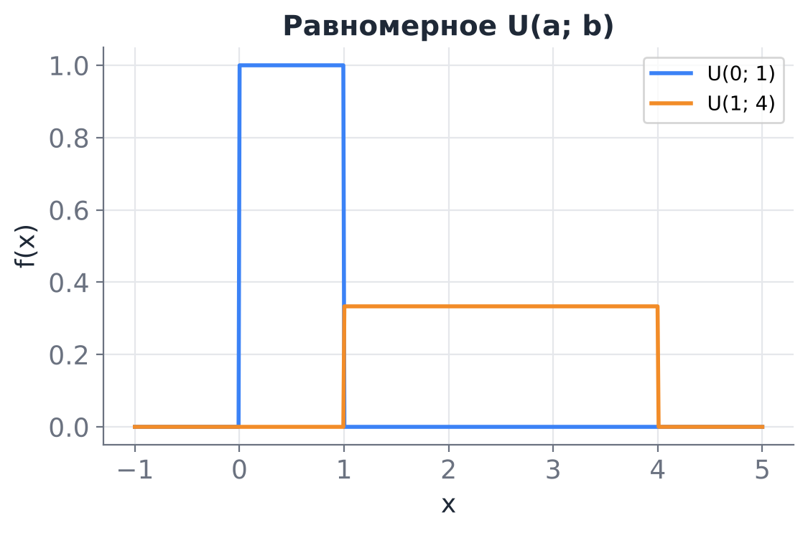

`scipy.stats.uniform(loc=a, scale=b-a)` — обратите внимание: второй параметр — **длина** отрезка, а не правый конец.

### 9.2. Показательное (экспоненциальное) распределение $\mathrm{Exp}(\lambda)$

**Модель.** Время ожидания до наступления события, которое может наступить в любой момент с постоянной интенсивностью $\lambda$ (событий в единицу времени).

$$
f(x)=\lambda e^{-\lambda x},\ x\ge0;\qquad F(x)=1-e^{-\lambda x},\ x\ge0;\qquad EX=\frac1\lambda,\quad DX=\frac1{\lambda^2}.
$$

Функция надёжности (вероятность «прожить» дольше $t$): $P(X>t) = e^{-\lambda t}$. Медиана: $\ln 2/\lambda$.

**Отсутствие памяти.** $P(X>s+t\mid X>s) = P(X>t)$.
*Доказательство:* $\dfrac{P(X>s+t)}{P(X>s)} = \dfrac{e^{-\lambda(s+t)}}{e^{-\lambda s}} = e^{-\lambda t}$.
Показательное — единственное непрерывное распределение с этим свойством; это непрерывный аналог геометрического. Смысл: устройство, которое «не стареет», после $s$ часов работы ведёт себя как новое.

**Связь с Пуассоном.** Если число событий за единицу времени распределено по Пуассону с параметром $\lambda$ (поток событий — пуассоновский), то промежутки между событиями распределены показательно с тем же $\lambda$. Действительно, $P(T>t) = P(\text{за время } t \text{ нет событий}) = e^{-\lambda t}$.

**Пример.** Запросы приходят пуассоновским потоком с интенсивностью 4 в минуту. Вероятность того, что следующего запроса придётся ждать дольше 30 секунд: $P(T>0{,}5) = e^{-4\cdot0{,}5} = e^{-2}\approx0{,}135$.

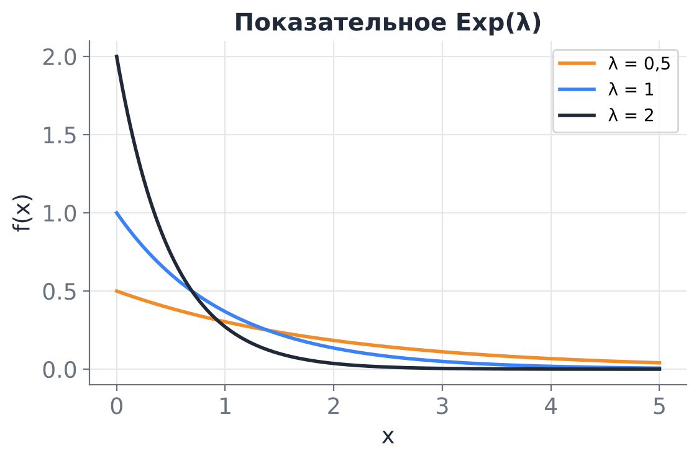

> [!warning] Параметризация в scipy
> `scipy.stats.expon` параметризуется **масштабом** `scale` $=1/\lambda$, а не интенсивностью. Для $\lambda = 4$ пишем `stats.expon(scale=1/4)`. То же в `numpy`: `rng.exponential(scale=1/4)`. Это одна из самых частых ошибок в коде.

### 9.3. Нормальное (гауссово) распределение $N(\mu,\sigma^2)$

$$
f(x)=\frac{1}{\sigma\sqrt{2\pi}}\exp\!\left(-\frac{(x-\mu)^2}{2\sigma^2}\right);\qquad EX=\mu,\quad DX=\sigma^2.
$$

Параметр $\mu$ сдвигает «колокол», $\sigma$ растягивает его по горизонтали. Плотность симметрична относительно $\mu$, мода, медиана и среднее совпадают.

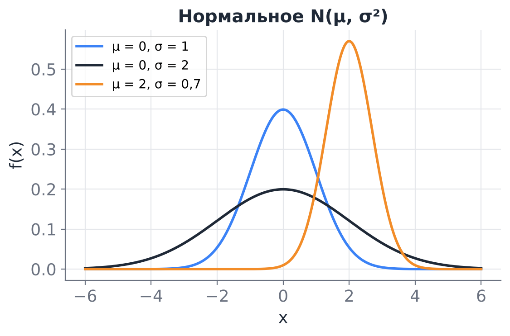

**Стандартизация.** Если $X\sim N(\mu,\sigma^2)$, то $Z=\dfrac{X-\mu}{\sigma}\sim N(0,1)$ — **стандартное нормальное** распределение. Его функция распределения обозначается $\Phi(x)$ и не выражается через элементарные функции, поэтому берётся из таблиц или из кода (`stats.norm.cdf`). Для любой нормальной величины
$$
P(a<X<b) = \Phi\!\left(\frac{b-\mu}{\sigma}\right)-\Phi\!\left(\frac{a-\mu}{\sigma}\right).
$$

> [!warning] Функция Лапласа в задачниках
> Во многих русских задачниках вместо $\Phi(x)$ используется **функция Лапласа** $\Phi_0(x)=\frac1{\sqrt{2\pi}}\int_0^x e^{-t^2/2}dt$, а её таблицы даны только для $x\ge 0$. Связь: $\Phi(x) = 0{,}5+\Phi_0(x)$. Тогда $P(a<X<b)=\Phi_0\!\left(\frac{b-\mu}\sigma\right)-\Phi_0\!\left(\frac{a-\mu}\sigma\right)$ — формула выглядит так же, только смысл обозначения другой. В коде всегда используется $\Phi$.

**Правило трёх сигм.**
$$
P(|X-\mu|<\sigma)\approx0{,}683,\quad P(|X-\mu|<2\sigma)\approx0{,}954,\quad P(|X-\mu|<3\sigma)\approx0{,}997.
$$
Значение, отстоящее от среднего больше чем на $3\sigma$, у нормальной величины встречается примерно в 3 случаях из 1000.

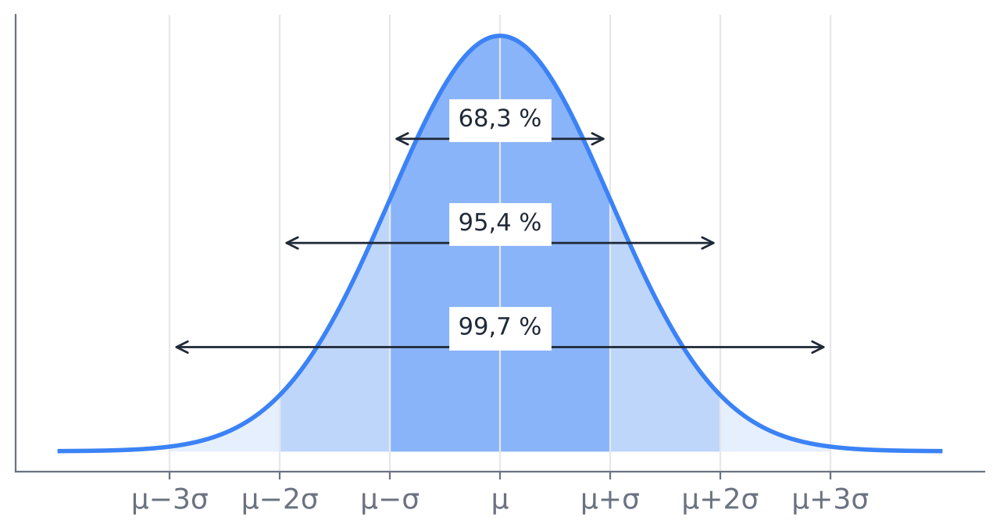

**Пример.** Ошибка модели регрессии распределена как $N(0;\,2^2)$ (в тысячах рублей). Вероятность ошибиться больше чем на 4 тыс.: $P(|X|>4)=2\bigl(1-\Phi(2)\bigr)\approx0{,}046$.

**Почему нормальное распределение встречается так часто.** Центральная предельная теорема (будет в курсе позже) утверждает, что сумма большого числа независимых небольших слагаемых приближённо нормальна. Ошибка измерения, рост человека, средний чек по многим покупкам — суммы многих факторов. Кроме того, при фиксированных среднем и дисперсии нормальное распределение имеет максимальную энтропию, то есть делает «наименьшее число дополнительных предположений» (Мёрфи, разд. 2.6.4). Связь с машинным обучением: минимизация среднеквадратичной ошибки (MSE) в линейной регрессии эквивалентна предположению, что шум нормален.

> [!warning] Не всё нормально
> Время ответа, доходы, цены, размеры файлов неотрицательны и имеют длинный правый хвост. Нормальная модель для них даёт отрицательные значения и сильно недооценивает вероятность больших значений. Для таких данных часто подходит **логнормальное** распределение: $X$ логнормально, если $\ln X\sim N(\mu,\sigma^2)$ (`scipy.stats.lognorm(s=σ, scale=e^μ)`).

---

## 10. Распределения в задачах анализа данных

### 10.1. Как выбрать модель по смыслу данных

| Что за величина | Кандидат | Параметр оценивается как |
|---|---|---|
| Да/нет (клик, отток, брак) | Бернулли $\mathrm{Bern}(p)$ | доля единиц |
| Число успехов из известного $n$ | Биномиальное $B(n,p)$ | $\hat p = \bar x/n$ |
| Число попыток до первого успеха | Геометрическое $\mathrm{Geom}(p)$ | $\hat p = 1/\bar x$ |
| Число событий за интервал (запросы, ошибки в логе, звонки) | Пуассона $\mathrm{Pois}(\lambda)$ | $\hat\lambda=\bar x$ |
| Время до события, интервал между событиями | Показательное $\mathrm{Exp}(\lambda)$ | $\hat\lambda = 1/\bar x$ |
| Нет предпочтений внутри диапазона | Равномерное $U(a,b)$ | $\hat a=\min$, $\hat b=\max$ |
| Сумма многих мелких факторов, ошибка измерения | Нормальное $N(\mu,\sigma^2)$ | $\hat\mu=\bar x$, $\hat\sigma = s$ |
| Положительные величины с длинным хвостом | Логнормальное | параметры нормального для $\ln x$ |

Оценки в последнем столбце получены **методом моментов**: теоретическое среднее приравнивается к выборочному. Подробно методы оценивания (моментов и максимального правдоподобия) изучаются в математической статистике.

### 10.2. Как проверить, что модель подходит

1. **Гистограмма с наложенной плотностью** (или ряд распределения для дискретных данных) — грубая проверка формы.
2. **ECDF против теоретической $F$** — видны расхождения в хвостах.
3. **QQ-график** (quantile–quantile): по горизонтали квантили модели, по вертикали квантили данных. Если модель верна, точки лежат около диагонали. Изгиб в конце означает, что у данных хвост тяжелее или легче, чем у модели.
4. **Проверка характерных свойств:** для Пуассона среднее ≈ дисперсии, для показательного среднее ≈ стандартному отклонению, для нормального ≈ 95 % наблюдений в $\bar x\pm2s$.

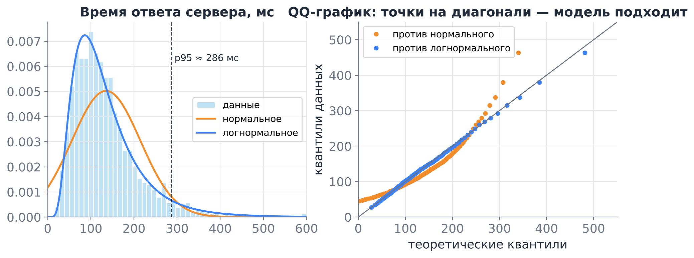

На рисунке нормальное распределение с теми же средним и дисперсией, что у данных, предсказывает отрицательное время ответа и плохо описывает хвост: на QQ-графике оранжевые точки уходят от диагонали. Логнормальная модель ложится почти на диагональ.

### 10.3. Что даёт модель распределения

- **Оценка рисков и мощностей.** Пуассоновская модель нагрузки отвечает, сколько серверов нужно, чтобы перегрузка случалась не чаще заданного (раздел 8.4).
- **SLA и квантили.** По модели времени ответа можно оценить p99 даже по небольшой выборке, где 99-й процентиль данных ещё ненадёжен.
- **Поиск аномалий.** Наблюдение, вероятность которого при модели очень мала (например, за пределами $\mu\pm3\sigma$ или с $P(X\ge x)<0{,}001$), — кандидат в аномалии.
- **A/B-тесты.** Биномиальная модель числа конверсий показывает, какие колебания объясняются случайностью.
- **Машинное обучение.** Вероятностная модель $p(y\mid x)$ — это выбор распределения целевой переменной: Бернулли для бинарной классификации, нормальное для регрессии, Пуассона для предсказания счётчиков (Пуассоновская регрессия). Функция потерь — это минус логарифм правдоподобия выбранного распределения (Мёрфи, гл. 2; Николенко и др., гл. 2).
- **Генерация синтетических данных и симуляции** (метод Монте-Карло) для проверки алгоритмов и оценки вероятностей, которые трудно посчитать аналитически.

### 10.4. Генерация случайных величин: метод обратной функции

> [!note] Теорема (метод обратной функции)
> Пусть $F$ — непрерывная строго возрастающая функция распределения, $U\sim U(0;1)$. Тогда случайная величина $X = F^{-1}(U)$ имеет функцию распределения $F$.

*Доказательство:* $P(X\le x) = P(F^{-1}(U)\le x) = P(U\le F(x)) = F(x)$, так как для равномерной на $[0;1]$ величины $P(U\le u)=u$.

**Пример.** Для $\mathrm{Exp}(\lambda)$: $u = 1-e^{-\lambda x}$, откуда $x=-\dfrac{\ln(1-u)}{\lambda}$. Значит, $-\ln(1-U)/\lambda\sim\mathrm{Exp}(\lambda)$.

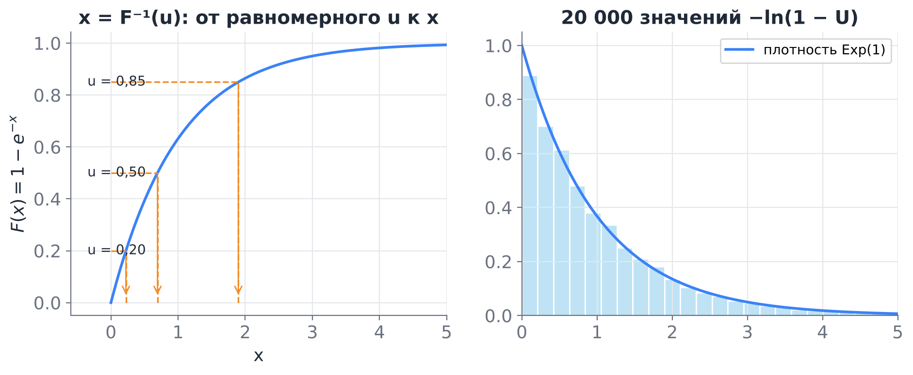

**Дискретный вариант.** Чтобы получить значение с рядом $(x_i,p_i)$, разбиваем $[0;1]$ на отрезки длины $p_1,p_2,\dots$ и смотрим, в какой отрезок попало $U$. В коде: `np.searchsorted(np.cumsum(p), u)`.

На этом методе (и его обобщениях) основаны генераторы во всех библиотеках. На семинаре реализуем его сами.

### 10.5. Сквозной пример

**Условие.** Логи показывают, что в среднем на сервис приходит 4 запроса в минуту. Считаем поток пуассоновским.

1. Вероятность, что за минуту не придёт ни одного запроса: $P(N=0)=e^{-4}\approx0{,}018$.
2. Вероятность перегрузки (8 и более запросов): $\approx0{,}051$.
3. Вероятность ждать следующий запрос дольше 30 с: $e^{-2}\approx0{,}135$.
4. Медиана интервала между запросами: $\ln2/4\approx0{,}173$ мин $\approx 10{,}4$ с.

```python
from scipy import stats
import numpy as np

lam = 4                                   # запросов в минуту
N = stats.poisson(mu=lam)
T = stats.expon(scale=1/lam)              # минуты между запросами
print(N.pmf(0), N.sf(7))                  # P(N=0), P(N>=8) = P(N>7)
print(T.sf(0.5), T.median() * 60)         # P(T>0.5 мин), медиана в секундах
```

Метод `sf(x)` (survival function) возвращает $P(X>x)=1-F(x)$. Для дискретной $N$ событие $\{N\ge 8\}$ совпадает с $\{N>7\}$, поэтому пишем `sf(7)`.

---

## 11. Шпаргалка

| Распределение | Значения | $P(X=k)$ или $f(x)$ | $EX$ | $DX$ | `scipy.stats` |
|---|---|---|---|---|---|
| Бернулли | $0,1$ | $p^k(1-p)^{1-k}$ | $p$ | $p(1-p)$ | `bernoulli(p)` |
| Биномиальное | $0,\dots,n$ | $C_n^kp^k(1-p)^{n-k}$ | $np$ | $np(1-p)$ | `binom(n, p)` |
| Геометрическое | $1,2,\dots$ | $(1-p)^{k-1}p$ | $1/p$ | $(1-p)/p^2$ | `geom(p)` |
| Пуассона | $0,1,\dots$ | $\lambda^ke^{-\lambda}/k!$ | $\lambda$ | $\lambda$ | `poisson(mu=λ)` |
| Равномерное | $[a;b]$ | $1/(b-a)$ | $(a+b)/2$ | $(b-a)^2/12$ | `uniform(loc=a, scale=b-a)` |
| Показательное | $[0;\infty)$ | $\lambda e^{-\lambda x}$ | $1/\lambda$ | $1/\lambda^2$ | `expon(scale=1/λ)` |
| Нормальное | $\mathbb{R}$ | $\frac{1}{\sigma\sqrt{2\pi}}e^{-(x-\mu)^2/(2\sigma^2)}$ | $\mu$ | $\sigma^2$ | `norm(loc=μ, scale=σ)` |

**Методы объекта распределения в `scipy.stats`:**

| Метод | Что возвращает |
|---|---|
| `pmf(k)` / `pdf(x)` | вероятность точки (дискретные) / плотность (непрерывные) |
| `cdf(x)` | $F(x)=P(X\le x)$ |
| `sf(x)` | $1-F(x)=P(X>x)$ |
| `ppf(q)` | квантиль уровня $q$, то есть $F^{-1}(q)$ |
| `rvs(size, random_state)` | случайная выборка |
| `mean()`, `var()`, `std()`, `median()` | характеристики |

**Ключевые формулы:**

- $F(x)=P(X\le x)$; $P(a<X\le b)=F(b)-F(a)$; $P(X=a)=F(a)-F(a-0)$.
- Дискретная: $\sum p_i=1$, $F(x)=\sum_{x_i\le x}p_i$.
- Непрерывная: $\int f=1$, $F(x)=\int_{-\infty}^xf$, $f=F'$, $P(X=a)=0$.
- Квантиль: $F(x_q)=q$.
- Метод обратной функции: $F^{-1}(U)\sim F$.

---

## 12. Вопросы для самопроверки

1. Почему случайная величина — это функция? Приведите пример двух разных случайных величин на одном и том же $\Omega$ с одинаковым распределением.
2. Может ли функция распределения убывать? Может ли она равняться $1{,}2$? Может ли плотность равняться $1{,}2$?
3. Ряд распределения: $X\in\{0,1,2\}$, $P(X=0)=0{,}3$, $P(X=1)=c$, $P(X=2)=2c$. Найдите $c$ и $F(1{,}5)$.
   *Ответ:* $c=7/30$, $F(1{,}5)=0{,}3+7/30=16/30\approx 0{,}533$.
4. Для суммы очков на двух кубиках найдите $P(3\le X\le 5)$ через функцию распределения. *Ответ:* $F(5)-F(2)=10/36-1/36=9/36$.
5. Плотность $f(x)=c\,x^2$ на $[0;3]$. Найдите $c$, $F(x)$, $P(X>2)$. *Ответ:* $c=1/9$, $F(x)=x^3/27$, $P(X>2)=19/27$.
6. Почему для непрерывной величины $P(a\le X\le b)=P(a<X<b)$, а для дискретной — нет?
7. Чем отличаются медиана и среднее? Для каких данных медиана информативнее?
8. В среднем за час в логе появляется 2 ошибки. Какое распределение у числа ошибок за час? Найдите вероятность хотя бы одной ошибки. *Ответ:* Пуассона, $1-e^{-2}\approx0{,}865$.
9. Время работы диска до отказа — $\mathrm{Exp}(\lambda)$ со средним 5 лет. Диск уже проработал 3 года. С какой вероятностью он проработает ещё 2 года? *Ответ:* $e^{-2/5}\approx0{,}670$, как у нового диска.
10. Как в `scipy` задать показательное распределение с $\lambda=3$? Что вернёт `stats.norm.ppf(0.5, loc=10, scale=2)`?
11. В данных о числе заказов в час среднее 12, а дисперсия 40. Подходит ли распределение Пуассона? Что может быть причиной?
12. Как с помощью `rng.random()` получить выборку из показательного распределения? Почему метод работает?

---

## Литература

- **Гмурман В. Е.** Теория вероятностей и математическая статистика. — гл. 6 (дискретные случайные величины, биномиальное, Пуассона, геометрическое), гл. 10–13 (функция распределения, плотность, нормальное и показательное распределения).
- **Мёрфи К. П.** Вероятностное машинное обучение: введение. — разд. 2.2 (случайные величины, функция распределения, плотность, квантили), 2.4–2.7 (Бернулли, биномиальное, гауссово и другие распределения), 2.8.7 (метод Монте-Карло).
- **Николенко С., Кадурин А., Архангельская Е.** Глубокое обучение. Погружение в мир нейронных сетей. — гл. 2 (дискретные и непрерывные величины, функция распределения и плотность в контексте машинного обучения).
- **Дайзенрот М. П., Фейзал А. А., Он Ч. С.** Математика для машинного обучения. — гл. 6 (вероятностное пространство и случайные величины, дискретные и непрерывные распределения, гауссово распределение, замена переменных и метод обратной функции).
- **Савелова Т. И.** Метод Монте-Карло. — теорема 2.3 (метод обратных функций) и моделирование случайных величин.
