---
tags:
  - теория-вероятностей
  - лекция
  - итмо
курс: Теория вероятностей (ИТМО)
лекция: 4
---

# Лекция 4. Математическое ожидание и дисперсия

> [!info] О методичке
> Это конспект к лекции 4 курса «Теория вероятностей» для студентов ИТМО. В нём полностью разобраны все темы лекции: определения, свойства с доказательствами или пояснениями, примеры с решениями и короткие фрагменты кода на Python. Презентация лекции лежит рядом: `04_expectation-variance-itmo.pptx`. Практика по этой теме будет на семинаре 4 (ноутбук `attachments/04-seminar-expectation-variance-itmo.ipynb`).

**План.**

1. [[#1. Зачем нужны числовые характеристики|Зачем нужны числовые характеристики]]
2. [[#2. Математическое ожидание|Математическое ожидание]]
3. [[#3. Свойства математического ожидания|Свойства математического ожидания]]
4. [[#4. Дисперсия|Дисперсия]]
5. [[#5. Стандартное отклонение|Стандартное отклонение]]
6. [[#6. Моменты, асимметрия и эксцесс|Моменты, асимметрия и эксцесс]]
7. [[#7. Сумма и среднее случайных величин|Сумма и среднее случайных величин]]
8. [[#8. Ковариация|Ковариация]]
9. [[#9. Корреляция|Корреляция]]
10. [[#10. Факторный анализ|Факторный анализ]]
11. [[#11. Числовые характеристики в анализе данных и ML|Числовые характеристики в анализе данных и ML]]
12. [[#12. Шпаргалка|Шпаргалка]]
13. [[#13. Вопросы для самопроверки|Вопросы для самопроверки]]

---

## 1. Зачем нужны числовые характеристики

На прошлой лекции мы научились описывать случайную величину **полностью**: рядом распределения, функцией распределения или плотностью. Но полное описание — это целая функция, а для многих вопросов достаточно нескольких чисел:

- **где** в среднем находятся значения (время ответа сервиса «в среднем 120 мс»);
- **насколько сильно** они разбросаны вокруг этого центра (± 30 мс или ± 300 мс?);
- **как связаны** две величины между собой (растёт ли время ответа вместе с нагрузкой?).

Эти три вопроса закрывают три объекта лекции: **математическое ожидание**, **дисперсия** (и стандартное отклонение), **ковариация** (и корреляция). Это первые и самые важные **числовые характеристики** распределения.

> [!tip] Главная мысль лекции
> Математическое ожидание — центр распределения, дисперсия — мера разброса вокруг центра, корреляция — мера **линейной** связи двух величин. Почти всё, что делает `df.describe()` и `df.corr()`, — это выборочные оценки этих характеристик.

Числовые характеристики не заменяют распределение: у совершенно разных распределений могут совпадать и среднее, и дисперсия (см. рисунок в разделе 4). Но они проще оцениваются по данным, с ними удобно считать, и на них построены многие методы статистики и машинного обучения.

---

## 2. Математическое ожидание

### 2.1. Дискретный случай

> [!note] Определение
> **Математическим ожиданием** дискретной случайной величины $X$ с рядом распределения $P(X=x_i)=p_i$ называется число
> $$
> EX = \sum_i x_i\,p_i,
> $$
> если ряд сходится абсолютно: $\sum_i |x_i|\,p_i<\infty$.

Другие обозначения: $\mathbb{E}X$, $\mathbb{E}[X]$, $M(X)$ (у Гмурмана), $\mu$. В англоязычной литературе — expected value, expectation, mean.

**Пример 1. Игральный кубик.** $X$ — число очков, $p_i=1/6$:
$$
EX = \frac{1+2+3+4+5+6}{6} = 3{,}5.
$$
Значение $3{,}5$ на кубике выпасть не может: математическое ожидание **не обязано** быть возможным значением величины.

**Пример 2. Индикатор события.** Пусть $I_A=1$, если событие $A$ произошло, и $0$ иначе. Тогда
$$
E I_A = 1\cdot P(A) + 0\cdot(1-P(A)) = P(A).
$$
Это простое равенство — мост между вероятностями и ожиданиями: вероятность события есть математическое ожидание его индикатора. Мы ещё не раз им воспользуемся.

**Пример 3. Отказы серверов** (из лекции 3). Число отказавших из трёх серверов, $p=0{,}1$:

| $X$ | 0 | 1 | 2 | 3 |
|---|---|---|---|---|
| $P$ | 0,729 | 0,243 | 0,027 | 0,001 |

$EX = 0\cdot0{,}729+1\cdot0{,}243+2\cdot0{,}027+3\cdot0{,}001 = 0{,}3$. Это ровно $np=3\cdot0{,}1$, и в разделе 3 мы увидим, что так и должно быть.

### 2.2. Непрерывный случай

> [!note] Определение
> Для непрерывной случайной величины с плотностью $f(x)$
> $$
> EX = \int_{-\infty}^{+\infty} x\,f(x)\,dx,
> $$
> если интеграл сходится абсолютно: $\int |x|\,f(x)\,dx<\infty$.

Формула получается из дискретной заменой суммы на интеграл, а вероятности $p_i$ — на «вероятность малого отрезка» $f(x)\,dx$.

**Пример 4. Равномерное распределение** $U(a;b)$:
$$
EX = \int_a^b \frac{x}{b-a}\,dx = \frac{b^2-a^2}{2(b-a)} = \frac{a+b}{2}.
$$
Середина отрезка, как и подсказывает интуиция.

**Пример 5. Показательное распределение** $\mathrm{Exp}(\lambda)$. Интегрируя по частям,
$$
EX = \int_0^{\infty} x\,\lambda e^{-\lambda x}\,dx = \Big[-x e^{-\lambda x}\Big]_0^\infty + \int_0^\infty e^{-\lambda x}\,dx = \frac{1}{\lambda}.
$$
Если запросы приходят с интенсивностью $\lambda=4$ в минуту, средний интервал между ними — $1/4$ минуты, то есть 15 секунд.

**Пример 6. Плотность $f(x)=3x^2$ на $[0;1]$** (задача с лекции 3):
$$
EX = \int_0^1 x\cdot 3x^2\,dx = \frac34.
$$

### 2.3. Смысл математического ожидания

**Механический смысл: центр масс.** Если разместить на числовой прямой грузы массой $p_i$ в точках $x_i$, то $EX$ — точка, в которой «стержень» уравновешен. Для непрерывной величины масса распределена по прямой с плотностью $f(x)$.

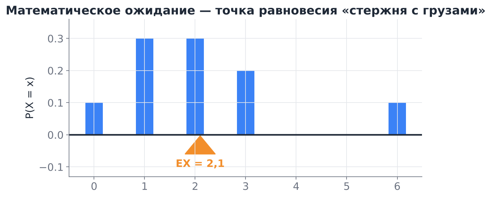

На рисунке $X$ принимает значения $0,1,2,3,6$ с вероятностями $0{,}1;\ 0{,}3;\ 0{,}3;\ 0{,}2;\ 0{,}1$. Тогда $EX = 0{,}3+0{,}6+0{,}6+0{,}6 = 2{,}1$: одинокий груз в точке 6 сдвигает центр вправо.

**Статистический смысл: долгосрочное среднее.** Пусть эксперимент повторяется $n$ раз, и значение $x_i$ встретилось $n_i$ раз. Среднее арифметическое
$$
\bar x = \frac{1}{n}\sum_i n_i x_i = \sum_i x_i\cdot\frac{n_i}{n} \approx \sum_i x_i p_i = EX,
$$
так как относительная частота $n_i/n$ близка к вероятности $p_i$. Строго это утверждение — **закон больших чисел** (ЗБЧ): среднее $n$ независимых наблюдений с ростом $n$ сходится к $EX$. Его мы докажем позже с помощью неравенства Чебышёва (раздел 5.3), а сейчас посмотрим на симуляцию.

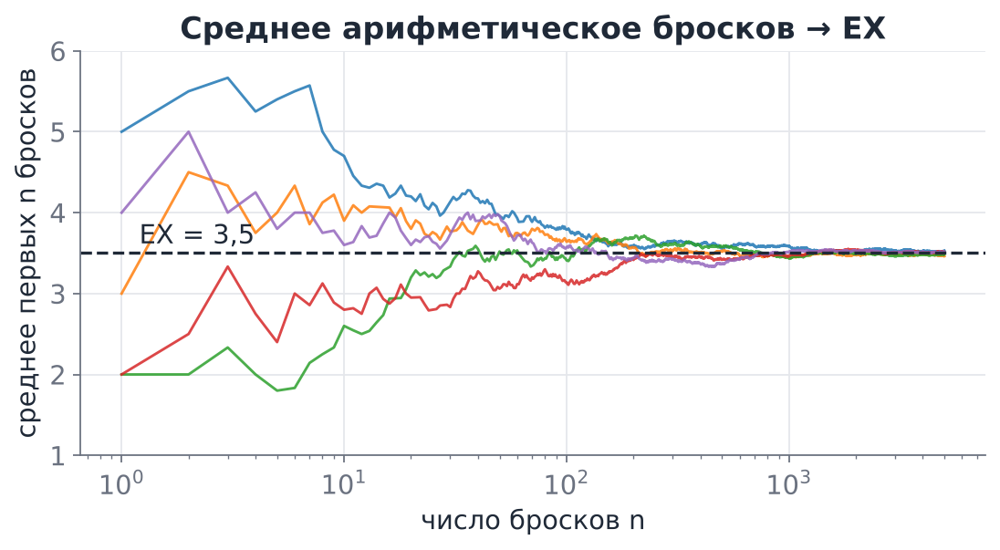

> [!example] Ожидаемый выигрыш
> Лотерея: билет стоит 100 ₽, с вероятностью $0{,}001$ выигрыш 50 000 ₽, с вероятностью $0{,}01$ — 1 000 ₽. Чистый выигрыш $X$: $49\,900$, $900$ или $-100$ ₽.
> $$
> EX = 49\,900\cdot0{,}001 + 900\cdot0{,}01 - 100\cdot0{,}989 = 49{,}9+9-98{,}9 = -40 \text{ ₽}.
> $$
> В среднем каждый билет приносит 40 ₽ убытка. Для одного покупателя это ничего не гарантирует, а для организатора, продавшего миллион билетов, это почти точный прогноз прибыли.

### 2.4. Математическое ожидание существует не всегда

Требование абсолютной сходимости в определении — не формальность.

**Санкт-Петербургский парадокс.** Монету бросают до первого орла. Если орёл выпал на $k$-м броске, игрок получает $2^k$ рублей. $P(X=2^k)=2^{-k}$, и
$$
EX = \sum_{k=1}^\infty 2^k\cdot 2^{-k} = 1+1+1+\dots = \infty.
$$
Ожидание бесконечно, хотя каждый конкретный выигрыш конечен, а в половине игр игрок получает всего 2 рубля.

**Распределение Коши** с плотностью $f(x)=\dfrac{1}{\pi(1+x^2)}$ симметрично относительно нуля, но $\int|x|f(x)\,dx=\infty$, поэтому $EX$ **не существует** (не равно нулю!). На практике это видно так: среднее выборки не стабилизируется с ростом $n$, потому что редкие огромные значения снова и снова «сбивают» его.

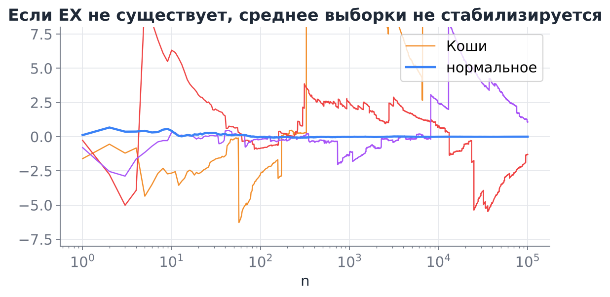

> [!warning] Тяжёлые хвосты
> В данных встречаются величины с очень тяжёлыми хвостами: размеры файлов, число подписчиков, суммы транзакций. Для них выборочное среднее может быть неустойчивым, и в отчётах полезно приводить ещё медиану и квантили.

### 2.5. Среднее, медиана, мода

Математическое ожидание — не единственный «центр» распределения:

- **медиана** — точка, где $F(x)=1/2$ (половина значений меньше, половина больше);
- **мода** — точка максимума ряда распределения или плотности (самое «типичное» значение).

Для симметричного унимодального распределения (например, нормального) все три совпадают. Для скошенного вправо распределения (доходы, время ответа, цены) обычно **мода < медиана < среднее**: длинный правый хвост тянет среднее вверх.

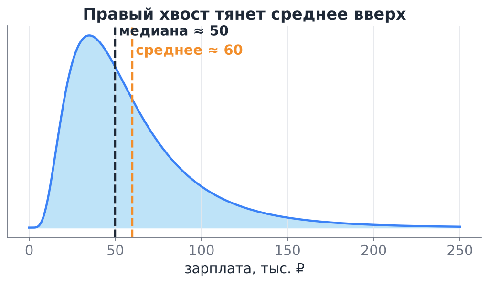

Чем медиана лучше: она **устойчива к выбросам**. Если в отдел из 10 человек с зарплатой 100 тыс. ₽ придёт директор с зарплатой 3 млн ₽, средняя зарплата вырастет до 364 тыс. ₽, а медиана останется 100 тыс. ₽.

Чем среднее лучше: оно **линейно** (раздел 3), с ним удобно считать, и оно является наилучшим прогнозом в смысле квадратичной ошибки (раздел 4.4).

---

## 3. Свойства математического ожидания

### 3.1. Основные свойства

Пусть $X,Y$ — случайные величины, у которых ожидания существуют, $a,b,c$ — числа.

1. **Ожидание константы:** $Ec = c$.
2. **Вынесение множителя:** $E(aX) = a\,EX$.
3. **Аддитивность:** $E(X+Y) = EX+EY$ — **для любых** $X,Y$, зависимых или нет.
4. **Следствие (линейность):** $E(aX+bY+c)=a\,EX+b\,EY+c$, и вообще $E\big(\sum_k X_k\big)=\sum_k EX_k$.
5. **Монотонность:** если $X\ge 0$, то $EX\ge0$; если $X\le Y$, то $EX\le EY$.
6. **Произведение независимых:** если $X$ и $Y$ **независимы**, то $E(XY)=EX\cdot EY$.

*Доказательство свойства 3 для дискретного случая.* Пусть $p_{ij}=P(X=x_i, Y=y_j)$. Тогда
$$
E(X+Y)=\sum_{i,j}(x_i+y_j)p_{ij}=\sum_i x_i\sum_j p_{ij}+\sum_j y_j\sum_i p_{ij}=\sum_i x_i P(X=x_i)+\sum_j y_jP(Y=y_j).
$$
Нигде не понадобилась независимость: мы лишь просуммировали совместные вероятности по одному из индексов.

*Доказательство свойства 6.* При независимости $p_{ij}=P(X=x_i)P(Y=y_j)$, и
$$
E(XY)=\sum_{i,j}x_iy_j\,P(X=x_i)P(Y=y_j)=\Big(\sum_i x_iP(X=x_i)\Big)\Big(\sum_j y_jP(Y=y_j)\Big).
$$

> [!warning] Частая ошибка
> $E(XY)=EX\cdot EY$ без независимости **неверно**. Пример: $X$ принимает значения $\pm1$ с вероятностью $1/2$, $Y=X$. Тогда $EX=EY=0$, но $E(XY)=EX^2=1$.
>
> И ещё: в общем случае $E\,g(X)\ne g(EX)$. Например, $E(X^2)\ne(EX)^2$ (разница — это дисперсия, см. раздел 4), $E(1/X)\ne 1/EX$.

### 3.2. Ожидание функции от случайной величины

> [!note] Теорема (ожидание функции)
> Если $Y=g(X)$, то
> $$
> E\,g(X) = \sum_i g(x_i)\,p_i \quad\text{(дискретный случай)},\qquad E\,g(X)=\int g(x)f(x)\,dx \quad\text{(непрерывный)}.
> $$

Удобство теоремы в том, что не нужно сначала искать распределение $Y$: достаточно «подставить» $g$ в формулу ожидания. В англоязычных книгах это называют LOTUS (law of the unconscious statistician).

**Пример.** Для кубика $E X^2 = \dfrac{1+4+9+16+25+36}{6}=\dfrac{91}{6}\approx 15{,}17$, а $(EX)^2=12{,}25$. Действительно, $EX^2\ne (EX)^2$.

### 3.3. Метод индикаторов

Линейность позволяет считать ожидания сложных величин, распределение которых найти трудно: представляем величину как сумму индикаторов и складываем вероятности.

**Пример: биномиальное распределение.** $X\sim B(n,p)$ — число успехов в $n$ испытаниях Бернулли. Запишем $X=I_1+\dots+I_n$, где $I_k$ — индикатор успеха в $k$-м испытании. Тогда
$$
EX = \sum_{k=1}^n E I_k = np.
$$
Никаких сумм с биномиальными коэффициентами.

**Пример: задача о совпадениях.** $n$ писем случайно разложили по $n$ конвертам. Сколько писем в среднем попадёт в свой конверт? Пусть $I_k$ — индикатор того, что $k$-е письмо в своём конверте; $P(I_k=1)=1/n$. Тогда
$$
E(\text{число совпадений}) = n\cdot\frac1n = 1
$$
при **любом** $n$. Индикаторы здесь зависимы, но для линейности ожидания это неважно.

**Пример: дубликаты в хеш-таблице.** $m$ ключей случайно и независимо раскладываются по $N$ ячейкам. Ожидаемое число пар ключей, попавших в одну ячейку (коллизий), — сумма индикаторов по всем $C_m^2$ парам, каждый с вероятностью $1/N$:
$$
E(\text{коллизий}) = \frac{m(m-1)}{2N}.
$$
При $N=365$ (дни рождения) и $m=23$ получаем $\approx0{,}69$ — отсюда «парадокс дней рождения».

### 3.4. Ожидание основных распределений

| Распределение | $EX$ | Как получить |
|---|---|---|
| Бернулли $\mathrm{Be}(p)$ | $p$ | индикатор |
| Биномиальное $B(n,p)$ | $np$ | сумма $n$ индикаторов |
| Геометрическое (номер первого успеха) | $1/p$ | ряд $\sum k(1-p)^{k-1}p$ |
| Пуассона $\mathrm{Pois}(\lambda)$ | $\lambda$ | $\sum k\frac{\lambda^k}{k!}e^{-\lambda}=\lambda\sum\frac{\lambda^{k-1}}{(k-1)!}e^{-\lambda}$ |
| Равномерное $U(a;b)$ | $(a+b)/2$ | пример 4 |
| Показательное $\mathrm{Exp}(\lambda)$ | $1/\lambda$ | пример 5 |
| Нормальное $N(\mu,\sigma^2)$ | $\mu$ | симметрия плотности относительно $\mu$ |

---

## 4. Дисперсия

### 4.1. Определение

Математическое ожидание говорит, где центр, но ничего не говорит о разбросе. Сравните: $X\equiv 0$ и $Y=\pm 1000$ с вероятностями $1/2$. У обеих $EX=EY=0$.

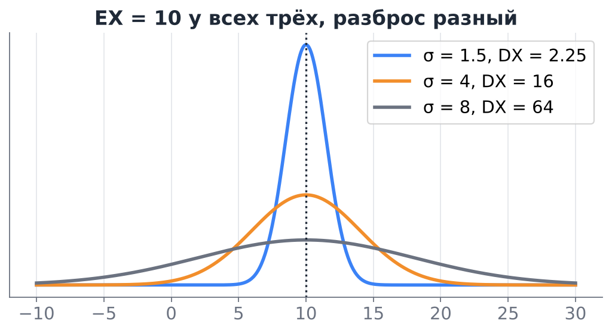

Естественная мера разброса — среднее отклонение от центра. Но $E(X-EX)=EX-EX=0$ всегда: отклонения разных знаков компенсируются. Можно взять модуль, $E|X-EX|$, но с ним неудобно считать. Поэтому берут **квадрат**.

> [!note] Определение
> **Дисперсией** случайной величины $X$ называется
> $$
> DX = E\big(X-EX\big)^2.
> $$

Обозначения: $DX$, $\mathrm{Var}(X)$, $\mathbb{V}[X]$, $\sigma^2$. Дискретный и непрерывный случаи (по теореме из раздела 3.2):
$$
DX=\sum_i (x_i-EX)^2p_i, \qquad DX=\int (x-EX)^2f(x)\,dx.
$$

### 4.2. Формула для вычисления

> [!note] Теорема
> $$
> DX = EX^2 - (EX)^2.
> $$

*Доказательство.* Обозначим $m=EX$ (это число). Раскроем квадрат и воспользуемся линейностью:
$$
E(X-m)^2 = E(X^2-2mX+m^2) = EX^2 - 2m\,EX + m^2 = EX^2 - m^2.
$$

«Среднее квадрата минус квадрат среднего». Отсюда, в частности, $EX^2\ge(EX)^2$ всегда, и равенство только для константы.

**Пример: кубик.** $DX = \dfrac{91}{6}-3{,}5^2 = \dfrac{91}{6}-\dfrac{49}{4} = \dfrac{35}{12}\approx 2{,}92$.

**Пример: центр масс из раздела 2.3.** $EX^2 = 0{,}3\cdot1+0{,}3\cdot4+0{,}2\cdot9+0{,}1\cdot36 = 6{,}9$, $DX = 6{,}9-2{,}1^2 = 2{,}49$.

**Пример: плотность $3x^2$ на $[0;1]$.** $EX^2=\int_0^1 3x^4dx=3/5$, $DX=3/5-9/16=3/80=0{,}0375$.

> [!warning] Вычислительная ловушка
> Формула $EX^2-(EX)^2$ удобна на бумаге, но в компьютере при больших значениях и малом разбросе она теряет точность: вычитаются два близких больших числа. Например, для времени в миллисекундах от начала эпохи ($\sim10^{12}$) результат может выйти даже отрицательным. Библиотеки (`numpy.var`, `pandas.var`) считают по определению, через отклонения от среднего, или используют устойчивые однопроходные алгоритмы (Уэлфорда).

### 4.3. Свойства дисперсии

1. $DX\ge0$, и $DX=0$ тогда и только тогда, когда $X$ — константа (с вероятностью 1).
2. $Dc = 0$.
3. $D(X+c) = DX$ — **сдвиг не меняет разброс**.
4. $D(aX) = a^2\,DX$ — множитель выносится **в квадрате**.
5. Если $X$ и $Y$ **независимы**, то $D(X+Y)=DX+DY$.
6. Если $X$ и $Y$ **независимы**, то $D(X-Y)=DX+DY$ (не разность!).

*Доказательство 3 и 4.* $D(aX+c)=E\big(aX+c-aEX-c\big)^2=a^2E(X-EX)^2=a^2DX$.

*Доказательство 5.* Обозначим $\tilde X=X-EX$, $\tilde Y=Y-EY$ (у них нулевые ожидания). Тогда
$$
D(X+Y)=E(\tilde X+\tilde Y)^2=E\tilde X^2+2E(\tilde X\tilde Y)+E\tilde Y^2 = DX+DY+2E(\tilde X\tilde Y).
$$
При независимости $E(\tilde X\tilde Y)=E\tilde X\cdot E\tilde Y=0$. Слагаемое $E(\tilde X\tilde Y)$ в общем случае — это **ковариация** (раздел 8).

Свойство 6 следует из 4 и 5: $D(X-Y)=DX+(-1)^2DY$. Интуиция: погрешности двух независимых измерений не компенсируются при вычитании, а накапливаются.

### 4.4. Дисперсия как наименьшая квадратичная ошибка

> [!note] Утверждение
> Для любого числа $c$
> $$
> E(X-c)^2 = DX + (EX-c)^2.
> $$
> Поэтому $\min_c E(X-c)^2 = DX$, и минимум достигается при $c=EX$.

*Доказательство.* $E(X-c)^2 = E\big((X-EX)+(EX-c)\big)^2 = DX + 2(EX-c)\cdot E(X-EX) + (EX-c)^2$, а средний член равен нулю.

Это важно для машинного обучения: если модель обязана предсказывать **константу** и мы штрафуем её **квадратичной** ошибкой (MSE), оптимальная константа — среднее. Если штрафовать **модулем** ошибки (MAE), оптимальна медиана. Дисперсия целевой переменной — это MSE «самой глупой» модели, и с ней сравнивают качество регрессии (коэффициент детерминации $R^2 = 1 - \mathrm{MSE}/DY$).

### 4.5. Дисперсия основных распределений

**Бернулли.** $EI^2=EI=p$ (так как $I^2=I$), поэтому $DI = p-p^2=p(1-p)$. Максимум $1/4$ при $p=1/2$: сильнее всего неопределённость у «честной монеты».

**Биномиальное.** $X=I_1+\dots+I_n$, индикаторы независимы, поэтому $DX=np(1-p)$.

**Пуассона.** Удобно сначала найти $E\,X(X-1)=\sum k(k-1)\frac{\lambda^k}{k!}e^{-\lambda}=\lambda^2$. Тогда $EX^2=\lambda^2+\lambda$ и $DX=\lambda$. Равенство $EX=DX$ — «отпечаток пальца» пуассоновского распределения (мы использовали его на лекции 3 для проверки модели).

**Равномерное $U(a;b)$.** $EX^2=\dfrac{a^2+ab+b^2}{3}$, откуда $DX=\dfrac{(b-a)^2}{12}$.

**Показательное.** $EX^2=\int_0^\infty x^2\lambda e^{-\lambda x}dx=2/\lambda^2$, $DX=1/\lambda^2$.

**Нормальное $N(\mu,\sigma^2)$.** $DX=\sigma^2$: второй параметр нормального распределения — это и есть дисперсия.

---

## 5. Стандартное отклонение

### 5.1. Определение и смысл

> [!note] Определение
> **Стандартным (средним квадратическим) отклонением** называется
> $$
> \sigma_X = \sqrt{DX}.
> $$

Зачем ещё одна характеристика? Дисперсия измеряется в **квадратах** единиц: если $X$ — время в миллисекундах, то $DX$ — в мс². Стандартное отклонение возвращает нас к исходным единицам, и его можно сравнивать со средним и откладывать на графике: «$120\pm30$ мс».

Свойства: $\sigma_{X+c}=\sigma_X$, $\sigma_{aX}=|a|\,\sigma_X$; для независимых $\sigma_{X+Y}=\sqrt{\sigma_X^2+\sigma_Y^2}$ (стандартные отклонения складываются «по Пифагору», а не арифметически).

**Коэффициент вариации** $\sigma_X/EX$ (для положительных величин) — безразмерная мера разброса. У показательного распределения он равен 1, у пуассоновского $1/\sqrt\lambda$.

### 5.2. Стандартизация

> [!note] Определение
> **Стандартизованная** величина
> $$
> Z = \frac{X-EX}{\sigma_X}
> $$
> имеет $EZ=0$, $DZ=1$.

*Проверка:* $EZ=(EX-EX)/\sigma_X=0$, $DZ=DX/\sigma_X^2=1$.

Значение $z$ показывает, на сколько стандартных отклонений наблюдение отстоит от среднего. Это **z-оценка** (z-score). В ML стандартизация признаков (`StandardScaler`) приводит их к одному масштабу, чтобы градиентный спуск и методы, основанные на расстояниях, не зависели от единиц измерения. Нормализация по мини-батчам (batch normalization) в нейросетях делает то же самое с активациями внутри сети (Николенко и др., разд. 4.3).

### 5.3. Неравенство Чебышёва

Насколько вероятны большие отклонения от среднего? Без знания распределения точно сказать нельзя, но **оценить сверху** можно.

> [!note] Неравенство Маркова
> Если $X\ge0$ и $a>0$, то
> $$
> P(X\ge a)\le\frac{EX}{a}.
> $$

*Доказательство.* $X\ge a\cdot I_{\{X\ge a\}}$ (если $X\ge a$, справа $a$, иначе 0). Берём ожидание: $EX\ge a\,P(X\ge a)$.

**Пример.** Среднее время ответа 200 мс. Тогда доля ответов дольше 2 секунд не больше $200/2000=10\,\%$ — при любом распределении.

> [!note] Неравенство Чебышёва
> Для любой $X$ с конечной дисперсией и любого $\varepsilon>0$
> $$
> P\big(|X-EX|\ge\varepsilon\big)\le\frac{DX}{\varepsilon^2}, \qquad\text{или}\qquad P\big(|X-EX|\ge k\sigma\big)\le\frac1{k^2}.
> $$

*Доказательство.* Применим неравенство Маркова к неотрицательной величине $(X-EX)^2$ и порогу $\varepsilon^2$:
$P(|X-EX|\ge\varepsilon)=P\big((X-EX)^2\ge\varepsilon^2\big)\le E(X-EX)^2/\varepsilon^2$.

Следствие: для **любого** распределения вне $EX\pm2\sigma$ лежит не более 25 % вероятности, вне $EX\pm3\sigma$ — не более $1/9\approx11\,\%$. Для нормального распределения эти доли гораздо меньше: 4,6 % и 0,27 % (правило трёх сигм). Граница Чебышёва грубая, зато универсальная.

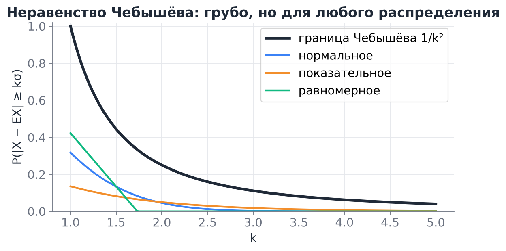

> [!warning] «Правило трёх сигм» — только для нормального
> Фраза «за $3\sigma$ почти ничего не выходит» верна для распределений, близких к нормальному. Для произвольного распределения гарантия — лишь 89 %. Поэтому поиск аномалий по правилу $|z|>3$ на данных с тяжёлым хвостом даст много ложных срабатываний.

---

## 6. Моменты, асимметрия и эксцесс

Ожидание и дисперсия — частные случаи **моментов**:

- **начальный момент** порядка $k$: $\nu_k = EX^k$ (так, $\nu_1=EX$);
- **центральный момент** порядка $k$: $\mu_k = E(X-EX)^k$ (так, $\mu_2=DX$, а $\mu_1=0$).

Моменты высших порядков описывают **форму** распределения:

- **коэффициент асимметрии** (skewness) $\gamma_1=\mu_3/\sigma^3$: ноль для симметричных распределений, положителен при длинном правом хвосте. У показательного $\gamma_1=2$.
- **эксцесс** (kurtosis) $\gamma_2=\mu_4/\sigma^4-3$: ноль у нормального, положителен у распределений с более тяжёлыми хвостами («островершинных»).

В `pandas` это `df.skew()` и `df.kurt()`, в `scipy` — `stats.skew`, `stats.kurtosis`. В курсе мы будем пользоваться ими лишь как диагностикой формы.

---

## 7. Сумма и среднее случайных величин

### 7.1. Сумма независимых величин

Пусть $X_1,\dots,X_n$ независимы. По линейности и свойству 5 дисперсии
$$
E\Big(\sum X_k\Big)=\sum EX_k,\qquad D\Big(\sum X_k\Big)=\sum DX_k.
$$

**Пример.** Сумма очков на $n$ кубиках: $E=3{,}5n$, $D=\frac{35}{12}n$, $\sigma\approx1{,}71\sqrt n$. Для 100 кубиков сумма в среднем 350 и отклоняется от этого «типично» на $\pm17$.

### 7.2. Среднее $n$ наблюдений: закон $\sqrt n$

Пусть $X_1,\dots,X_n$ независимы и одинаково распределены, $EX_k=\mu$, $DX_k=\sigma^2$. Для выборочного среднего $\bar X=\frac1n\sum X_k$:
$$
E\bar X=\mu,\qquad D\bar X=\frac{1}{n^2}\cdot n\sigma^2=\frac{\sigma^2}{n},\qquad \sigma_{\bar X}=\frac{\sigma}{\sqrt n}.
$$

> [!tip] Это одна из главных формул прикладной статистики
> Точность среднего растёт как $\sqrt n$: чтобы уменьшить погрешность вдвое, нужно **вчетверо** больше данных. Величину $\sigma/\sqrt n$ называют **стандартной ошибкой среднего** (standard error). На ней основаны доверительные интервалы и расчёт размера выборки в опросах и измерениях.

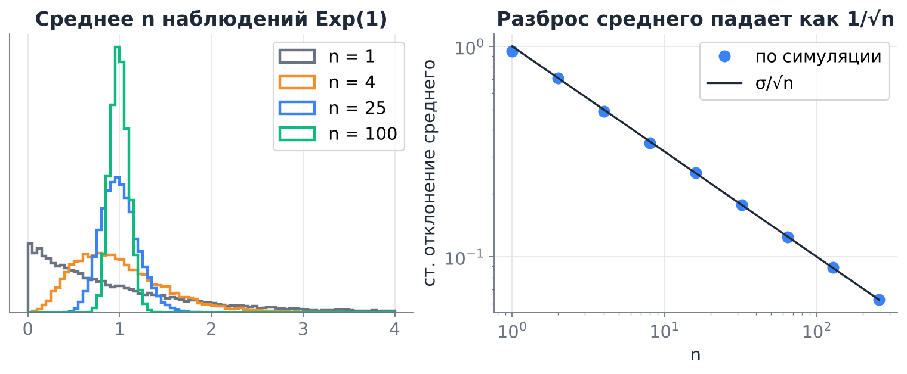

**Закон больших чисел (форма Чебышёва).** Подставим $\bar X$ в неравенство Чебышёва:
$$
P\big(|\bar X-\mu|\ge\varepsilon\big)\le\frac{\sigma^2}{n\varepsilon^2}\xrightarrow[n\to\infty]{}0.
$$
Среднее сходится к математическому ожиданию — именно это мы видели на рисунке с кубиком в разделе 2.3.

**Пример.** Сколько пользователей нужно опросить, чтобы с вероятностью не менее 95 % доля довольных отличалась от истинной не более чем на 0,05? Ответ пользователя — индикатор с $\sigma^2=p(1-p)\le1/4$. По Чебышёву нужно $\frac{1/4}{n\cdot0{,}05^2}\le0{,}05$, то есть $n\ge2000$. (Центральная предельная теорема, о которой будет отдельная лекция, даёт более точную оценку $n\approx385$.)

---

## 8. Ковариация

### 8.1. Определение

Как измерить, связаны ли две величины? Посмотрим на знак произведения отклонений $(X-EX)(Y-EY)$: оно положительно, когда обе величины одновременно выше или одновременно ниже своих средних, и отрицательно, когда они отклоняются в разные стороны.

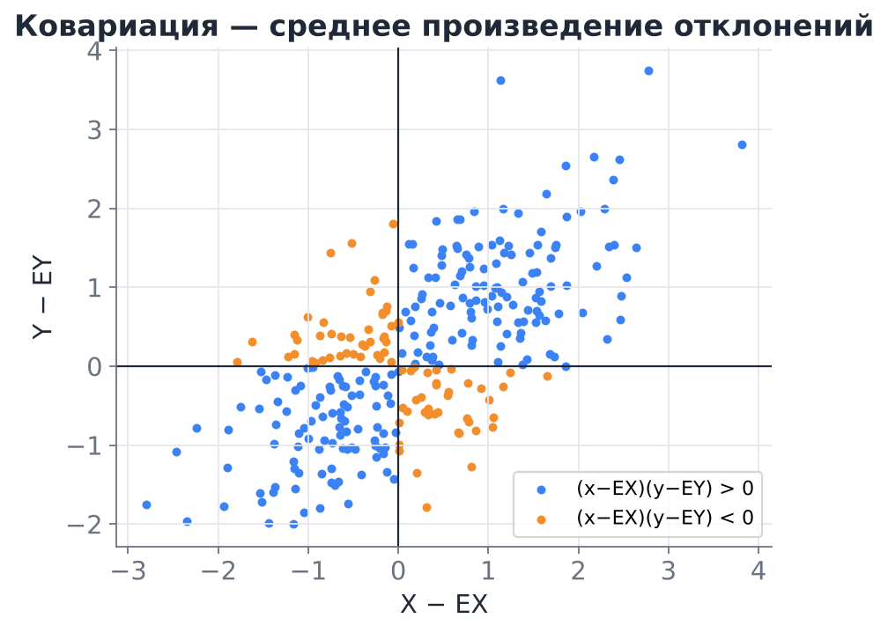

> [!note] Определение
> **Ковариацией** случайных величин $X$ и $Y$ называется
> $$
> \mathrm{cov}(X,Y) = E\big[(X-EX)(Y-EY)\big] = E(XY)-EX\cdot EY.
> $$

У Гмурмана ковариация называется **корреляционным моментом** и обозначается $\mu_{xy}$ или $K_{xy}$. Вторая формула доказывается раскрытием скобок так же, как формула для дисперсии.

**Пример.** Совместное распределение двух бинарных признаков: $X$ — пользователь открыл рассылку, $Y$ — совершил покупку.

| | $Y=0$ | $Y=1$ |
|---|---|---|
| $X=0$ | 0,4 | 0,1 |
| $X=1$ | 0,2 | 0,3 |

$EX=0{,}5$, $EY=0{,}4$, $E(XY)=P(X=1,Y=1)=0{,}3$, поэтому $\mathrm{cov}(X,Y)=0{,}3-0{,}2=0{,}1>0$: открывшие рассылку покупают чаще.

### 8.2. Свойства ковариации

1. $\mathrm{cov}(X,X)=DX$.
2. Симметрия: $\mathrm{cov}(X,Y)=\mathrm{cov}(Y,X)$.
3. $\mathrm{cov}(X,c)=0$, $\mathrm{cov}(X+c,Y)=\mathrm{cov}(X,Y)$.
4. Билинейность: $\mathrm{cov}(aX+bY,Z)=a\,\mathrm{cov}(X,Z)+b\,\mathrm{cov}(Y,Z)$.
5. Если $X$ и $Y$ независимы, то $\mathrm{cov}(X,Y)=0$ (так как $E(XY)=EX\,EY$).
6. **Дисперсия суммы в общем случае:**
$$
D(X+Y)=DX+DY+2\,\mathrm{cov}(X,Y),\qquad D\Big(\sum_k X_k\Big)=\sum_k DX_k+2\sum_{i<j}\mathrm{cov}(X_i,X_j).
$$

**Пример: диверсификация.** Два актива с доходностями $X$ и $Y$, $\sigma_X=0{,}2$, $\sigma_Y=0{,}3$. Вложим поровну: портфель $\frac12X+\frac12Y$. Его дисперсия $\frac14\sigma_X^2+\frac14\sigma_Y^2+\frac12\mathrm{cov}(X,Y)$. При $\mathrm{cov}=0$ стандартное отклонение портфеля $\approx0{,}18$, меньше, чем у каждого актива по отдельности; при отрицательной ковариации ($\rho=-0{,}5$) — уже $\approx0{,}13$. Ковариация определяет, насколько смешивание снижает риск. Тот же эффект лежит в основе ансамблей моделей: усреднение слабо коррелированных моделей уменьшает дисперсию прогноза.

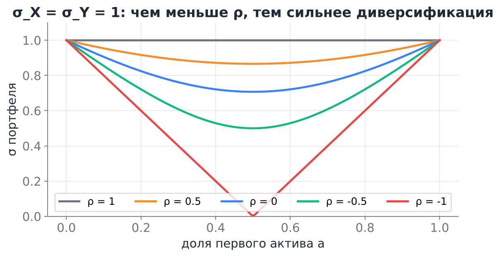

### 8.3. Ковариационная матрица

Для случайного вектора $\mathbf X=(X_1,\dots,X_d)$ все попарные ковариации собирают в **ковариационную матрицу**
$$
\Sigma_{ij}=\mathrm{cov}(X_i,X_j),\qquad \Sigma = E\big[(\mathbf X-E\mathbf X)(\mathbf X-E\mathbf X)^\top\big].
$$
На диагонали стоят дисперсии. Матрица симметрична и неотрицательно определена: для любого вектора весов $\mathbf a$
$$
D(\mathbf a^\top\mathbf X)=\mathbf a^\top\Sigma\,\mathbf a\ge0.
$$
Это прямое обобщение свойства 6. Ковариационная матрица — параметр многомерного нормального распределения и основной объект метода главных компонент (PCA ищет направления $\mathbf a$, где $\mathbf a^\top\Sigma\mathbf a$ максимальна; «Математика для МО», гл. 10).

### 8.4. Недостаток ковариации

Ковариация зависит от единиц измерения: если измерять рост в сантиметрах, а не в метрах, ковариация роста и веса вырастет в 100 раз, хотя связь не изменилась. По её величине нельзя сказать, сильная связь или слабая. Отсюда нормированная версия — корреляция.

---

## 9. Корреляция

### 9.1. Определение

> [!note] Определение
> **Коэффициентом корреляции** (Пирсона) величин $X$ и $Y$ с ненулевыми дисперсиями называется
> $$
> \rho(X,Y)=\frac{\mathrm{cov}(X,Y)}{\sigma_X\,\sigma_Y}.
> $$

Это ковариация стандартизованных величин: $\rho(X,Y)=\mathrm{cov}\Big(\frac{X-EX}{\sigma_X},\frac{Y-EY}{\sigma_Y}\Big)$. Поэтому корреляция **не зависит** от сдвигов и положительных множителей: $\rho(aX+b,\,cY+d)=\rho(X,Y)$ при $ac>0$ (при $ac<0$ меняется знак).

**Пример (продолжение).** Для рассылки и покупки $DX=0{,}25$, $DY=0{,}24$, $\rho=0{,}1/\sqrt{0{,}06}\approx0{,}41$.

### 9.2. Свойства корреляции

> [!note] Теорема
> 1. $-1\le\rho(X,Y)\le1$.
> 2. $|\rho(X,Y)|=1$ тогда и только тогда, когда $Y=aX+b$ с вероятностью 1 (при $a>0$ $\rho=1$, при $a<0$ $\rho=-1$).

*Доказательство.* Пусть $U$ и $V$ — стандартизованные $X$ и $Y$, тогда $\rho=\mathrm{cov}(U,V)$ и
$$
0\le D(U\mp V)=DU+DV\mp2\,\mathrm{cov}(U,V)=2(1\mp\rho).
$$
Отсюда $\rho\le1$ и $\rho\ge-1$. Если $\rho=1$, то $D(U-V)=0$, то есть $U-V$ — константа (равная нулю, раз $EU=EV=0$). Значит $V=U$, и $Y$ — линейная функция $X$. Это же рассуждение — частный случай неравенства Коши — Буняковского.

**Как читать значения.** $\rho$ близко к $\pm1$ — точки почти на прямой; $\rho\approx0$ — линейной связи нет. Условные пороги «слабая/умеренная/сильная» зависят от предметной области и не являются законом.

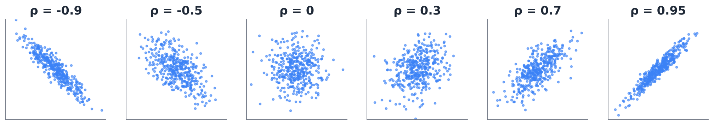

### 9.3. Некоррелированность и независимость

- Если $X$ и $Y$ **независимы**, то $\rho=0$.
- Обратное **неверно**: $\rho=0$ означает лишь отсутствие **линейной** связи.

**Пример.** $X\sim U(-1;1)$, $Y=X^2$. $Y$ полностью определяется $X$, но
$$
\mathrm{cov}(X,Y)=EX^3-EX\cdot EX^2=0-0=0,
$$
так как $EX=EX^3=0$ по симметрии. Корреляция равна нулю, а зависимость — функциональная.

Исключение: для **совместно нормальных** величин некоррелированность равносильна независимости. Именно поэтому в моделях с нормальным распределением ковариационная матрица описывает всю структуру зависимостей.

### 9.4. Ловушки корреляции

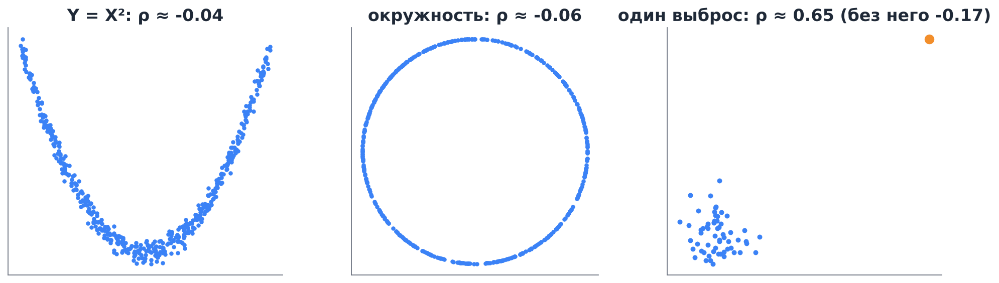

1. **Нелинейная связь.** Корреляция её не видит (левый и средний графики). Смотрите на диаграмму рассеяния, а не только на число.
2. **Выбросы.** Одна далёкая точка может создать сильную корреляцию на пустом месте (правый график) или уничтожить настоящую. Устойчивая альтернатива — **ранговая корреляция Спирмена** (корреляция Пирсона между рангами значений), `df.corr(method="spearman")`.
3. **Корреляция ≠ причинность.** Продажи мороженого и число утоплений коррелированы, потому что оба растут летом. Общая причина (**конфаундер**) создаёт корреляцию без причинной связи. Установить причинность помогают рандомизированные эксперименты и методы причинного вывода (Мёрфи, разд. 3.1.4).
4. **Парадокс Симпсона.** Корреляция в объединённых данных может иметь знак, противоположный корреляции внутри каждой подгруппы.
5. **Ложные корреляции временных рядов.** Два ряда с трендом (например, ВВП и число пользователей интернета) почти всегда сильно коррелированы. Анализировать стоит приращения, а не уровни.

### 9.5. Корреляция и линейная регрессия

Найдём наилучшее линейное приближение $Y\approx a+bX$ в смысле $E(Y-a-bX)^2\to\min$. По разделу 4.4 при фиксированном $b$ оптимально $a=EY-b\,EX$, и остаётся минимизировать $D(Y-bX)=DY-2b\,\mathrm{cov}(X,Y)+b^2DX$. Это парабола по $b$ с минимумом в
$$
b=\frac{\mathrm{cov}(X,Y)}{DX}=\rho\,\frac{\sigma_Y}{\sigma_X}.
$$
Остаточная дисперсия равна $DY(1-\rho^2)$. Значит, **$\rho^2$ — доля дисперсии $Y$, объяснённая линейной функцией от $X$**. При $\rho=0{,}5$ объясняется лишь 25 % разброса.

---

## 10. Факторный анализ

### 10.1. Идея: корреляции из-за скрытых причин

В 1904 году Чарльз Спирмен заметил, что оценки школьников по совсем разным предметам положительно коррелированы, и предположил, что за ними стоит одна скрытая величина — «общие способности». Так появился **факторный анализ**: метод, который объясняет корреляции многих наблюдаемых признаков небольшим числом ненаблюдаемых **факторов**.

Пример ниже — оценки 800 школьников за 6 контрольных. Корреляционная матрица распадается на два блока: точные предметы сильно связаны между собой, гуманитарные тоже, а между блоками связь слабее. Естественная гипотеза — у школьника есть две скрытые характеристики, «математические» и «гуманитарные» способности, и каждая оценка зависит в основном от одной из них.

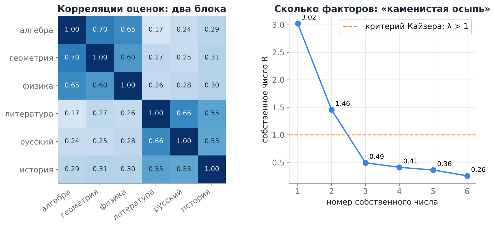

Факторный анализ используют там, где измеряют то, что нельзя измерить напрямую: в психологии (тесты личности, «большая пятёрка»), социологии и маркетинге (анкеты: удовлетворённость, лояльность), в финансах (доходности акций движутся вместе из-за общих рыночных и отраслевых факторов).

### 10.2. Модель

Пусть $X_1,\dots,X_d$ — стандартизованные признаки ($EX_i=0$, $DX_i=1$). **Модель факторного анализа** с $k$ факторами:
$$
X_i=\lambda_{i1}F_1+\dots+\lambda_{ik}F_k+\varepsilon_i,\qquad i=1,\dots,d,
$$
где
- $F_1,\dots,F_k$ — **общие факторы**: $EF_j=0$, $DF_j=1$, факторы некоррелированы между собой;
- $\varepsilon_i$ — **специфические факторы** (всё, что влияет только на $X_i$, включая ошибку измерения): $E\varepsilon_i=0$, $D\varepsilon_i=\psi_i$, они некоррелированы между собой и с $F_j$;
- $\lambda_{ij}$ — **факторные нагрузки**, $k\ll d$.

Всё, что нужно для работы с моделью, — свойства дисперсии и ковариации из разделов 4 и 8.

**Дисперсия признака.** Слагаемые некоррелированы, поэтому
$$
DX_i=\lambda_{i1}^2+\dots+\lambda_{ik}^2+\psi_i=h_i^2+\psi_i=1.
$$
Число $h_i^2=\sum_j\lambda_{ij}^2$ называют **общностью**: это доля дисперсии $X_i$, объяснённая общими факторами. $\psi_i=1-h_i^2$ — **специфичность**, доля, которую общие факторы не объясняют.

**Ковариация двух признаков.** По билинейности ковариации при $i\ne l$
$$
\mathrm{cov}(X_i,X_l)=\sum_{j}\lambda_{ij}\lambda_{lj}.
$$
Специфические факторы в ковариацию не входят: корреляции между признаками создают **только** общие факторы.

**Матричная форма.** Для вектора $\mathbf X$ и матрицы нагрузок $\Lambda$ размера $d\times k$
$$
R=\Lambda\Lambda^\top+\Psi,\qquad \Psi=\mathrm{diag}(\psi_1,\dots,\psi_d),
$$
где $R$ — корреляционная матрица. Модель утверждает, что $d(d-1)/2$ корреляций объясняются всего $dk$ нагрузками.

**Смысл нагрузки.** $\mathrm{cov}(X_i,F_j)=\lambda_{ij}$, а дисперсии $X_i$ и $F_j$ равны 1, поэтому $\lambda_{ij}=\rho(X_i,F_j)$: **нагрузка — это корреляция признака с фактором**.

> [!example] Один фактор
> Пусть $k=1$ и нагрузки трёх тестов $\lambda=(0{,}9;\ 0{,}8;\ 0{,}7)$. Тогда модель предсказывает корреляции $\rho_{12}=0{,}9\cdot0{,}8=0{,}72$, $\rho_{13}=0{,}63$, $\rho_{23}=0{,}56$ и общности $0{,}81$, $0{,}64$, $0{,}49$. Обратно: по трём корреляциям можно найти нагрузки, например $\lambda_1^2=\rho_{12}\rho_{13}/\rho_{23}=0{,}81$. Так Спирмен и оценивал «общий фактор».

### 10.3. Сколько факторов

Сумма собственных чисел корреляционной матрицы равна её следу, то есть $d$. Каждое собственное число показывает, сколько «признаков» дисперсии собирает соответствующее направление.
- **Критерий Кайзера:** брать столько факторов, сколько собственных чисел больше 1 (фактор должен объяснять больше, чем один исходный признак).
- **Каменистая осыпь** (scree plot): собственные числа по убыванию; число факторов — до «локтя», после которого график становится пологим.

На рисунке выше собственные числа $3{,}02;\ 1{,}46;\ 0{,}49;\dots$: оба критерия дают два фактора. Правила эвристические, и окончательное решение принимают по тому, удаётся ли осмысленно интерпретировать факторы.

### 10.4. Вращение: решение не единственно

Если $Q$ — ортогональная матрица ($QQ^\top=I$), то нагрузки $\Lambda Q$ дают ту же матрицу:
$$
(\Lambda Q)(\Lambda Q)^\top+\Psi=\Lambda QQ^\top\Lambda^\top+\Psi=\Lambda\Lambda^\top+\Psi.
$$
Значит, по данным факторы определены лишь с точностью до поворота (и знака: $F_j$ и $-F_j$ одинаково хороши). Эту свободу используют, чтобы сделать нагрузки удобными для интерпретации: **вращение varimax** ищет поворот, при котором у каждого признака одна большая нагрузка, а остальные близки к нулю («простая структура»). Общности $h_i^2$ при повороте не меняются.

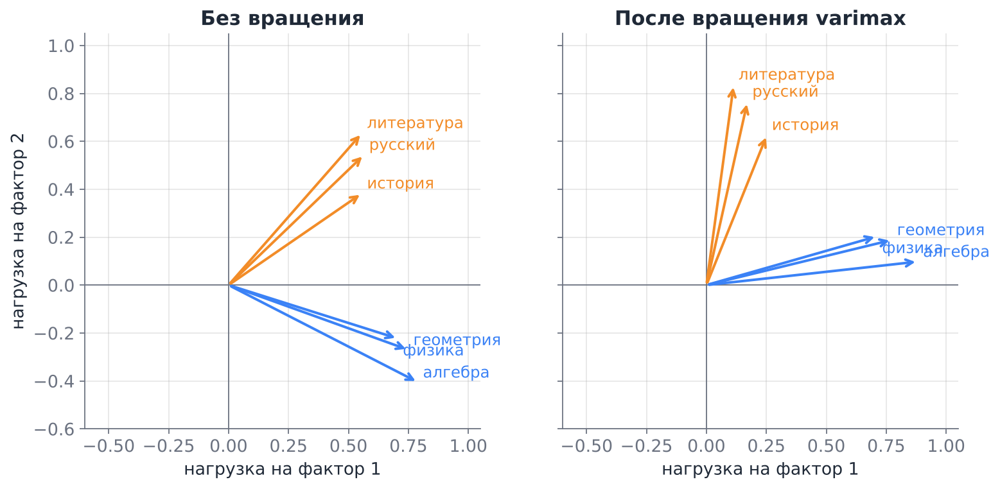

До вращения первый фактор — «общий уровень» (на него нагружены все предметы), второй противопоставляет гуманитарные предметы точным. После varimax факторы читаются сразу: фактор 1 — точные науки (нагрузки 0,7–0,9), фактор 2 — гуманитарные. Название фактора придумывает исследователь, математика его не даёт.

### 10.5. Факторный анализ и метод главных компонент

Метод главных компонент (PCA) тоже ищет несколько направлений вместо многих признаков, но решает другую задачу.

| | PCA | Факторный анализ |
|---|---|---|
| Что объясняет | всю дисперсию признаков | только общую часть, корреляции |
| Модель | нет, это поворот осей | $R=\Lambda\Lambda^\top+\Psi$ |
| Шум $\varepsilon_i$ | входит в компоненты | отделён в $\psi_i$ |
| Когда использовать | сжать данные, убрать мультиколлинеарность | найти и интерпретировать скрытые причины |

На практике, если специфичности малы, результаты близки. Если у какого-то признака много собственного шума, PCA «тратит» на него компоненту, а факторный анализ относит его в $\psi_i$.

### 10.6. Как это сделать в Python

```python
from sklearn.decomposition import FactorAnalysis

Z = (X - X.mean(0)) / X.std(0, ddof=1)        # стандартизуем признаки
R = np.corrcoef(X, rowvar=False)
eig = np.sort(np.linalg.eigvalsh(R))[::-1]   # собственные числа для выбора k
fa = FactorAnalysis(n_components=2, rotation="varimax", random_state=0).fit(Z)
loadings = fa.components_.T                  # матрица нагрузок d × k
h2 = 1 - fa.noise_variance_                  # общности
```

`FactorAnalysis` оценивает нагрузки методом максимального правдоподобия в предположении нормальности. Знак столбца нагрузок произволен: если все нагрузки фактора отрицательны, умножьте столбец на $-1$.

### 10.7. Ловушки

1. **Обратные вопросы.** В анкетах часть вопросов формулируют наоборот («Я редко волнуюсь» среди вопросов о тревожности). У них **отрицательная** нагрузка на свой фактор. Группировать признаки нужно по $|\lambda|$, а не по $\lambda$.
2. **Признак без общего фактора.** Если $h_i^2$ мала (меньше 0,2), признак почти не связан с остальными: это шум или отдельная тема, и в интерпретацию его не включают.
3. **Мало данных.** Корреляции оцениваются с погрешностью порядка $1/\sqrt n$; нужно хотя бы 5–10 наблюдений на признак и не меньше 100–200 наблюдений всего.
4. **Корреляция ≠ причинность** (раздел 9.4). Факторы описывают структуру корреляций; то, что фактор «вызывает» ответы, — гипотеза, а не вывод.
5. **Только линейные связи.** Модель строится по корреляционной матрице и не видит нелинейных зависимостей.

---

## 11. Числовые характеристики в анализе данных и ML

### 11.1. Выборочные аналоги

По выборке $x_1,\dots,x_n$ теоретические характеристики оцениваются так:

| Характеристика | Оценка | `numpy` / `pandas` |
|---|---|---|
| $EX$ | $\bar x=\frac1n\sum x_i$ | `x.mean()` |
| $DX$ | $s^2=\frac1{n-1}\sum(x_i-\bar x)^2$ | `np.var(x, ddof=1)`, `s.var()` |
| $\sigma_X$ | $s=\sqrt{s^2}$ | `np.std(x, ddof=1)`, `s.std()` |
| $\mathrm{cov}(X,Y)$ | $\frac1{n-1}\sum(x_i-\bar x)(y_i-\bar y)$ | `np.cov(x, y)`, `df.cov()` |
| $\rho(X,Y)$ | $r=\frac{\sum(x_i-\bar x)(y_i-\bar y)}{\sqrt{\sum(x_i-\bar x)^2\sum(y_i-\bar y)^2}}$ | `np.corrcoef(x, y)`, `df.corr()` |

> [!warning] `ddof`: делить на $n$ или на $n-1$?
> `numpy.var` и `numpy.std` по умолчанию делят на $n$ (`ddof=0`), а `pandas` — на $n-1$ (`ddof=1`). Деление на $n-1$ даёт **несмещённую** оценку дисперсии: $Es^2=\sigma^2$. Причина в том, что отклонения считаются от $\bar x$, а не от истинного $\mu$, и $\bar x$ «подогнан» под выборку, поэтому $\sum(x_i-\bar x)^2$ в среднем меньше $\sum(x_i-\mu)^2$. Подробно это будет в математической статистике, а на семинаре проверим симуляцией. Для больших $n$ разница несущественна.

### 11.2. Где это встречается в ML

- **Функции потерь.** MSE — это $E(Y-\hat Y)^2$; разложение $E(Y-c)^2=DY+(EY-c)^2$ объясняет, почему регрессия с MSE предсказывает **условное среднее** (Мёрфи, гл. 4–5; Николенко и др., разд. 2.2).
- **Смещение и разброс (bias–variance).** Ошибка модели раскладывается в квадрат смещения плюс дисперсию прогноза — та же формула раздела 4.4, применённая к прогнозу как случайной величине (Мёрфи, разд. 4.7.6).
- **Инициализация весов.** Выход нейрона $\sum_k w_kx_k$ — сумма $n$ слагаемых; при независимых весах с дисперсией $\sigma_w^2$ его дисперсия $\approx n\sigma_w^2\,Ex^2$. Чтобы сигнал не затухал и не «взрывался» от слоя к слою, берут $\sigma_w^2\sim1/n$ — это инициализация Ксавье (Глорота) и Хе (Николенко и др., разд. 4.2).
- **Мини-батчи и стохастический градиент.** Градиент по батчу из $B$ примеров — среднее $B$ слагаемых, его разброс падает как $1/\sqrt B$ (раздел 7.2). Это одна из причин, почему больший батч даёт более «гладкое» обучение.
- **Отбор признаков и мультиколлинеарность.** Матрица корреляций признаков показывает дублирующие друг друга признаки; сильно коррелированные признаки делают коэффициенты линейной регрессии неустойчивыми.
- **PCA и многомерное нормальное распределение** опираются на ковариационную матрицу («Математика для МО», разд. 6.4 и гл. 10).

### 11.3. Сквозной пример

**Условие.** В логах сервиса за сутки есть время ответа $T$ (мс) и число одновременных запросов $N$. Среднее время 180 мс, стандартное отклонение 60 мс, корреляция с нагрузкой $\rho(T,N)=0{,}7$, $EN=40$, $\sigma_N=10$.

1. *Оценка доли медленных ответов (> 420 мс) без знания распределения.* $420=180+4\cdot60$, по Чебышёву доля не больше $1/16\approx6{,}3\,\%$ (по Маркову — не больше $180/420\approx43\,\%$, гораздо хуже).
2. *Линейный прогноз времени по нагрузке.* $b=\rho\,\sigma_T/\sigma_N=0{,}7\cdot60/10=4{,}2$ мс на запрос; $T\approx180+4{,}2(N-40)$. При $N=60$ прогноз 264 мс.
3. *Сколько разброса объясняет нагрузка?* $\rho^2=0{,}49$, то есть около половины; остаточное стандартное отклонение $60\sqrt{1-0{,}49}\approx43$ мс.
4. *Среднее по 100 независимым запросам* имеет стандартное отклонение $60/\sqrt{100}=6$ мс.

```python
import numpy as np

rng = np.random.default_rng(0)
N = rng.normal(40, 10, size=100_000)
T = 180 + 4.2 * (N - 40) + rng.normal(0, 60 * np.sqrt(1 - 0.7**2), size=N.size)

print(T.mean(), T.std(ddof=1))           # ≈ 180, ≈ 60
print(np.corrcoef(T, N)[0, 1])           # ≈ 0.7
print(np.cov(T, N)[0, 1] / N.var(ddof=1))  # наклон регрессии ≈ 4.2
```

---

## 12. Шпаргалка

**Определения:**

| Характеристика | Дискретная | Непрерывная |
|---|---|---|
| $EX$ | $\sum x_ip_i$ | $\int xf(x)\,dx$ |
| $E\,g(X)$ | $\sum g(x_i)p_i$ | $\int g(x)f(x)\,dx$ |
| $DX$ | $E(X-EX)^2=EX^2-(EX)^2$ | то же |
| $\sigma_X$ | $\sqrt{DX}$ | то же |
| $\mathrm{cov}(X,Y)$ | $E(XY)-EX\,EY$ | то же |
| $\rho(X,Y)$ | $\mathrm{cov}(X,Y)/(\sigma_X\sigma_Y)$ | то же |

**Свойства:**

- $E(aX+bY+c)=aEX+bEY+c$ — всегда.
- $E(XY)=EX\cdot EY$ — если независимы.
- $D(aX+c)=a^2DX$.
- $D(X\pm Y)=DX+DY\pm2\,\mathrm{cov}(X,Y)$; для независимых $D(X\pm Y)=DX+DY$.
- $E\bar X=\mu$, $D\bar X=\sigma^2/n$, $\sigma_{\bar X}=\sigma/\sqrt n$.
- $\min_c E(X-c)^2=DX$ при $c=EX$.
- Марков: $P(X\ge a)\le EX/a$. Чебышёв: $P(|X-EX|\ge k\sigma)\le1/k^2$.
- $|\rho|\le1$; $|\rho|=1\iff$ линейная зависимость; независимы $\Rightarrow\rho=0$, но не наоборот.
- Регрессия: $b=\mathrm{cov}(X,Y)/DX$, доля объяснённой дисперсии $\rho^2$.

**Распределения:**

| Распределение | $EX$ | $DX$ |
|---|---|---|
| $\mathrm{Be}(p)$ | $p$ | $p(1-p)$ |
| $B(n,p)$ | $np$ | $np(1-p)$ |
| $\mathrm{Geom}(p)$ | $1/p$ | $(1-p)/p^2$ |
| $\mathrm{Pois}(\lambda)$ | $\lambda$ | $\lambda$ |
| $U(a;b)$ | $(a+b)/2$ | $(b-a)^2/12$ |
| $\mathrm{Exp}(\lambda)$ | $1/\lambda$ | $1/\lambda^2$ |
| $N(\mu,\sigma^2)$ | $\mu$ | $\sigma^2$ |

**Факторный анализ:** $X_i=\sum_j\lambda_{ij}F_j+\varepsilon_i$; $R=\Lambda\Lambda^\top+\Psi$; общность $h_i^2=\sum_j\lambda_{ij}^2$, $\psi_i=1-h_i^2$; $\lambda_{ij}=\rho(X_i,F_j)$; число факторов — собственные числа $R$ больше 1; поворот $\Lambda Q$ не меняет $R$.

**Python:** `x.mean()`, `np.var(x, ddof=1)`, `np.std(x, ddof=1)`, `np.cov(x, y)`, `np.corrcoef(x, y)`, `df.describe()`, `df.cov()`, `df.corr()`, `df.corr(method="spearman")`, `stats.<распределение>.mean()/var()/std()`, `FactorAnalysis(n_components=k, rotation="varimax")` из `sklearn.decomposition`.

---

## 13. Вопросы для самопроверки

1. Может ли математическое ожидание не совпадать ни с одним возможным значением величины? Приведите пример.
2. $X$ принимает значения $-1, 0, 2$ с вероятностями $0{,}2;\ 0{,}5;\ 0{,}3$. Найдите $EX$, $DX$, $E(3X-1)$, $D(3X-1)$.
   *Ответ:* $EX=0{,}4$, $EX^2=1{,}4$, $DX=1{,}24$, $E(3X-1)=0{,}2$, $D(3X-1)=11{,}16$.
3. Почему $E(X+Y)=EX+EY$ не требует независимости, а $D(X+Y)=DX+DY$ требует?
4. Для плотности $f(x)=2x$ на $[0;1]$ найдите $EX$ и $DX$. *Ответ:* $2/3$ и $1/18$.
5. В лифт на 9 этажей вошли 5 человек, каждый независимо выходит на одном из 9 этажей равновероятно. Найдите ожидаемое число остановок. *Ответ:* $9\big(1-(8/9)^5\big)\approx4{,}17$ (метод индикаторов).
6. $X$ и $Y$ независимы, $DX=4$, $DY=9$. Найдите $D(2X-Y+5)$ и $\sigma_{X-Y}$. *Ответ:* 25 и $\sqrt{13}$.
7. Почему стандартное отклонение удобнее дисперсии для интерпретации? Когда удобнее дисперсия?
8. Средний чек 1500 ₽, $\sigma=500$ ₽. Оцените сверху долю чеков, отличающихся от среднего больше чем на 2000 ₽. *Ответ:* $\le 1/16$.
9. Сколько наблюдений нужно, чтобы стандартная ошибка среднего уменьшилась в 10 раз?
10. Приведите пример зависимых величин с нулевой корреляцией.
11. $\mathrm{cov}(X,Y)=3$, $DX=4$, $DY=9$. Найдите $\rho$, $D(X+Y)$ и наклон линейной регрессии $Y$ на $X$. *Ответ:* $0{,}5$; $19$; $0{,}75$.
12. Как изменится корреляция роста и веса, если рост перевести из сантиметров в дюймы, а вес — из килограммов в фунты? А ковариация?
13. Чем `np.var(x)` отличается от `pd.Series(x).var()`?
14. Почему сильная корреляция между числом пожарных машин на пожаре и ущербом от пожара не означает, что пожарные увеличивают ущерб?
15. Один фактор, нагрузки трёх тестов $0{,}8;\ 0{,}6;\ 0{,}5$. Найдите корреляции между тестами и общности. *Ответ:* $0{,}48$, $0{,}40$, $0{,}30$; $0{,}64$, $0{,}36$, $0{,}25$.
16. Почему факторы определены лишь с точностью до поворота? Что при повороте не меняется?
17. Собственные числа корреляционной матрицы 10 вопросов анкеты: $3{,}1;\ 2{,}4;\ 1{,}2;\ 0{,}7;\ \dots$ Сколько факторов брать по критерию Кайзера? Чему равна сумма всех собственных чисел? *Ответ:* 3; 10.
18. У вопроса анкеты нагрузка $-0{,}7$ на фактор «тревожность». Что это значит?

---

## Литература

- **Гмурман В. Е.** Теория вероятностей и математическая статистика. — гл. 7 (математическое ожидание дискретной величины), гл. 8 (дисперсия, среднее квадратическое отклонение, моменты), гл. 9 (закон больших чисел, неравенство Чебышёва), гл. 12 (числовые характеристики непрерывных величин), гл. 14 (корреляционный момент, коэффициент корреляции, коррелированность и зависимость).
- **Мёрфи К. П.** Вероятностное машинное обучение: введение. — разд. 2.2.5 (моменты распределения: среднее, дисперсия, условные моменты), 2.8.4 (моменты линейного преобразования), 3.1 (ковариация, корреляция, «некоррелированные не значит независимые», «корреляция не означает причинность», парадокс Симпсона), 4.7.6 (смещение и дисперсия).
- **Николенко С., Кадурин А., Архангельская Е.** Глубокое обучение. Погружение в мир нейронных сетей. — разд. 2.2 (функции ошибки), 4.2 (инициализация весов и дисперсия активаций), 4.3 (нормализация по мини-батчам).
- **Дайзенрот М. П., Фейзал А. А., Он Ч. С.** Математика для машинного обучения. — разд. 6.4 (среднее и дисперсия, эмпирические среднее и дисперсия, три формулы дисперсии, суммы и линейные преобразования), гл. 10 (метод главных компонент и ковариационная матрица).
- **Мёрфи К. П.** Вероятностное машинное обучение: введение. — разд. 20.2 (факторный анализ, связь с PCA, неидентифицируемость и вращения).
