---
tags:
  - теория-вероятностей
  - лекция
  - итмо
курс: Теория вероятностей (ИТМО)
лекция: 5
---

# Лекция 5. Закон больших чисел и центральная предельная теорема

> [!info] О методичке
> Это конспект к лекции 5 курса «Теория вероятностей» для студентов ИТМО. В нём разобраны все темы лекции: формулировки теорем, доказательства или идеи доказательств, примеры с решениями и короткие фрагменты кода на Python. Презентация лекции лежит рядом: `05_lln-clt-itmo.pptx`. Практика по этой теме будет на семинаре 5 (ноутбук `attachments/05-seminar-lln-clt-itmo.ipynb`).

**План.**

1. [[#1. От случайности к статистике|От случайности к статистике]]
2. [[#2. Что значит «сходится» для случайных величин|Что значит «сходится» для случайных величин]]
3. [[#3. Закон больших чисел|Закон больших чисел]]
4. [[#4. Выборочные характеристики|Выборочные характеристики]]
5. [[#5. Центральная предельная теорема|Центральная предельная теорема]]
6. [[#6. Влияние размера выборки|Влияние размера выборки]]
7. [[#7. Когда ЗБЧ и ЦПТ подводят|Когда ЗБЧ и ЦПТ подводят]]
8. [[#8. ЗБЧ и ЦПТ в анализе данных и ML|ЗБЧ и ЦПТ в анализе данных и ML]]
9. [[#9. Шпаргалка|Шпаргалка]]
10. [[#10. Вопросы для самопроверки|Вопросы для самопроверки]]

---

## 1. От случайности к статистике

До сих пор мы шли **от модели к данным**: известно распределение, и мы считали вероятности, ожидания и дисперсии. В реальной работе всё наоборот: есть данные, а распределение неизвестно.

- Сервис ответил на 10 000 запросов. Какое у него «настоящее» среднее время ответа?
- 412 из 8 000 посетителей купили товар. Какова конверсия страницы и насколько мы в ней уверены?
- В районе A за год 9 случаев болезни на 600 жителей, в районе B — 1 300 на 100 000. Где опаснее?

Чтобы отвечать на такие вопросы, данные описывают **вероятностной моделью**.

> [!note] Модель выборки
> Данные $x_1,\dots,x_n$ считаются значениями **независимых одинаково распределённых** (н. о. р., англ. i.i.d.) случайных величин $X_1,\dots,X_n$ с общим неизвестным распределением $F$. Это распределение называют **генеральной совокупностью**, а $X_1,\dots,X_n$ — **выборкой** объёма $n$.

Любая функция от выборки — среднее, медиана, доля, максимум — называется **статистикой**. Главная мысль этой лекции:

> [!tip] Статистика — это случайная величина
> Если повторить сбор данных, получится другая выборка и другое среднее. Значит, у выборочного среднего есть своё распределение, своё ожидание и своя дисперсия. Две теоремы лекции описывают это распределение при большом $n$:
> - **закон больших чисел (ЗБЧ)**: выборочное среднее приближается к $EX$;
> - **центральная предельная теорема (ЦПТ)**: отклонение среднего от $EX$ распределено почти нормально, с разбросом $\sigma/\sqrt n$.

ЗБЧ отвечает на вопрос «к чему сходится», ЦПТ — «насколько мы ошибаемся при конечном $n$». Вместе они превращают теорию вероятностей в инструмент статистики: на них построены доверительные интервалы, A/B-тесты, расчёт объёма выборки и метод Монте-Карло.

---

## 2. Что значит «сходится» для случайных величин

Для чисел $a_n\to a$ означает, что $|a_n-a|$ становится сколь угодно малым. Для случайных величин $Y_n$ есть несколько разных смыслов.

> [!note] Сходимость по вероятности
> $Y_n\xrightarrow{P} a$, если для любого $\varepsilon>0$
> $$
> P\big(|Y_n-a|\ge\varepsilon\big)\xrightarrow[n\to\infty]{}0.
> $$
> Большие отклонения становятся всё менее вероятными.

> [!note] Сходимость почти наверное
> $Y_n\to a$ почти наверное, если $P\big(\lim_{n\to\infty} Y_n=a\big)=1$: почти каждая траектория $Y_1(\omega),Y_2(\omega),\dots$ сходится к $a$ в обычном смысле.

> [!note] Сходимость по распределению
> $Y_n\xrightarrow{d} Y$, если $F_{Y_n}(x)\to F_Y(x)$ во всех точках непрерывности $F_Y$. Сходятся не значения, а **вероятности**: $P(Y_n\le x)\approx P(Y\le x)$ при большом $n$.

Связь: из сходимости почти наверное следует сходимость по вероятности, а из неё — сходимость по распределению. Обратное в общем случае неверно.

ЗБЧ — утверждение о сходимости по вероятности (слабый ЗБЧ) или почти наверное (усиленный ЗБЧ). ЦПТ — о сходимости по распределению.

---

## 3. Закон больших чисел

### 3.1. ЗБЧ в форме Чебышёва

На лекции 4 мы уже получили его из неравенства Чебышёва. Повторим, потому что это главный кирпич всей темы.

> [!note] Теорема (ЗБЧ Чебышёва)
> Пусть $X_1,X_2,\dots$ попарно некоррелированы, $EX_k=\mu$, $DX_k=\sigma^2<\infty$. Тогда для $\bar X_n=\frac1n\sum_{k=1}^n X_k$ и любого $\varepsilon>0$
> $$
> P\big(|\bar X_n-\mu|\ge\varepsilon\big)\le\frac{\sigma^2}{n\varepsilon^2}\xrightarrow[n\to\infty]{}0.
> $$

**Доказательство.** $E\bar X_n=\mu$. В силу некоррелированности $D\bar X_n=\frac1{n^2}\sum DX_k=\frac{\sigma^2}{n}$. Неравенство Чебышёва $P(|Y-EY|\ge\varepsilon)\le DY/\varepsilon^2$ для $Y=\bar X_n$ даёт ответ. $\blacksquare$

Заметьте, что доказательство использует только две вещи: дисперсия среднего равна $\sigma^2/n$, и она стремится к нулю. Поэтому ЗБЧ верен и для **разных** распределений, если их дисперсии ограничены одной константой, а средние равны (или если сходится среднее их ожиданий).

### 3.2. ЗБЧ Бернулли: частота стремится к вероятности

Пусть в каждом из $n$ независимых испытаний событие $A$ происходит с вероятностью $p$. Число успехов $S_n=\sum I_k$, где $I_k$ — индикатор успеха в $k$-м испытании, $EI_k=p$, $DI_k=p(1-p)\le\frac14$.

> [!note] Теорема Бернулли (1713)
> Относительная частота $S_n/n$ сходится по вероятности к $p$:
> $$
> P\left(\left|\frac{S_n}{n}-p\right|\ge\varepsilon\right)\le\frac{p(1-p)}{n\varepsilon^2}\le\frac{1}{4n\varepsilon^2}.
> $$

Это частный случай ЗБЧ Чебышёва и **математическое обоснование частотного смысла вероятности**: вероятность события — это то, к чему стремится его частота в длинной серии независимых повторений. Именно этой интерпретацией мы пользовались с первой лекции.

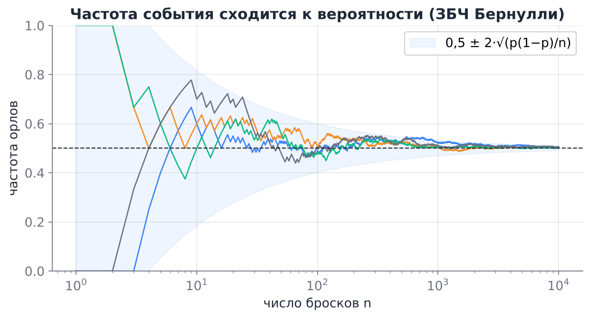

На рисунке 4 серии по 10 000 бросков монеты. В начале частота «гуляет» сильно, потом траектории прижимаются к $0{,}5$. Голубой коридор $0{,}5\pm2\sqrt{p(1-p)/n}$ сужается как $1/\sqrt n$: в нём частота остаётся примерно в 95 % случаев. Откуда берётся именно такой коридор, объяснит ЦПТ.

Другой взгляд на тот же факт: распределение частоты при росте $n$ стягивается к точке $p$.

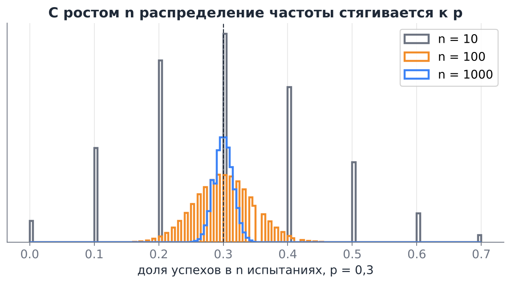

### 3.3. ЗБЧ Хинчина и усиленный ЗБЧ

Конечная дисперсия удобна для доказательства, но не обязательна.

> [!note] Теорема Хинчина (слабый ЗБЧ)
> Если $X_1,X_2,\dots$ независимы, одинаково распределены и $E|X_1|<\infty$, то $\bar X_n\xrightarrow{P}\mu=EX_1$.

> [!note] Усиленный ЗБЧ (Колмогоров)
> При тех же условиях $\bar X_n\to\mu$ **почти наверное**: с вероятностью 1 конкретная бесконечная последовательность наблюдений даёт средние, сходящиеся к $\mu$.

Доказательства этих теорем сложнее (через характеристические функции и через неравенство Колмогорова), мы их не приводим. Практический смысл такой: среднее сходится к ожиданию всегда, когда ожидание существует. При бесконечной дисперсии сходимость остаётся, но становится очень медленной (раздел 7.2).

Обратите внимание на роли условий:

| Условие | Зачем нужно | Что будет, если нарушить |
|---|---|---|
| $EX$ существует | есть к чему сходиться | Коши: среднее не стабилизируется (лекция 4) |
| независимость (или хотя бы слабая зависимость) | дисперсия среднего падает как $1/n$ | при сильной зависимости среднее сходится медленнее или вообще не к $\mu$ |
| одинаковое распределение | одно и то же $\mu$ у всех | среднее сходится к среднему из ожиданий, если оно существует |

### 3.4. Метод Монте-Карло

ЗБЧ — теоретическая основа **метода Монте-Карло**: любую величину, которую можно записать как ожидание, можно оценить средним большой выборки.

$$
\int_a^b g(x)\,dx=(b-a)\,E\,g(U),\quad U\sim U(a;b),\qquad\text{поэтому}\qquad \int_a^b g(x)\,dx\approx\frac{b-a}{n}\sum_{k=1}^n g(U_k).
$$

Вероятность — это ожидание индикатора, поэтому вероятность любого события можно оценить его частотой в симуляции. Мы так делали на всех семинарах.

**Пример. Число $\pi$.** Точка $(U_1,U_2)$ равномерна в квадрате $[0;1]^2$. Вероятность попасть в четверть круга $u_1^2+u_2^2\le1$ равна $\pi/4$. Поэтому $\pi\approx4\cdot$ (доля точек внутри).

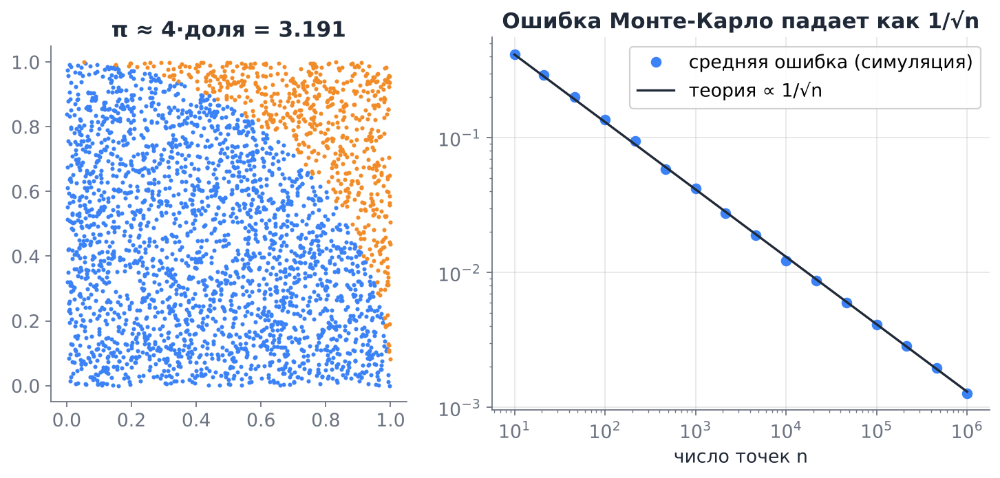

```python
import numpy as np

rng = np.random.default_rng(0)
n = 1_000_000
u = rng.random((n, 2))
inside = (u ** 2).sum(axis=1) <= 1
pi_hat = 4 * inside.mean()
se = 4 * inside.std(ddof=1) / np.sqrt(n)        # стандартная ошибка оценки
print(f"π ≈ {pi_hat:.4f} ± {1.96 * se:.4f}")      # ≈ 3.1416 ± 0.0032
```

Ошибка Монте-Карло падает как $1/\sqrt n$ **независимо от размерности** задачи. Для интеграла по одномерному отрезку это медленно (формула трапеций гораздо точнее), а для интеграла по 100-мерному пространству — единственный рабочий способ. Поэтому Монте-Карло лежит в основе байесовских методов, обучения с подкреплением и моделирования в физике и финансах.

### 3.5. Чего ЗБЧ не говорит: ошибка игрока

ЗБЧ часто понимают неправильно: «если долго выпадали решки, то теперь должны пойти орлы, чтобы частота вернулась к $1/2$». Это **ошибка игрока** (gambler's fallacy).

Монета не помнит прошлого: после десяти решек подряд вероятность орла по-прежнему $1/2$. Частота приближается к $1/2$ не потому, что отклонения **компенсируются**, а потому что они **разбавляются** новыми бросками. Абсолютная разница между числом орлов и решек при этом не уменьшается, а растёт, как $\sqrt n$:
$$
D\Big(S_n-\frac n2\Big)=\frac n4,\qquad\sigma=\frac{\sqrt n}{2},\qquad\text{но}\qquad \sigma\Big(\frac{S_n}{n}-\frac12\Big)=\frac{1}{2\sqrt n}\to0.
$$

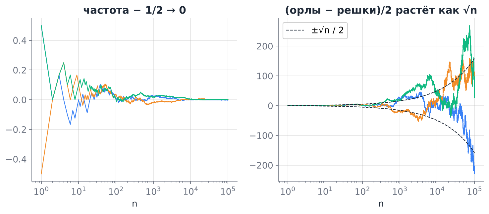

> [!example] Казино и ЗБЧ
> Ставка 1 ₽ на красное в европейской рулетке выигрывает с вероятностью $18/37$. Чистый выигрыш за одну ставку $\pm1$ ₽, $EX=2\cdot\frac{18}{37}-1=-\frac1{37}\approx-0{,}027$ ₽, $\sigma\approx1$.
> - За 1 000 ставок игрок в среднем теряет 27 ₽ при разбросе $\pm32$ ₽: он в плюсе примерно с вероятностью 19 %, удача ещё многое решает.
> - Казино за вечер принимает $10^6$ таких ставок: ожидаемая прибыль 27 000 ₽, разброс $\pm1\,000$ ₽. Вероятность убытка — меньше $10^{-150}$.
>
> Один и тот же закон делает результат игрока случайным, а результат казино — почти детерминированным. Так же работают страхование и любой бизнес с большим числом мелких независимых рисков.

---

## 4. Выборочные характеристики

### 4.1. Выборочное распределение

Пусть $T=T(X_1,\dots,X_n)$ — статистика. Её распределение при фиксированном $n$ называют **выборочным распределением** (sampling distribution). Его можно получить:

- точно, если повезло с моделью (например, сумма нормальных величин нормальна, сумма бернуллиевских — биномиальна);
- приближённо, через ЦПТ (раздел 5);
- симуляцией: сгенерировать много выборок и посчитать $T$ на каждой.

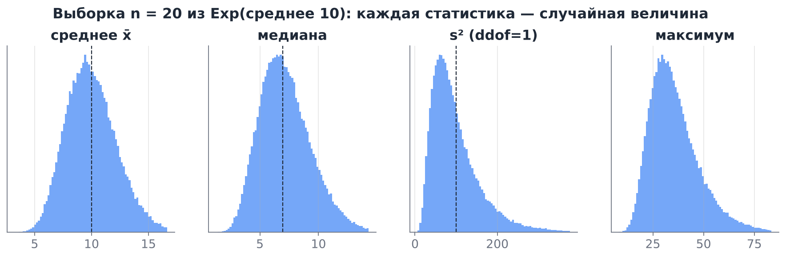

На рисунке 100 000 выборок по $n=20$ из показательного распределения со средним 10. У каждой статистики своё распределение: среднее симметрично и сосредоточено около 10, медиана — около $10\ln2\approx6{,}9$ (медиана распределения), $s^2$ сильно скошена вправо, максимум тоже скошен и не сходится ни к какому числу, а растёт с $n$.

У «хорошей» статистики, которой мы оцениваем параметр $\theta$, обычно спрашивают три свойства:

> [!note] Свойства оценок
> - **Несмещённость:** $ET=\theta$ при любом $n$, то есть в среднем по повторениям мы не ошибаемся в одну сторону.
> - **Состоятельность:** $T\xrightarrow{P}\theta$ при $n\to\infty$. Это и есть ЗБЧ для данной статистики.
> - **Эффективность:** среди несмещённых оценок у $T$ меньшая дисперсия (меньше разброс при том же $n$).

Величину $\sqrt{DT}$ называют **стандартной ошибкой** (standard error, SE) статистики. Это главная мера точности оценки.

### 4.2. Выборочное среднее и выборочная доля

Для $\bar X=\frac1n\sum X_k$ (лекция 4):
$$
E\bar X=\mu,\qquad D\bar X=\frac{\sigma^2}{n},\qquad SE(\bar X)=\frac{\sigma}{\sqrt n}.
$$
Среднее несмещённое, по ЗБЧ состоятельное.

Выборочная доля $\hat p=S_n/n$ — это среднее индикаторов, поэтому
$$
E\hat p=p,\qquad SE(\hat p)=\sqrt{\frac{p(1-p)}{n}}.
$$

На практике $\sigma$ и $p$ неизвестны, и в формулу подставляют их оценки: $\widehat{SE}=s/\sqrt n$ и $\sqrt{\hat p(1-\hat p)/n}$. По ЗБЧ эти оценки близки к истинным при большом $n$.

### 4.3. Выборочная дисперсия

$$
s^2=\frac{1}{n-1}\sum_{k=1}^n(X_k-\bar X)^2.
$$

**Несмещённость.** Раскроем сумму, используя $\sum(X_k-\bar X)^2=\sum(X_k-\mu)^2-n(\bar X-\mu)^2$:
$$
E\sum(X_k-\bar X)^2=n\sigma^2-n\cdot\frac{\sigma^2}{n}=(n-1)\sigma^2.
$$
Отсюда $Es^2=\sigma^2$. При делении на $n$ получилась бы оценка, в среднем заниженная в $\frac{n-1}{n}$ раз: отклонения считаются от $\bar X$, которое «подогнано» под выборку и всегда ближе к точкам, чем истинное $\mu$. Это та самая разница `ddof=0` и `ddof=1` с лекции 4.

**Состоятельность.** $\frac1n\sum X_k^2\to EX^2$ и $\bar X\to\mu$ по ЗБЧ, поэтому $s^2\to EX^2-\mu^2=\sigma^2$.

> [!warning] Разброс самой $s^2$
> Если $EX^4<\infty$, то $D s^2\approx\frac{\mu_4-\sigma^4}{n}$, где $\mu_4=E(X-\mu)^4$. Для данных с тяжёлыми хвостами $\mu_4$ огромно, и выборочная дисперсия очень неустойчива: один выброс меняет её в разы. Это видно по сильно скошенной гистограмме $s^2$ на рисунке выше.

### 4.4. Эмпирическая функция распределения и квантили

Оценкой всей функции распределения служит **эмпирическая функция распределения**
$$
\hat F_n(x)=\frac{1}{n}\,\#\{k:\ X_k\le x\}.
$$
При фиксированном $x$ это доля успехов: индикаторы $I\{X_k\le x\}$ — бернуллиевские с вероятностью $F(x)$. По ЗБЧ $\hat F_n(x)\to F(x)$, а $SE=\sqrt{F(x)(1-F(x))/n}$.

> [!note] Теорема Гливенко — Кантелли
> $\sup_x|\hat F_n(x)-F(x)|\to0$ почти наверное. Эмпирическая функция приближает истинную **равномерно по всей прямой**.

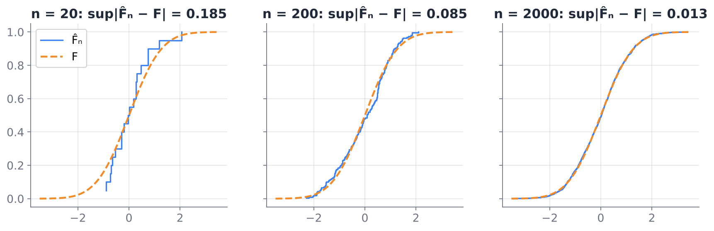

Эту теорему иногда называют основной теоремой статистики: по достаточно большой выборке можно восстановить распределение целиком. Следствие: выборочные квантили (медиана, p95) сходятся к истинным, если $F$ строго возрастает в окрестности квантиля.

**Медиана против среднего.** Для выборки из $N(\mu,\sigma^2)$ медиана тоже состоятельна и несмещённа, но её дисперсия при большом $n$ равна $\frac{\pi}{2}\cdot\frac{\sigma^2}{n}\approx1{,}57\,\frac{\sigma^2}{n}$. Значит, медиане нужно в 1,57 раза больше данных, чтобы сравняться со средним по точности: для нормальных данных среднее **эффективнее**. Для данных с тяжёлыми хвостами всё наоборот: медиана устойчива, а среднее «скачет» (раздел 7).

### 4.5. Как ведут себя выборочные характеристики: сводка

| Статистика | Оценивает | Несмещённая | $SE$ при большом $n$ |
|---|---|---|---|
| $\bar X$ | $\mu$ | да | $\sigma/\sqrt n$ |
| $\hat p$ | $p$ | да | $\sqrt{p(1-p)/n}$ |
| $s^2$ (`ddof=1`) | $\sigma^2$ | да | $\sqrt{(\mu_4-\sigma^4)/n}$ |
| $s$ | $\sigma$ | нет (чуть занижает) | для нормальных $\approx\sigma/\sqrt{2n}$ |
| медиана | медиана $m$ | для симметричных | $\dfrac{1}{2f(m)\sqrt n}$ |
| $\hat F_n(x)$ | $F(x)$ | да | $\sqrt{F(x)(1-F(x))/n}$ |
| максимум | — | — | не сходится к числу, растёт с $n$ |

Во всех строках, кроме последней, точность растёт как $\sqrt n$. Это общий закон: почти все «гладкие» статистики ведут себя как средние, и к ним применима ЦПТ.

---

## 5. Центральная предельная теорема

### 5.1. Формулировка

ЗБЧ говорит, что $\bar X_n-\mu\to0$. Но насколько быстро и с каким распределением? Отклонение имеет порядок $\sigma/\sqrt n$, поэтому естественно рассмотреть **стандартизованную** величину
$$
Z_n=\frac{\bar X_n-\mu}{\sigma/\sqrt n}=\frac{S_n-n\mu}{\sigma\sqrt n},\qquad EZ_n=0,\quad DZ_n=1.
$$

> [!note] Центральная предельная теорема (Линдеберг — Леви)
> Пусть $X_1,X_2,\dots$ независимы, одинаково распределены, $EX_k=\mu$, $0<DX_k=\sigma^2<\infty$. Тогда для любого $x$
> $$
> P\left(\frac{S_n-n\mu}{\sigma\sqrt n}\le x\right)\xrightarrow[n\to\infty]{}\Phi(x)=\frac{1}{\sqrt{2\pi}}\int_{-\infty}^x e^{-t^2/2}\,dt.
> $$

На практике её используют в виде приближений: при большом $n$
$$
S_n\ \dot\sim\ N\big(n\mu,\ n\sigma^2\big),\qquad \bar X_n\ \dot\sim\ N\Big(\mu,\ \frac{\sigma^2}{n}\Big).
$$
Значок $\dot\sim$ читается «приближённо распределено как».

> [!tip] Что здесь удивительно
> Про исходное распределение не известно ничего, кроме $\mu$ и $\sigma$. Оно может быть дискретным, скошенным, двугорбым. Но сумма многих независимых слагаемых всегда приближённо нормальна, и её распределение определяется только двумя числами. Вся остальная информация о форме слагаемых «забывается».

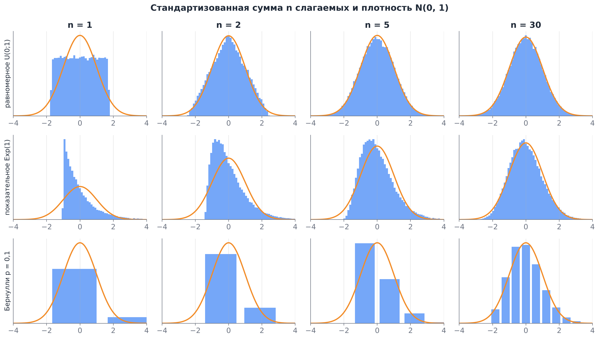

Для равномерных слагаемых нормальная форма видна уже при $n=5$, для показательных нужно $n\approx30$, а для бернуллиевских с $p=0{,}1$ и при $n=30$ видна заметная асимметрия и дискретность.

### 5.2. Почему именно нормальное распределение

**Идея доказательства.** Характеристическая функция $\varphi_X(t)=Ee^{itX}$ суммы независимых величин равна произведению характеристических функций слагаемых. Для $Y=(X-\mu)/\sigma$ разложение Тейлора даёт $\varphi_Y(t)=1-\frac{t^2}{2}+o(t^2)$. Тогда
$$
\varphi_{Z_n}(t)=\left(\varphi_Y\Big(\frac{t}{\sqrt n}\Big)\right)^n=\left(1-\frac{t^2}{2n}+o\Big(\frac1n\Big)\right)^n\to e^{-t^2/2},
$$
а $e^{-t^2/2}$ — характеристическая функция $N(0,1)$. По теореме непрерывности Леви из сходимости характеристических функций следует сходимость распределений. Всё, что осталось от слагаемых в пределе, — их первые два момента: третий и старшие члены разложения имеют порядок $n^{-3/2}$ и меньше и при умножении на $n$ исчезают.

**Устойчивость нормального распределения.** Сумма двух независимых нормальных величин нормальна: $N(\mu_1,\sigma_1^2)+N(\mu_2,\sigma_2^2)=N(\mu_1+\mu_2,\sigma_1^2+\sigma_2^2)$. Поэтому нормальное распределение — «неподвижная точка» операции «сложить и стандартизовать». Это объясняет, почему предел может быть только нормальным, если дисперсия конечна.

**Доска Гальтона.** Шарик падает через $k$ рядов штырьков и на каждом с вероятностью $1/2$ отскакивает вправо. Номер ячейки — число отскоков вправо, то есть сумма $k$ бернуллиевских величин, и распределение шариков по ячейкам близко к нормальному.

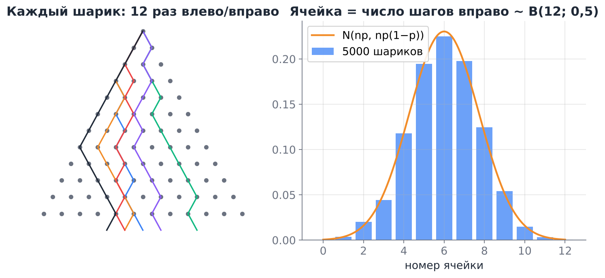

**Почему нормальное распределение встречается в природе.** Рост человека, ошибка измерения, шум датчика складываются из множества мелких независимых влияний. Если ни одно из них не доминирует, сумма приближённо нормальна. Это обобщение ЦПТ на разные распределения слагаемых (теоремы Ляпунова и Линдеберга):

> [!note] ЦПТ для неодинаково распределённых слагаемых (Ляпунов)
> Пусть $X_k$ независимы, $EX_k=\mu_k$, $DX_k=\sigma_k^2$, $B_n^2=\sum_{k=1}^n\sigma_k^2$, и выполнено условие Ляпунова: $\dfrac{1}{B_n^{3}}\sum_{k=1}^n E|X_k-\mu_k|^3\to0$. Тогда $\dfrac{S_n-\sum\mu_k}{B_n}\xrightarrow{d}N(0,1)$.

Смысл условия: вклад каждого отдельного слагаемого в общую дисперсию пренебрежимо мал. Если одно слагаемое доминирует, сумма похожа на него, а не на нормальное распределение.

### 5.3. Теорема Муавра — Лапласа

Применим ЦПТ к числу успехов $S_n\sim B(n,p)$: $\mu=p$, $\sigma^2=p(1-p)$.

> [!note] Интегральная теорема Муавра — Лапласа
> При $n\to\infty$ и фиксированном $0<p<1$
> $$
> P(a\le S_n\le b)\approx\Phi\left(\frac{b-np}{\sqrt{np(1-p)}}\right)-\Phi\left(\frac{a-np}{\sqrt{np(1-p)}}\right).
> $$

> [!note] Локальная теорема Муавра — Лапласа
> $$
> P(S_n=k)\approx\frac{1}{\sqrt{np(1-p)}}\,\varphi\left(\frac{k-np}{\sqrt{np(1-p)}}\right),\qquad\varphi(x)=\frac{1}{\sqrt{2\pi}}e^{-x^2/2}.
> $$

Это исторически первая ЦПТ (Муавр, 1733, для $p=1/2$; Лаплас, 1812, для любого $p$). У Гмурмана обе теоремы формулируются через функцию Лапласа $\Phi_0(x)=\Phi(x)-\frac12$, и тогда $P(a\le S_n\le b)\approx\Phi_0(x_2)-\Phi_0(x_1)$. В Python удобнее $\Phi(x)$ = `stats.norm.cdf(x)`.

**Поправка на непрерывность.** $S_n$ принимает только целые значения, а нормальное распределение непрерывно. Каждому значению $k$ соответствует столбик ширины 1 от $k-0{,}5$ до $k+0{,}5$, поэтому точнее брать
$$
P(a\le S_n\le b)\approx\Phi\left(\frac{b+0{,}5-np}{\sqrt{np(1-p)}}\right)-\Phi\left(\frac{a-0{,}5-np}{\sqrt{np(1-p)}}\right).
$$

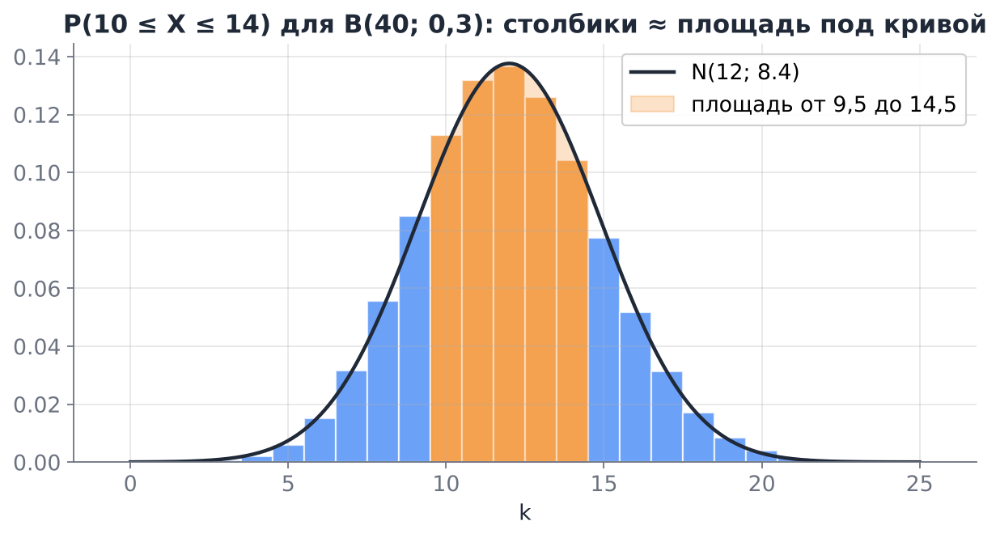

**Пример 1. Монета.** Монету бросают 1 000 раз. Найдём $P(480\le S\le520)$. Здесь $np=500$, $\sqrt{np(1-p)}=\sqrt{250}\approx15{,}81$.

- Без поправки: $2\Phi(20/15{,}81)-1=2\Phi(1{,}265)-1\approx0{,}794$.
- С поправкой: $2\Phi(20{,}5/15{,}81)-1=2\Phi(1{,}297)-1\approx0{,}8052$.
- Точно (`stats.binom`): $0{,}80523$.

Поправка уменьшила ошибку с $0{,}011$ до $0{,}00003$.

**Пример 2. Брак.** Доля брака 2 %, в партии 400 изделий. Найдём вероятность, что бракованных не меньше 12. $np=8$, $\sqrt{np(1-p)}=2{,}8$.

- ЦПТ с поправкой: $P(S\ge12)=P(S>11{,}5)\approx1-\Phi\big((11{,}5-8)/2{,}8\big)=1-\Phi(1{,}25)\approx0{,}106$.
- Пуассон с $\lambda=8$: $0{,}112$.
- Точно: $0{,}110$.

При малом $p$ и умеренном $np$ приближение Пуассона обычно точнее нормального (семинар про схему Бернулли), а нормальное становится хорошим при $np(1-p)\gtrsim10$.

**Пример 3. Сумма времени.** Время обработки запроса имеет показательное распределение со средним 50 мс, $\sigma=50$ мс. Сервер обрабатывает 100 запросов последовательно. Какова вероятность, что это займёт больше 6 секунд?

$ES=5000$ мс, $\sigma_S=50\sqrt{100}=500$ мс. По ЦПТ $P(S>6000)\approx1-\Phi(2)\approx0{,}023$. Точный ответ (сумма показательных имеет гамма-распределение): $0{,}028$. Приближение занижает правый хвост, потому что показательное распределение скошено вправо (раздел 5.5).

```python
from scipy import stats

print(stats.norm.sf(6000, loc=5000, scale=500))     # ЦПТ: 0.0228
print(stats.gamma.sf(6000, a=100, scale=50))         # точно: 0.0279
```

**Пример 4. Кубики.** Бросают 100 кубиков. $ES=350$, $DS=100\cdot\frac{35}{12}\approx291{,}7$, $\sigma_S\approx17{,}08$. Вероятность набрать не меньше 380 очков по ЦПТ с поправкой: $1-\Phi\big((379{,}5-350)/17{,}08\big)=1-\Phi(1{,}727)\approx0{,}0421$. Точно (свёрткой распределений) $0{,}0420$.

### 5.4. Правило «двух сигм» для среднего

Из ЦПТ сразу следуют практические правила для среднего $n$ наблюдений:
$$
P\Big(|\bar X_n-\mu|\le1{,}96\,\frac{\sigma}{\sqrt n}\Big)\approx0{,}95,\qquad P\Big(|\bar X_n-\mu|\le2{,}58\,\frac{\sigma}{\sqrt n}\Big)\approx0{,}99.
$$
Числа $1{,}96$ и $2{,}58$ — квантили $z_{0{,}975}$ и $z_{0{,}995}$ стандартного нормального распределения (`stats.norm.ppf(0.975)`). Это и есть голубой коридор с рисунка в разделе 3.2.

Сравните с Чебышёвым: для любого распределения вне $\pm2\sigma$ лежит до 25 % вероятности. Для **среднего** большой выборки, благодаря ЦПТ, — лишь около 5 %. ЦПТ даёт оценки во много раз точнее, но только приближённые.

### 5.5. Насколько большим должно быть $n$

Классическое правило «$n\ge30$» — грубое. Скорость сходимости зависит от формы слагаемых.

> [!note] Неравенство Берри — Эссеена
> Если $\rho=E|X-\mu|^3<\infty$, то
> $$
> \sup_x\big|P(Z_n\le x)-\Phi(x)\big|\le\frac{C\rho}{\sigma^3\sqrt n},\qquad C<0{,}48.
> $$

Ошибка нормального приближения убывает как $1/\sqrt n$ и тем больше, чем больше $\rho/\sigma^3$ — величина, тесно связанная с асимметрией.

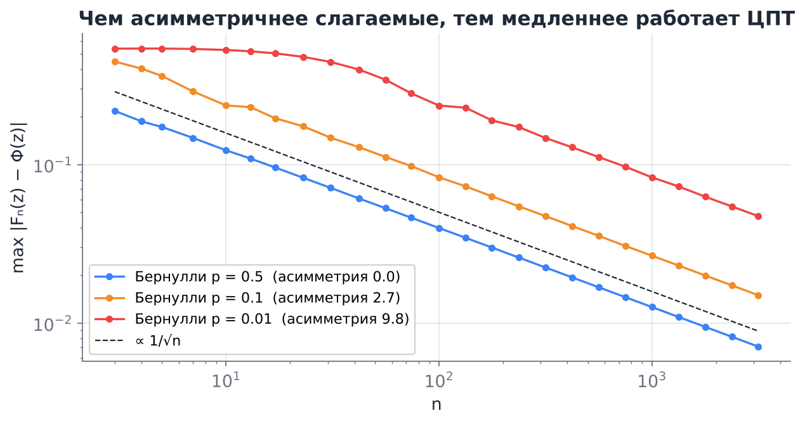

Практические ориентиры:

| Слагаемые | Когда нормальное приближение хорошее |
|---|---|
| симметричные без тяжёлых хвостов (равномерное, кубик) | уже при $n\approx5$–$10$ |
| умеренно скошенные (показательное, логнормальное с малым $\sigma$) | $n\approx30$–$100$; хвосты приближаются хуже центра |
| бернуллиевские | $np(1-p)\ge10$; при $p=0{,}01$ это $n\gtrsim1000$ |
| сильно скошенные (выручка, размер файлов) | сотни и тысячи наблюдений |
| бесконечная дисперсия (Парето $\alpha\le2$, Коши) | ЦПТ не применима (раздел 7.2) |

Проверить нормальность на практике удобно **QQ-графиком**: квантили выборки откладывают против квантилей $N(0,1)$. Если точки лежат на прямой, распределение близко к нормальному.

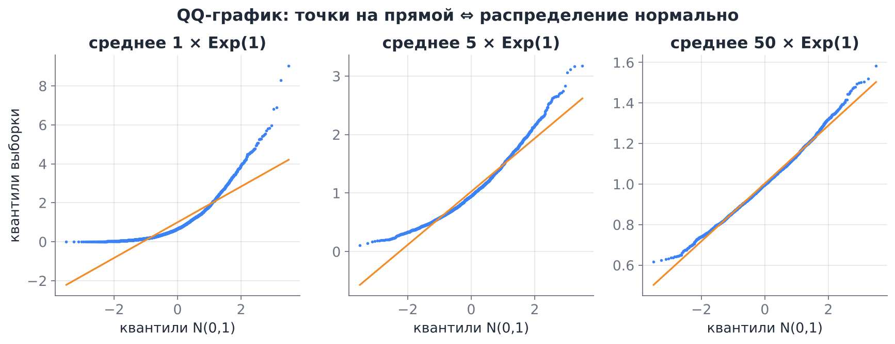

> [!warning] Центр приближается лучше хвостов
> Абсолютная ошибка $|F_n-\Phi|$ мала, но для вероятностей порядка $10^{-3}$ и меньше **относительная** ошибка может быть огромной. ЦПТ не годится для оценки вероятности очень редких событий (крах системы, катастрофический убыток). Для них используют точные распределения, неравенства для больших уклонений или моделирование хвостов.

---

## 6. Влияние размера выборки

### 6.1. Закон $\sqrt n$ и цена точности

Из раздела 4: стандартная ошибка почти любой оценки пропорциональна $1/\sqrt n$. Отсюда два следствия, которые полезно помнить наизусть.

- Чтобы уменьшить погрешность **вдвое**, нужно **вчетверо** больше данных. Чтобы уменьшить в 10 раз — в 100 раз больше.
- Точность зависит от **абсолютного** объёма выборки, а не от доли генеральной совокупности. Опрос 1 000 человек одинаково точен для города в 100 000 жителей и для страны в 140 миллионов (если выборка случайная).

### 6.2. Доверительный интервал

ЦПТ позволяет не только оценить параметр, но и указать диапазон, в котором он, вероятно, лежит. Из $P\big(|\bar X-\mu|\le z\,\sigma/\sqrt n\big)\approx1-\alpha$, где $z=z_{1-\alpha/2}$, получаем:

> [!note] Асимптотический доверительный интервал для среднего
> $$
> \bar x\pm z_{1-\alpha/2}\,\frac{s}{\sqrt n},\qquad\text{для 95 %: } \bar x\pm1{,}96\,\frac{s}{\sqrt n}.
> $$
> Для доли: $\hat p\pm z_{1-\alpha/2}\sqrt{\hat p(1-\hat p)/n}$.

**Как это понимать.** Случаен интервал, а не $\mu$. Если повторять сбор данных много раз и каждый раз строить интервал, около 95 % интервалов накроют истинное $\mu$. Про конкретный интервал нельзя сказать «$\mu$ лежит в нём с вероятностью 95 %» в строгом частотном смысле: $\mu$ либо лежит, либо нет.

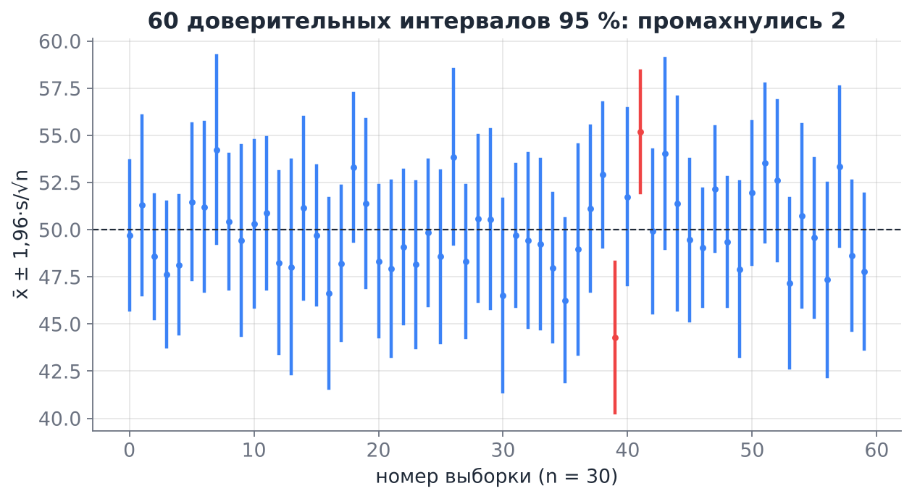

**Пример. Конверсия.** 412 покупок на 8 000 посетителей: $\hat p=0{,}0515$, $SE=\sqrt{0{,}0515\cdot0{,}9485/8000}\approx0{,}00247$. Интервал 95 %: $0{,}0515\pm0{,}0048$, то есть от 4,67 % до 5,63 %.

> [!warning] Малые выборки
> При $n<30$ замена $\sigma$ на $s$ сама вносит заметную ошибку, и вместо $z$ берут квантиль распределения Стьюдента $t_{n-1}$ (`stats.t.ppf(0.975, n - 1)`): при $n=10$ это $2{,}26$ вместо $1{,}96$. Для долей при малых $np$ формула выше плохо работает; лучше интервал Уилсона (`statsmodels.stats.proportion.proportion_confint(method="wilson")`). Подробно это будет в математической статистике.

### 6.3. Сколько данных нужно

Обратная задача: какой $n$ нужен, чтобы погрешность $\pm\varepsilon$ гарантировалась с вероятностью $1-\alpha$?
$$
z_{1-\alpha/2}\frac{\sigma}{\sqrt n}\le\varepsilon\quad\Longrightarrow\quad n\ge\left(\frac{z_{1-\alpha/2}\,\sigma}{\varepsilon}\right)^2.
$$

**Опросы.** Для доли $\sigma^2=p(1-p)\le\frac14$, и худший случай даёт $n\ge\big(\frac{1{,}96}{2\varepsilon}\big)^2$:

| Погрешность | $n$ по ЦПТ | $n$ по Чебышёву ($\alpha=0{,}05$) |
|---|---|---|
| $\pm5$ п. п. | 385 | 2 000 |
| $\pm3$ п. п. | 1 068 | 5 556 |
| $\pm1$ п. п. | 9 604 | 50 000 |

Вот почему социологические опросы обычно опрашивают 1 000–1 600 человек и указывают погрешность «±3 %».

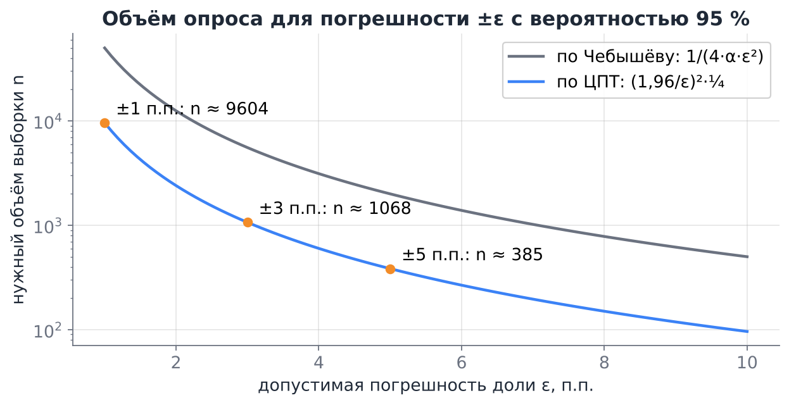

**A/B-тест.** Конверсия 5 %, хотим заметить рост до 5,5 % (на 0,5 п. п.). Разность двух долей имеет $SE=\sqrt{2p(1-p)/n}$ при $n$ посетителях в каждой группе. Если потребовать, чтобы $1{,}96\cdot SE\le0{,}005$, получится $n\approx2\cdot0{,}0475\cdot(1{,}96/0{,}005)^2\approx14\,600$ на группу. С учётом мощности теста (вероятности заметить эффект, когда он есть) обычно выходит около 30 000 на группу. Отсюда правило: маленькие эффекты требуют огромных выборок.

### 6.4. Закон малых чисел и «самая опасная формула»

Формулу $\sigma_{\bar X}=\sigma/\sqrt n$ статистик Говард Уэйнер назвал «самой опасной формулой»: её незнание обходится очень дорого.

**Пример (Уэйнер, 2007).** В США заметили, что среди лучших по результатам тестов школ непропорционально много маленьких. Фонд Гейтса вложил около 1,7 млрд долларов в разделение больших школ на маленькие. Потом оказалось, что среди **худших** школ маленьких тоже непропорционально много. Причина одна: средний балл маленькой школы считается по малому $n$, поэтому сильнее разбросан, и маленькие школы чаще попадают в **оба** хвоста рейтинга.

То же самое с заболеваемостью по районам, рейтингами товаров с тремя отзывами, конверсией кампаний с сотней показов. Канеман и Тверски назвали веру в то, что малые выборки так же репрезентативны, как большие, **законом малых чисел** (это ирония, такого закона нет).

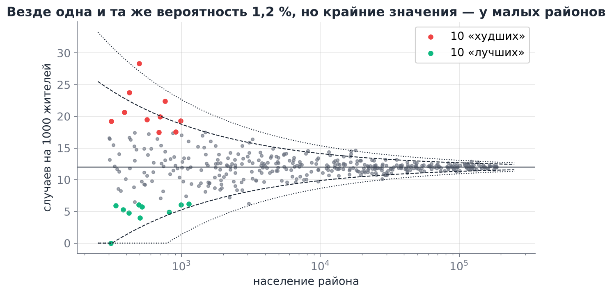

На рисунке 400 районов, и во **всех** одинаковая вероятность заболеть, $p=1{,}2\,\%$. Все 10 «самых опасных» и 10 «самых безопасных» районов — маленькие. Правильный способ смотреть на такие данные — **воронка** (funnel plot): границы $p\pm z\sqrt{p(1-p)/n}$ сужаются с ростом $n$, и подозрительны только точки **вне** воронки, а не просто крайние значения.

> [!tip] Как не попасться
> Прежде чем объяснять, почему у объекта рекордное значение, проверьте, по скольким наблюдениям оно посчитано. Сравнивайте не сами доли, а $z$-оценки $\dfrac{\hat p_i-p}{\sqrt{p(1-p)/n_i}}$, или сортируйте по нижней границе доверительного интервала (так делают рейтинги с отзывами).

---

## 7. Когда ЗБЧ и ЦПТ подводят

### 7.1. Зависимые наблюдения

Формула $D\bar X=\sigma^2/n$ требует некоррелированности. Если соседние наблюдения положительно коррелированы (временные ряды, повторные сессии одного пользователя, ученики одного класса), то
$$
D\bar X=\frac{\sigma^2}{n}\Big(1+\frac2n\sum_{i<j}\rho_{ij}\Big)>\frac{\sigma^2}{n}.
$$
Данные «стоят» меньше, чем их количество. Для ряда $x_t=\varphi x_{t-1}+\text{шум}$ **эффективный объём выборки** $n_{\text{eff}}\approx n\frac{1-\varphi}{1+\varphi}$: при $\varphi=0{,}8$ это $n/9$, и настоящая стандартная ошибка втрое больше наивной $s/\sqrt n$.

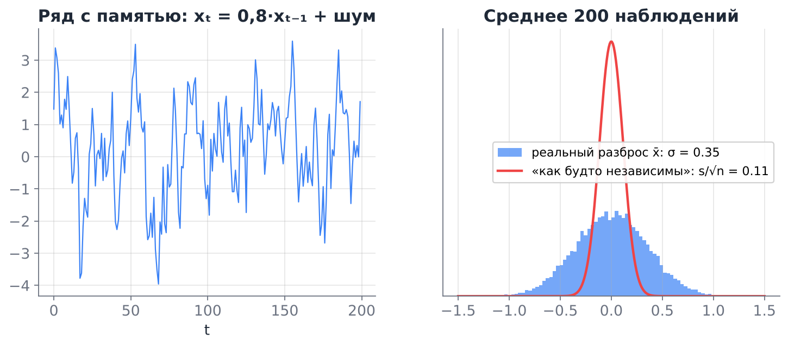

> [!example] Типичная ошибка A/B-тестов
> Метрика — кликабельность (CTR) = клики / просмотры. Один пользователь делает десятки просмотров, и они зависимы (кто-то кликает много, кто-то никогда). Если считать $SE=\sqrt{\hat p(1-\hat p)/n_{\text{просмотров}}}$, интервал получится в несколько раз уже настоящего, и тест будет «находить» эффекты, которых нет. Правильно считать дисперсию по **независимым единицам** — пользователям (через агрегацию по пользователю, дельта-метод или бутстреп по пользователям).

### 7.2. Тяжёлые хвосты

- Если $EX$ не существует (Коши), среднее вообще не сходится (лекция 4).
- Если $EX$ существует, но $DX=\infty$ (например, распределение Парето с $1<\alpha\le2$), ЗБЧ выполняется, а ЦПТ — нет. Среднее сходится медленно и рывками, а распределение средних остаётся скошенным при любом $n$: его предел — не нормальное, а так называемое устойчивое распределение с тяжёлым хвостом.

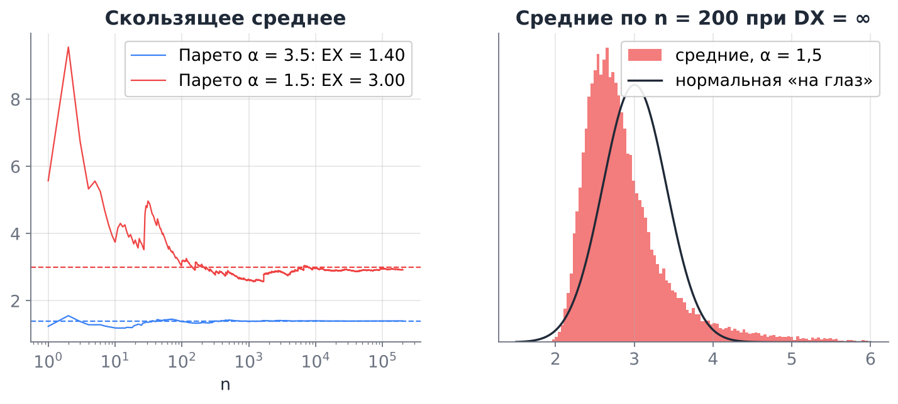

Такие распределения встречаются в данных часто: доход и богатство, размеры городов и файлов, число подписчиков, размер страховых убытков. Признаки — огромная разница между средним и медианой и «скачки» скользящего среднего при появлении новых данных. Что делать: смотреть на медиану и квантили, логарифмировать, отдельно моделировать хвост.

### 7.3. Статистики, которые не являются средними

ЦПТ — теорема про суммы. Максимум, минимум, размах ведут себя иначе: например, максимум $n$ показательных величин растёт как $\ln n$ и после центрирования сходится к распределению Гумбеля, а не к нормальному. Это предмет теории экстремальных значений (расчёт дамб на «наводнение раз в 100 лет», пиковой нагрузки на сервис).

### 7.4. Систематическая ошибка

ЗБЧ гарантирует сходимость к ожиданию **того распределения, из которого реально взяты данные**. Если выборка смещена (опрос только среди тех, кто ответил на звонок; отзывы пишут в основном недовольные; в датасет попали только выжившие компании), то с ростом $n$ мы всё точнее оцениваем **не ту** величину. Большая смещённая выборка хуже маленькой случайной: она даёт узкий доверительный интервал вокруг неверного ответа.

> [!example] Literary Digest, 1936
> Журнал опросил около 2,4 млн читателей и предсказал победу Лэндона над Рузвельтом с отрывом в 14 п. п. Рузвельт выиграл с отрывом в 24 п. п. Гэллап опросил около 50 000 человек случайно и предсказал верно. Списки читателей, владельцев телефонов и автомобилей в 1936 году были богаче среднего избирателя, и никакое $n$ это не исправило.

---

## 8. ЗБЧ и ЦПТ в анализе данных и ML

- **Эмпирический риск.** Модель обучают минимизировать среднюю ошибку на обучающей выборке $\frac1n\sum L(y_i,f(x_i))$, а хотим мы малую **ожидаемую** ошибку $E\,L(Y,f(X))$ на новых данных. По ЗБЧ одно приближает другое при фиксированной модели. Ошибка на тестовой выборке из $n$ объектов — тоже среднее, и её погрешность $\approx s/\sqrt n$: разница точности моделей 0,3 % на тесте из 1 000 объектов ничего не значит.
- **Стохастический градиентный спуск.** Градиент по мини-батчу размера $B$ — выборочное среднее градиентов по объектам. Он несмещён, а его шум по ЦПТ приближённо нормален с разбросом $\propto1/\sqrt B$. Поэтому увеличение батча в 4 раза уменьшает шум градиента только вдвое.
- **Бутстреп.** Чтобы оценить $SE$ сложной статистики (медианы, коэффициента модели, метрики качества), из выборки много раз извлекают выборки с возвращением и смотрят на разброс статистики. Это симуляция выборочного распределения, где неизвестное $F$ заменено на $\hat F_n$; работает благодаря теореме Гливенко — Кантелли.
- **Ансамбли.** Среднее предсказаний $M$ слабо коррелированных моделей имеет меньшую дисперсию (лекция 4). Случайный лес и бэггинг — это ЗБЧ для моделей.
- **Монте-Карло в вероятностных моделях.** Ожидания по сложным распределениям (байесовские апостериорные, награда в RL, ELBO в вариационных автокодировщиках) оценивают средними по сэмплам, с ошибкой $\propto1/\sqrt n$.
- **Инициализация нейросетей.** Предактивация нейрона — сумма многих слагаемых $w_ix_i$, поэтому она приближённо нормальна; на этом основаны схемы инициализации Ксавье и Хе, которые подбирают дисперсию весов так, чтобы дисперсия активаций не росла и не затухала от слоя к слою.

---

## 9. Шпаргалка

**Основные теоремы:**

| | Утверждение | Условия |
|---|---|---|
| ЗБЧ Чебышёва | $P(\lvert\bar X_n-\mu\rvert\ge\varepsilon)\le\dfrac{\sigma^2}{n\varepsilon^2}\to0$ | некоррелированы, $DX_k\le C$ |
| ЗБЧ Бернулли | $S_n/n\xrightarrow{P}p$ | независимые испытания |
| ЗБЧ Хинчина, усиленный ЗБЧ | $\bar X_n\to\mu$ (по вер., п. н.) | н. о. р., $E\lvert X\rvert<\infty$ |
| Гливенко — Кантелли | $\sup\lvert\hat F_n-F\rvert\to0$ | н. о. р. |
| ЦПТ | $\dfrac{S_n-n\mu}{\sigma\sqrt n}\xrightarrow{d}N(0,1)$ | н. о. р., $0<\sigma^2<\infty$ |
| Муавр — Лаплас | $S_n\sim B(n,p)\ \dot\sim\ N(np,\,np(1-p))$ | $np(1-p)\gtrsim10$ |
| Берри — Эссеен | $\sup\lvert F_{Z_n}-\Phi\rvert\le\dfrac{0{,}48\,\rho}{\sigma^3\sqrt n}$ | $E\lvert X\rvert^3<\infty$ |

**Рабочие формулы:**

- $E\bar X=\mu$, $SE(\bar X)=\sigma/\sqrt n$; $SE(\hat p)=\sqrt{p(1-p)/n}$.
- $s^2=\frac{1}{n-1}\sum(x_i-\bar x)^2$ — несмещённая оценка $\sigma^2$.
- Поправка на непрерывность: $P(a\le S\le b)\approx\Phi\big(\frac{b+0{,}5-np}{\sigma}\big)-\Phi\big(\frac{a-0{,}5-np}{\sigma}\big)$.
- Интервал 95 %: $\bar x\pm1{,}96\,s/\sqrt n$; для доли $\hat p\pm1{,}96\sqrt{\hat p(1-\hat p)/n}$.
- Объём выборки: $n\ge(z\sigma/\varepsilon)^2$; для доли в худшем случае $n\ge(z/2\varepsilon)^2$.
- Квантили: $z_{0{,}95}=1{,}645$, $z_{0{,}975}=1{,}96$, $z_{0{,}995}=2{,}576$.
- Зависимость: $n_{\text{eff}}\approx n(1-\varphi)/(1+\varphi)$ для AR(1).

**Python:** `stats.norm.cdf/sf/ppf`, `stats.binom.cdf/sf`, `stats.poisson.sf`, `stats.probplot` (QQ-график), `np.cumsum(x) / np.arange(1, n + 1)` (скользящее среднее), `x.std(ddof=1) / np.sqrt(n)` (стандартная ошибка), `rng.choice(x, size=(B, n), replace=True)` (бутстреп).

---

## 10. Вопросы для самопроверки

1. Чем сходимость по вероятности отличается от сходимости по распределению? О какой из них говорят ЗБЧ и ЦПТ?
2. Выведите ЗБЧ Бернулли из неравенства Чебышёва. Сколько бросков монеты гарантирует по Чебышёву, что частота отличается от $1/2$ меньше чем на 0,01 с вероятностью не менее 0,99? *Ответ:* $n\ge\frac{1/4}{0{,}01\cdot0{,}01^2}=250\,000$.
3. Ту же задачу решите по ЦПТ. *Ответ:* $n\ge(2{,}576/0{,}02)^2\approx16\,590$.
4. После 10 решек подряд игрок ставит на орла, «потому что по закону больших чисел орлы должны догнать». В чём ошибка?
5. Почему у $\frac{1}{n}\sum(x_i-\bar x)^2$ есть смещение, а у $\frac{1}{n}\sum(x_i-\mu)^2$ нет?
6. Почему среднее нормальной выборки эффективнее медианы, а для выборки из распределения Коши — наоборот?
7. В партии 10 000 лампочек, каждая независимо бракованная с вероятностью 0,05. Оцените вероятность, что бракованных больше 540. *Ответ:* $\sigma=\sqrt{475}\approx21{,}8$, $P\approx1-\Phi\big((540{,}5-500)/21{,}8\big)=1-\Phi(1{,}86)\approx0{,}032$.
8. Время ответа сервиса: среднее 120 мс, $\sigma=80$ мс. Найдите приближённо вероятность, что среднее по 64 запросам превысит 140 мс. Почему ответ ЦПТ здесь, скорее всего, немного занижен? *Ответ:* $1-\Phi(2)\approx0{,}023$; распределение времени скошено вправо.
9. Опрос 1 200 человек: 54 % «за». Постройте 95 %-ный доверительный интервал. Можно ли утверждать, что «за» большинство? *Ответ:* $0{,}54\pm0{,}028$, то есть $[0{,}512;\ 0{,}568]$; да, интервал целиком выше 0,5.
10. Почему точность опроса почти не зависит от размера страны?
11. Самая высокая заболеваемость в стране — в деревне на 300 жителей. Какой вопрос нужно задать прежде, чем искать причину?
12. Суточные данные о продажах сильно коррелированы с предыдущим днём. Почему $s/\sqrt n$ недооценивает погрешность среднего?
13. Для каких из величин применима ЦПТ при большом $n$: сумма доходов $n$ случайных людей; максимум из $n$ времён ответа; доля кликов по $n$ пользователям; среднее $n$ величин Коши?
14. Модель A на тесте из 2 000 объектов даёт точность 91,2 %, модель B — 90,6 %. Можно ли уверенно сказать, что A лучше? *Подсказка:* $SE$ точности около $\sqrt{0{,}91\cdot0{,}09/2000}\approx0{,}64$ п. п.

---

## Литература

- **Гмурман В. Е.** Теория вероятностей и математическая статистика. — гл. 4 (локальная и интегральная теоремы Лапласа, оценка отклонения частоты), гл. 9 (закон больших чисел: неравенство Чебышёва, теоремы Чебышёва и Бернулли), гл. 12 (нормальное распределение, понятие о теореме Ляпунова), гл. 15–16 (выборочный метод, эмпирическая функция распределения, статистические оценки, доверительные интервалы).
- **Мёрфи К. П.** Вероятностное машинное обучение: введение. — разд. 2.8 (преобразования случайных величин, центральная предельная теорема, приближение Монте-Карло), 4.7 (частотная статистика: выборочное распределение, бутстреп, доверительные интервалы).
- **Дайзенрот М. П., Фейзал А. А., Он Ч. С.** Математика для машинного обучения. — разд. 6.4 (эмпирические среднее и дисперсия, суммы независимых величин), 6.5 (нормальное распределение), 8.2 (минимизация эмпирического риска).
- **Николенко С., Кадурин А., Архангельская Е.** Глубокое обучение. Погружение в мир нейронных сетей. — разделы о стохастическом градиентном спуске и мини-батчах, об инициализации весов.
- **Савелова Т. И.** Метод Монте-Карло. — основы метода, оценка погрешности через ЦПТ.
- **Wainer H.** The Most Dangerous Equation // American Scientist. 2007. Vol. 95, № 3. — пример с маленькими школами и воронки.
