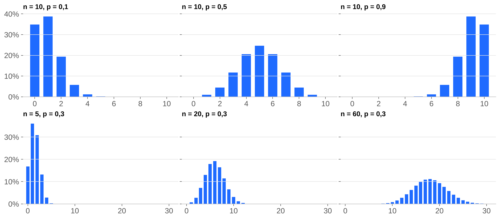
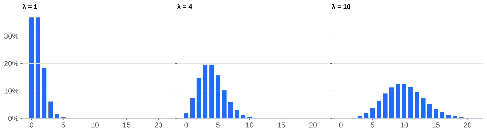
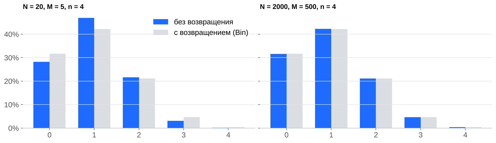
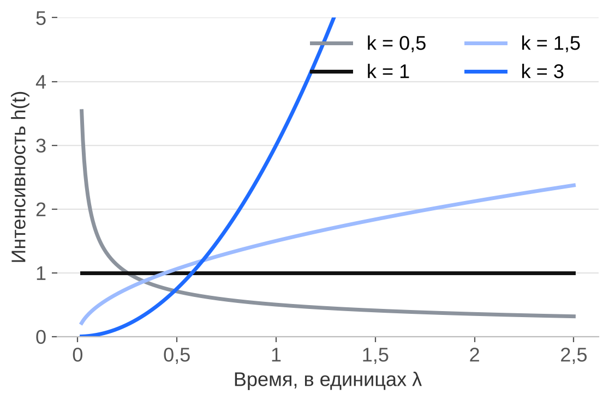
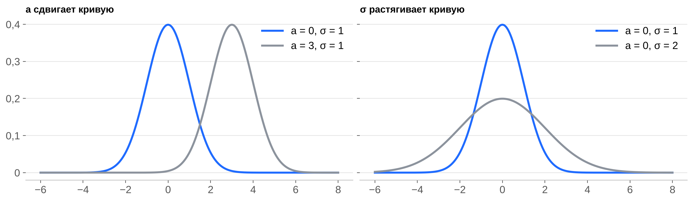
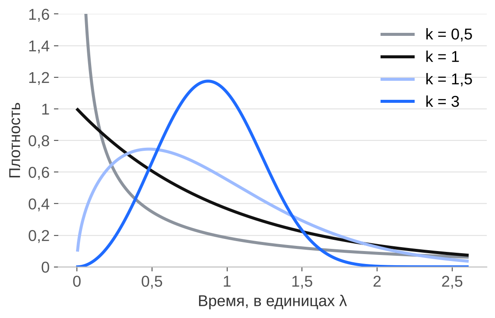
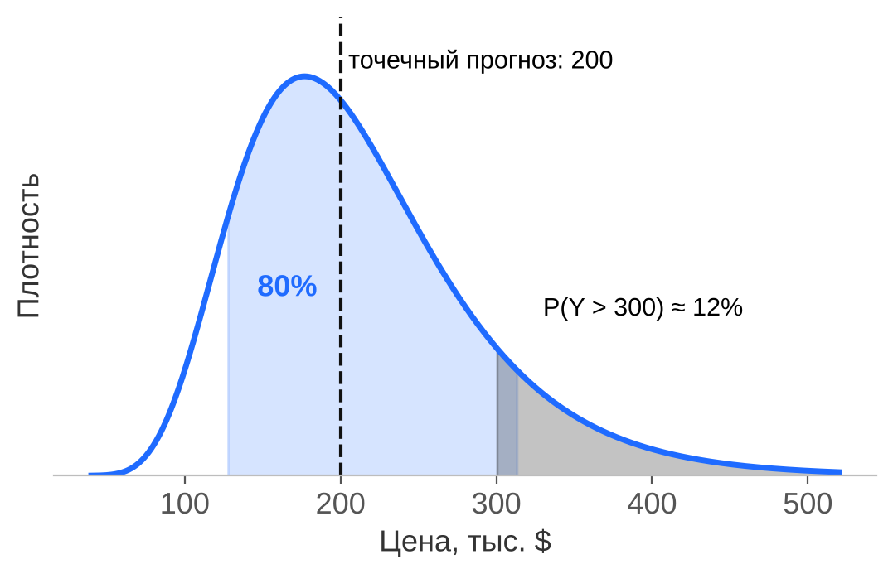
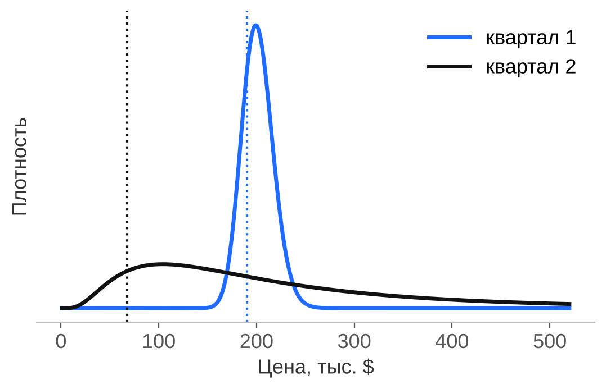
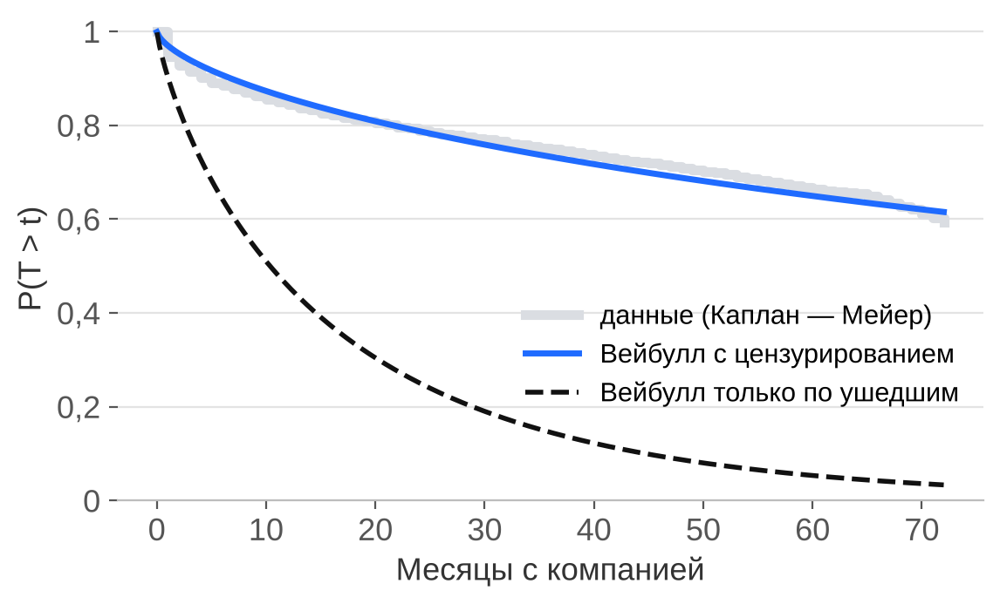

# Лекция 6. Основные распределения

> Группа **17-25-2**. Презентация: `06_distributions-17-25-2.pptx`. Тетрадка с примерами: `../attachments/06-lecture-distributions-17-25-2.ipynb`.

Обозначения: $E(X)$ — математическое ожидание, $\mathrm{Var}(X)$ — дисперсия, $\sigma(X)=\sqrt{\mathrm{Var}(X)}$, $q=1-p$, $F(x)=P(X<x)$. У Гмурмана матожидание и дисперсия обозначены $M(X)$ и $D(X)$.

## Зачем знать готовые распределения

Случайные величины в задачах устроены похоже. Число бракованных деталей в партии, число вызовов за час, время работы прибора до отказа повторяются в разных областях. Для типовых ситуаций есть готовые **семейства распределений**. Семейство задаёт формулу вероятностей, а **параметры** ($n$, $p$, $\lambda$, $a$, $\sigma$, $k$) настраивают её под конкретную задачу. Запись $X\sim\mathrm{Bin}(n,p)$ читается «$X$ имеет биномиальное распределение с параметрами $n$ и $p$».

Семейство выбирают по устройству опыта: что считаем или измеряем и какие условия выполнены.

| Вопрос | Распределение |
|---|---|
| Сколько бракованных среди 10 деталей? | Биномиальное |
| Сколько вызовов придёт за час? | Пуассона |
| Какая по счёту деталь первой окажется бракованной? | Геометрическое |
| Сколько бракованных среди 4 деталей, взятых из партии 20 без возвращения? | Гипергеометрическое |
| Какова ошибка округления по шкале? | Равномерное |
| Сколько часов прибор проработает до отказа? | Показательное или Вейбулла |
| Насколько диаметр отклонится от номинала? | Нормальное |

---

## Часть 1. Дискретные распределения

Дискретная величина принимает отдельные значения (обычно целые). Закон задаётся рядом: значения и их вероятности, сумма вероятностей равна 1.

### 1.1. Дискретное равномерное $U\{1,\dots,n\}$

Значения $1,2,\dots,n$ равновероятны.

$$P(X=k)=\frac1n,\qquad E(X)=\frac{n+1}{2},\qquad \mathrm{Var}(X)=\frac{n^2-1}{12}.$$

**Пример.** Игральная кость: $n=6$, $E(X)=3{,}5$, $\mathrm{Var}(X)=35/12\approx2{,}92$. Матожидание 3,5 не является возможным значением: это центр масс ряда.

### 1.2. Биномиальное $\mathrm{Bin}(n,p)$

Число успехов в $n$ независимых испытаниях, в каждом из которых успех наступает с одной и той же вероятностью $p$.

$$P(X=k)=C_n^k\,p^k q^{\,n-k},\quad k=0,1,\dots,n,\qquad E(X)=np,\qquad \mathrm{Var}(X)=npq.$$

Условия модели: число испытаний известно заранее, испытания независимы, $p$ одно и то же.

**Почему $E(X)=np$ и $\mathrm{Var}(X)=npq$.** Запишем $X=I_1+\dots+I_n$, где $I_j=1$, если $j$-е испытание успешно, и $0$ иначе. Для одного испытания $E(I_j)=p$, $\mathrm{Var}(I_j)=p-p^2=pq$. Матожидания складываются всегда, дисперсии — потому что испытания независимы.

**Наивероятнейшее число успехов** $k_0$ — значение с наибольшей вероятностью:

$$np-q\ \le\ k_0\ \le\ np+p.$$

Откуда границы: $k_0$ должно быть не менее вероятно, чем соседи. Из $P(X=k_0)\ge P(X=k_0-1)$ получаем $k_0\le np+p$, из $P(X=k_0)\ge P(X=k_0+1)$ — $k_0\ge np-q$. Длина отрезка $p+q=1$, поэтому внутри одно целое число (два, если концы целые).

**Пример.** ОТК проверяет 10 деталей, каждая бракованная с вероятностью 0,1. Партию возвращают, если брака 2 детали и больше.

$$P(X\ge2)=1-0{,}9^{10}-10\cdot0{,}1\cdot0{,}9^{9}\approx0{,}264,\qquad E(X)=1,\quad \mathrm{Var}(X)=0{,}9,\quad k_0=1.$$

При $p=0{,}5$ ряд симметричен, при малом $p$ прижат к нулю, при большом — к $n$. С ростом $n$ ряд становится похож на колокол.

### 1.3. Распределение Пуассона $\mathrm{Pois}(\lambda)$

Число редких независимых событий за промежуток времени (или на участке площади, длины). $\lambda$ — среднее число событий за этот промежуток.

$$P(X=k)=\frac{\lambda^k}{k!}e^{-\lambda},\quad k=0,1,2,\dots,\qquad E(X)=\lambda,\qquad \mathrm{Var}(X)=\lambda.$$

Матожидание и дисперсия равны. Это быстрая проверка на данных: если дисперсия числа событий намного больше среднего, события приходят группами, и закон Пуассона не подходит.

**Пример.** В среднем за час поступает 3 вызова, дежурный справляется с четырьмя.

$$P(X\ge5)=1-\sum_{k=0}^{4}\frac{3^k}{k!}e^{-3}\approx0{,}185.$$

**Пуассон как предел биномиального.** Если $n$ велико, а $p$ мало, то $\mathrm{Bin}(n,p)\approx\mathrm{Pois}(np)$. Пример: отправлено 5000 изделий, каждое повреждается с вероятностью 0,0002; $\lambda=1$, $P(X=3)\approx e^{-1}/3!\approx0{,}0613$.

### 1.4. Геометрическое $\mathrm{Geom}(p)$

Номер первого успеха в серии независимых испытаний с вероятностью успеха $p$.

$$P(X=k)=q^{\,k-1}p,\quad k=1,2,\dots,\qquad P(X>k)=q^{\,k},\qquad E(X)=\frac1p,\qquad \mathrm{Var}(X)=\frac{q}{p^2}.$$

**Пример.** Стрелок попадает с вероятностью 0,3. $P(X=3)=0{,}7^2\cdot0{,}3\approx0{,}147$, $E(X)\approx3{,}33$, $\sigma\approx2{,}8$.

**Отсутствие памяти:** $P(X>m+k\mid X>m)=P(X>k)$. Пять промахов подряд не приближают попадание.

### 1.5. Гипергеометрическое $\mathrm{HG}(N,M,n)$

В партии $N$ деталей, из них $M$ бракованных. Берём $n$ деталей **без возвращения**, $X$ — число бракованных среди взятых.

$$P(X=k)=\frac{C_M^k\,C_{N-M}^{\,n-k}}{C_N^n},\qquad E(X)=n\frac MN,\qquad \mathrm{Var}(X)=n\frac MN\left(1-\frac MN\right)\frac{N-n}{N-1}.$$

**Пример.** $N=20$, $M=5$, $n=4$: $P(X=0)=C_{15}^4/C_{20}^4\approx0{,}282$, $E(X)=1$, $\mathrm{Var}(X)\approx0{,}63$.

Матожидание такое же, как у $\mathrm{Bin}(n, M/N)$, а дисперсия меньше в $\frac{N-n}{N-1}$ раз. Если выборка составляет малую долю партии (до 5 %), гипергеометрическое заменяют биномиальным.

### Сводная таблица дискретных законов

| Закон | Значения | $P(X=k)$ | $E(X)$ | $\mathrm{Var}(X)$ |
|---|---|---|---|---|
| $U\{1,\dots,n\}$ | $1,\dots,n$ | $1/n$ | $(n+1)/2$ | $(n^2-1)/12$ |
| $\mathrm{Bin}(n,p)$ | $0,\dots,n$ | $C_n^kp^kq^{n-k}$ | $np$ | $npq$ |
| $\mathrm{Pois}(\lambda)$ | $0,1,2,\dots$ | $\lambda^ke^{-\lambda}/k!$ | $\lambda$ | $\lambda$ |
| $\mathrm{Geom}(p)$ | $1,2,\dots$ | $q^{k-1}p$ | $1/p$ | $q/p^2$ |
| $\mathrm{HG}(N,M,n)$ | $0,\dots,\min(n,M)$ | $C_M^kC_{N-M}^{n-k}/C_N^n$ | $nM/N$ | $n\frac MN\left(1-\frac MN\right)\frac{N-n}{N-1}$ |

---

## Часть 2. Непрерывные распределения

Для непрерывной величины вероятность интервала равна площади под плотностью $f(x)$, вероятность отдельной точки равна нулю.

### 2.1. Равномерное $U(a,b)$

Значение внутри отрезка $[a;b]$, ни одно значение не предпочтительнее.

$$f(x)=\frac1{b-a},\quad F(x)=\frac{x-a}{b-a}\ \ (a\le x\le b),\qquad E(X)=\frac{a+b}2,\qquad \mathrm{Var}(X)=\frac{(b-a)^2}{12}.$$

**Пример.** Цена деления амперметра 0,1 А, показание округляют до ближайшего деления. Ошибка $X\sim U(-0{,}05;\,0{,}05)$. $P(|X|>0{,}02)=0{,}06/0{,}1=0{,}6$, $\sigma=0{,}1/\sqrt{12}\approx0{,}029$ А.

### 2.2. Показательное (экспоненциальное) $\mathrm{Exp}(\lambda)$

Время до события при постоянной интенсивности $\lambda$: элемент «не стареет».

$$f(t)=\lambda e^{-\lambda t},\quad F(t)=1-e^{-\lambda t}\ \ (t\ge0),\qquad E(T)=\frac1\lambda,\qquad \mathrm{Var}(T)=\frac1{\lambda^2}.$$

**Пример.** Элемент отказывает с интенсивностью 0,02 в час. $P(T>100)=e^{-2}\approx0{,}135$, $E(T)=50$ ч. Функцию $R(t)=P(T>t)$ называют функцией надёжности.

**Отсутствие памяти:** $P(T>s+t\mid T>s)=P(T>t)$. Элемент, проработавший 50 часов, так же надёжен, как новый.

**Связь с Пуассоном.** Если события идут простейшим потоком с интенсивностью $\lambda$, то число событий за время $t$ имеет распределение $\mathrm{Pois}(\lambda t)$, а время до первого события — $\mathrm{Exp}(\lambda)$.

### 2.3. Интенсивность отказов

$$h(t)=\frac{f(t)}{1-F(t)}.$$

$h(t)$ показывает, насколько вероятен отказ в ближайший момент для элемента, который проработал до момента $t$. У показательного закона $h(t)=\lambda$ постоянна. Растущая $h(t)$ означает износ, убывающая — приработку.

### 2.4. Нормальное $N(a,\sigma^2)$

Сумма многих мелких независимых влияний: ошибки измерения, размеры деталей, рост, масса.

$$f(x)=\frac1{\sigma\sqrt{2\pi}}\,e^{-\frac{(x-a)^2}{2\sigma^2}},\qquad E(X)=a,\qquad \mathrm{Var}(X)=\sigma^2.$$

$a$ сдвигает кривую, $\sigma$ растягивает её.

**Вероятность интервала** через функцию Лапласа $\Phi(x)$ ($\Phi(-x)=-\Phi(x)$, при $x\ge4$ $\Phi(x)\approx0{,}5$):

$$P(\alpha<X<\beta)=\Phi\!\left(\frac{\beta-a}\sigma\right)-\Phi\!\left(\frac{\alpha-a}\sigma\right),\qquad P(|X-a|<\delta)=2\Phi\!\left(\frac\delta\sigma\right).$$

**Пример.** Диаметр детали: $a=20$ мм, $\sigma=0{,}1$ мм, допуск $20\pm0{,}2$ мм. $P(|X-20|<0{,}2)=2\Phi(2)\approx0{,}954$: в брак уходит около 4,6 % деталей.

**Правило трёх сигм:** $P(|X-a|<\sigma)\approx0{,}683$, $P(|X-a|<2\sigma)\approx0{,}954$, $P(|X-a|<3\sigma)\approx0{,}997$.

### 2.5. Распределение Вейбулла $\mathrm{Weib}(k,\lambda)$

Время до отказа, когда опасность отказа растёт (износ) или убывает (приработка). $k>0$ — параметр формы, $\lambda>0$ — масштаб.

$$F(t)=1-e^{-(t/\lambda)^k}\ (t\ge0),\qquad h(t)=\frac k\lambda\left(\frac t\lambda\right)^{k-1},$$

$$E(T)=\lambda\,\Gamma\!\left(1+\frac1k\right),\qquad \mathrm{Var}(T)=\lambda^2\left[\Gamma\!\left(1+\frac2k\right)-\Gamma^2\!\left(1+\frac1k\right)\right].$$

$\Gamma$ — гамма-функция, продолжение факториала: $\Gamma(m+1)=m!$. Значения берут из таблиц или из компьютера (`scipy.special.gamma`).

- $k<1$: $h(t)$ убывает, приработка (отказывают элементы с дефектом).
- $k=1$: показательный закон, старения нет.
- $k>1$: $h(t)$ растёт, износ.

**Пример.** Ресурс подшипника: $k=1{,}5$, $\lambda=1000$ ч. $P(T>500)=e^{-0{,}5^{1{,}5}}\approx0{,}70$, но $P(T>1000\mid T>500)\approx0{,}52$: подшипник стареет. $E(T)\approx903$ ч.

Где встречается: ресурс подшипников, двигателей, шин; прочность материалов; скорость ветра ($k\approx2$); время, которое клиент пробудет с компанией.

### Сводная таблица непрерывных законов

| Закон | Значения | $E(X)$ | $\mathrm{Var}(X)$ |
|---|---|---|---|
| $U(a,b)$ | $[a;b]$ | $(a+b)/2$ | $(b-a)^2/12$ |
| $\mathrm{Exp}(\lambda)$ | $[0;+\infty)$ | $1/\lambda$ | $1/\lambda^2$ |
| $N(a,\sigma^2)$ | $(-\infty;+\infty)$ | $a$ | $\sigma^2$ |
| $\mathrm{Weib}(k,\lambda)$ | $[0;+\infty)$ | $\lambda\Gamma(1+1/k)$ | $\lambda^2[\Gamma(1+2/k)-\Gamma^2(1+1/k)]$ |

### Как выбрать семейство

| Устройство величины | Семейство |
|---|---|
| Значения равновероятны | Равномерное |
| Число успехов в $n$ опытах | Биномиальное |
| Успехи в выборке без возвращения | Гипергеометрическое |
| Число редких событий за промежуток | Пуассона |
| Номер первого успеха | Геометрическое |
| Время до события без старения | Показательное |
| Время до отказа с износом или приработкой | Вейбулла |
| Сумма многих малых влияний | Нормальное |
| Произведение многих множителей, положительная величина с длинным хвостом | Логнормальное |

---

## Часть 3. Прогноз распределением

### Откуда берутся параметры

В задачах параметры даны. На практике их оценивают по данным, и часто они зависят от объекта: средний спрос в маленьком магазине и в гипермаркете разный. Тогда модель машинного обучения предсказывает не одно число, а **параметры распределения** для каждого объекта $x$:

$$Y\mid x\ \sim\ \text{Семейство}(\theta(x)).$$

Из распределения получают всё, что нужно для решения: среднее, интервал, вероятность превысить порог, квантиль для запаса.

### Логнормальное распределение

$Y$ логнормальна, если $\ln Y\sim N(\mu,\sigma^2)$. Такая величина положительна и имеет длинный правый хвост: цены, доходы, время выполнения заказа.

$$\mathrm{Me}=e^{\mu},\qquad E(Y)=e^{\mu+\sigma^2/2},\qquad \mathrm{Var}(Y)=\left(e^{\sigma^2}-1\right)e^{2\mu+\sigma^2}.$$

### Кейс «Цена жилья»

Перепись Калифорнии 1990 года, 19 448 кварталов. Модель предсказывает для каждого квартала $\mu(x)$ и $\sigma(x)$ логнормального закона цены. Лучшая модель — два градиентных бустинга: первый предсказывает $\mu(x)$, второй — $\sigma(x)$. Она даёт 80 %-ные интервалы, которые действительно накрывают цену в 81 % случаев, и они втрое уже, чем у модели без признаков. Для двух кварталов с одинаковым точечным прогнозом модель может выдать очень разную неопределённость.

### Кейс «Отток клиентов»

Данные телеком-оператора IBM Telco, 7032 клиента. $T$ — сколько месяцев клиент пробудет с компанией. Для ушедших клиентов $T$ известно, для оставшихся известно только, что $T$ не меньше текущего срока (**цензурирование**). Их нельзя выбрасывать: в расчёт ушедшие входят плотностью $f(t_i)$, оставшиеся — вероятностью $P(T>t_i)$.

Модель предсказывает параметры Вейбулла $k(x)$ и $\lambda(x)$ для каждого клиента. Без договора $k\approx0{,}8$ (чаще уходят новые клиенты), с договором $k\approx2$–$3$ (уходят ближе к концу срока).

### Когда нужен прогноз распределением

- цена ошибки в разные стороны разная (сколько товара завезти);
- решение зависит от порога (залог дешевле суммы кредита);
- нужно что-то пообещать (срок доставки — верхний квантиль, а не среднее);
- для разных объектов прогноз надёжен по-разному;
- данные цензурированы (отток, ресурс техники);
- прогнозы потом складывают (для суммы нужны дисперсии).

---

## Вопросы для самопроверки

1. Почему в формуле наивероятнейшего числа справа стоит $p$, а слева $q$?
2. В партии 1000 деталей, из них 50 бракованных, берём 10. Каким законом можно заменить гипергеометрический и почему?
3. За 5 минут в среднем приходит 2 покупателя. Какое распределение у числа покупателей за 15 минут и какой у него параметр?
4. Чем отличаются $P(T>100)$ и $P(T>150\mid T>50)$ для показательного закона? А для закона Вейбулла с $k=2$?
5. Почему для цены квартиры логнормальный закон лучше нормального?
6. Почему нельзя обучать модель оттока только на ушедших клиентах?

## Что почитать

- В. Е. Гмурман. Теория вероятностей и математическая статистика. Глава 6 (дискретные законы), глава 12 (нормальное распределение), глава 13 (показательное распределение и надёжность).
- К. Мэрфи. Вероятностное машинное обучение. Глава 2.
