# Лекция 7. Закон больших чисел и центральная предельная теорема

> Презентация: `07_lln-clt.pptx`. Тетрадка с демонстрациями: `../attachments/07-lecture-lln-clt.ipynb`. Короткий конспект: `07_lln-clt-short.md`.

Обозначения: $E(X)$ — математическое ожидание, $\mathrm{Var}(X)$ — дисперсия, $\sigma=\sqrt{\mathrm{Var}(X)}$ — среднее квадратическое отклонение, $q=1-p$. $\Phi(x)$ — функция Лапласа:

$$\Phi(x)=\frac{1}{\sqrt{2\pi}}\int_0^x e^{-t^2/2}\,dt,\qquad \Phi(-x)=-\Phi(x),\qquad \Phi(1)\approx0{,}341,\ \ \Phi(2)\approx0{,}477,\ \ \Phi(3)\approx0{,}4987.$$

## Зачем эта лекция

Одно наблюдение случайно и может оказаться каким угодно. Среднее многих наблюдений почти не случайно: средний чек за месяц, доля брака в большой партии, урожайность большого поля меняются мало. Сегодня отвечаем на три вопроса.

1. **Что можно гарантировать, зная только $E(X)$ и $\mathrm{Var}(X)$?** Неравенства Маркова и Чебышёва.
2. **Куда сходится среднее и как быстро?** Закон больших чисел (ЗБЧ).
3. **Как именно разбросано среднее вокруг своего предела?** Центральная предельная теорема (ЦПТ).

### Вступительный пример: где болеют реже всего

Исследователи посчитали частоту редкой болезни в 3 000 районах. Районы с самой низкой частотой оказались в основном сельскими и малонаселёнными. Первая мысль — чистый воздух, меньше стресса, натуральная еда. Но и районы с самой **высокой** частотой — тоже маленькие.

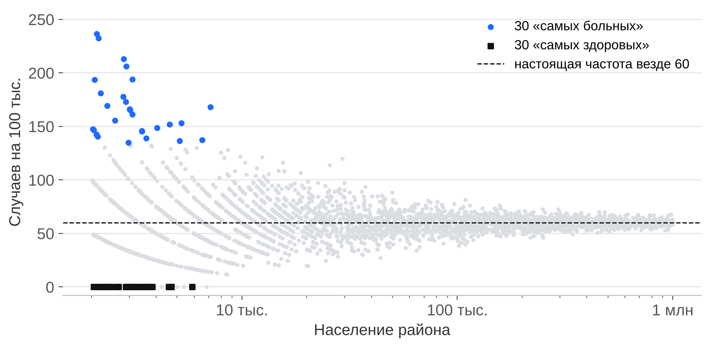

На рисунке симуляция: настоящая частота во всех районах одинаковая, 60 случаев на 100 тыс. жителей. Все 60 крайних мест рейтинга, и «здоровые», и «больные», заняли районы меньше 20 тыс. жителей. Частота в маленьком районе посчитана по маленькой выборке, поэтому она сильнее шумит и чаще оказывается на краях. Пример основан на реальном исследовании рака почки по округам США (Х. Уэйнер, Д. Канеман). В конце части 2 мы точно скажем, насколько шумит частота.

---

## Часть 1. Неравенства Маркова и Чебышёва

### 1.1. Неравенство Маркова

**Вопрос.** Средняя зарплата на предприятии — 100 тыс. руб. Какая наибольшая доля сотрудников может получать 500 тыс. руб. и больше? Распределение зарплат неизвестно, известно только среднее.

**Теорема (неравенство Маркова).** Если $X\ge0$, то для любого $a>0$

$$P(X\ge a)\le\frac{E(X)}{a}.$$

**Доказательство** для дискретной величины со значениями $x_i\ge0$ и вероятностями $p_i$:

$$E(X)=\sum_i x_ip_i\ \ge\ \sum_{x_i\ge a}x_ip_i\ \ge\ \sum_{x_i\ge a}a\,p_i\ =\ a\cdot P(X\ge a).$$

* Первый шаг: отбросили слагаемые с $x_i<a$. Они неотрицательны, потому что $X\ge0$, значит сумма могла только уменьшиться.
* Второй шаг: в оставшихся слагаемых $x_i\ge a$, заменили $x_i$ на $a$ — сумма опять могла только уменьшиться.

Осталось разделить на $a$. Для непрерывной величины с плотностью $f(x)$ рассуждение то же, с интегралом:

$$E(X)=\int_0^{\infty}xf(x)\,dx\ \ge\ \int_a^{\infty}xf(x)\,dx\ \ge\ a\int_a^{\infty}f(x)\,dx=a\cdot P(X\ge a).$$

**Ответ на вопрос:** $P(X\ge500)\le100/500=20\%$. Это верно для любого распределения зарплат.

### 1.2. Почему граница Маркова грубая

Граница 20% достигается, только если 80% сотрудников получают 0, а 20% — ровно 500 тыс. руб.: среднее как раз $0{,}2\cdot500=100$. Значит, улучшить неравенство нельзя, если о законе ничего не известно. Но для реальных законов вероятность намного меньше. Если зарплаты распределены показательно со средним 100, то

$$P(X\ge500)=e^{-500/100}=e^{-5}\approx0{,}67\%.$$

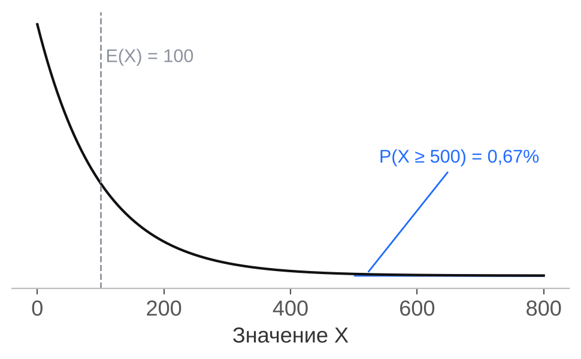

Смысл неравенства: неотрицательная величина не может часто уходить далеко от своего среднего, иначе среднее было бы больше.

### 1.3. Неравенство Чебышёва

**Теорема (неравенство Чебышёва).** Для любой величины с конечной дисперсией и любого $\varepsilon>0$

$$P(|X-E(X)|\ge\varepsilon)\le\frac{\mathrm{Var}(X)}{\varepsilon^2},\qquad\text{или, что то же,}\qquad P(|X-E(X)|<\varepsilon)\ge1-\frac{\mathrm{Var}(X)}{\varepsilon^2}.$$

**Доказательство** — применим неравенство Маркова к подходящей неотрицательной величине.

1. Возьмём $Y=(X-E(X))^2$. Это квадрат, поэтому $Y\ge0$. Его среднее по определению дисперсии $E(Y)=\mathrm{Var}(X)$.
2. Обе части неравенства $|X-E(X)|\ge\varepsilon$ неотрицательны, их можно возвести в квадрат: событие $|X-E(X)|\ge\varepsilon$ совпадает с событием $Y\ge\varepsilon^2$.
3. Неравенство Маркова для $Y$ с порогом $a=\varepsilon^2$:

$$P(|X-E(X)|\ge\varepsilon)=P(Y\ge\varepsilon^2)\le\frac{E(Y)}{\varepsilon^2}=\frac{\mathrm{Var}(X)}{\varepsilon^2}.$$

Вторая форма получается переходом к противоположному событию.

### 1.4. Чебышёв «в сигмах»

Подставим $\varepsilon=k\sigma$:

$$P(|X-E(X)|\ge k\sigma)\le\frac{1}{k^2}.$$

| Отклонение от $E(X)$ | $1{,}5\sigma$ | $2\sigma$ | $3\sigma$ |
|---|---|---|---|
| Чебышёв: не больше | 44% | 25% | 11% |
| Нормальный закон на самом деле | 13% | 4,6% | 0,27% |

Для нормального закона правило трёх сигм даёт 0,27%, а Чебышёв гарантирует только «не больше 11%». Неравенство обязано работать для любого закона с данной $\sigma$, даже для самого неудобного, где весь «хвост» сидит ровно на границе. Зато оно не требует знать форму распределения, и из него в одну строку получается закон больших чисел.

**Задача «Фасовка».** Средняя масса пакета с крупой 1000 г, $\sigma=10$ г. Оцените вероятность того, что масса пакета отличается от 1000 г меньше чем на 20 г.

$$P(|X-1000|<20)\ge1-\frac{10^2}{20^2}=1-\frac{100}{400}=0{,}75.$$

Если известно, что масса распределена нормально, ответ точный:

$$P(|X-1000|<20)=2\Phi\left(\frac{20}{10}\right)=2\Phi(2)\approx0{,}954.$$

Чебышёв даёт «не меньше 75%» для любого закона, знание формы даёт 95,4%. В ноутбуке есть закон (значения 980, 1000, 1020 с вероятностями 1/8, 3/4, 1/8), на котором граница 75% достигается точно.

---

## Часть 2. Закон больших чисел

### 2.1. Среднее $n$ наблюдений

Пусть $X_1,X_2,\dots,X_n$ — независимые наблюдения одной и той же величины: $E(X_i)=a$, $\mathrm{Var}(X_i)=\sigma^2$. Например, масса $n$ случайно взятых яблок. Их среднее

$$\bar X=\frac{X_1+X_2+\ldots+X_n}{n}$$

тоже случайная величина: другая выборка дала бы другое среднее. Найдём его матожидание и дисперсию.

$$E(\bar X)=\frac1n\bigl(E(X_1)+\ldots+E(X_n)\bigr)=\frac1n\cdot na=a.$$

Постоянный множитель выносится за знак матожидания, матожидание суммы равно сумме матожиданий (независимость здесь не нужна).

$$\mathrm{Var}(\bar X)=\frac1{n^2}\bigl(\mathrm{Var}(X_1)+\ldots+\mathrm{Var}(X_n)\bigr)=\frac1{n^2}\cdot n\sigma^2=\frac{\sigma^2}{n}.$$

Постоянный множитель выносится из дисперсии в квадрате. Дисперсия суммы равна сумме дисперсий, потому что $X_i$ независимы.

$$\boxed{E(\bar X)=a,\qquad \sigma(\bar X)=\frac{\sigma}{\sqrt n}}$$

Величину $\sigma/\sqrt n$ называют **стандартной ошибкой** среднего. Центр не сдвигается, а разброс убывает как $1/\sqrt n$: чтобы стать вдвое точнее, нужно вчетверо больше данных.

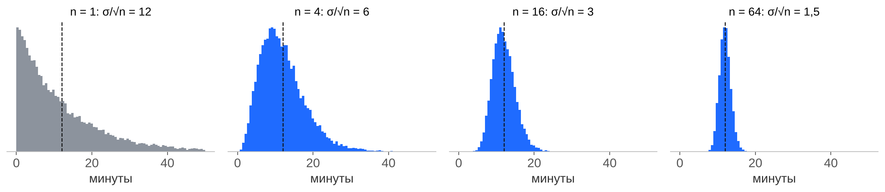

Время ожидания автобуса: среднее 12 мин, $\sigma=12$ мин (показательный закон). Каждая гистограмма — 20 000 средних по $n$ ожиданиям. При $n=1$ «среднее» — это сами данные. Выборка вчетверо больше — разброс вдвое меньше.

### 2.2. Закон больших чисел (теорема Чебышёва)

Подставим в неравенство Чебышёва $\bar X$ вместо $X$, используя $E(\bar X)=a$ и $\mathrm{Var}(\bar X)=\sigma^2/n$:

$$\boxed{P(|\bar X-a|\ge\varepsilon)\le\frac{\sigma^2}{n\varepsilon^2}\xrightarrow[n\to\infty]{}0},\qquad P(|\bar X-a|<\varepsilon)\ge1-\frac{\sigma^2}{n\varepsilon^2}\longrightarrow1.$$

**Формулировка.** Если наблюдения независимы и имеют одинаковое матожидание $a$ и конечную дисперсию $\sigma^2$, то для любой точности $\varepsilon>0$ вероятность того, что среднее промахнётся мимо $a$ больше чем на $\varepsilon$, стремится к нулю при $n\to\infty$. Говорят, что $\bar X$ **сходится к $a$ по вероятности**.

Всё доказательство — одна подстановка в неравенство Чебышёва (П. Л. Чебышёв, 1867).

### 2.3. Теорема Бернулли: частота стремится к вероятности

Пусть $m$ — число успехов в $n$ независимых опытах, в каждом из которых успех наступает с вероятностью $p$. Обозначим $I_j=1$, если в $j$-м опыте успех, и $I_j=0$ иначе. Тогда $m=I_1+\ldots+I_n$, а **частота** $m/n$ — это среднее индикаторов. Для одного индикатора $E(I_j)=p$, $\mathrm{Var}(I_j)=p-p^2=pq$. По формулам пункта 2.1

$$E\left(\frac mn\right)=p,\qquad \mathrm{Var}\left(\frac mn\right)=\frac{pq}{n},$$

и неравенство Чебышёва даёт

$$\boxed{P\left(\left|\frac mn-p\right|\ge\varepsilon\right)\le\frac{pq}{n\varepsilon^2}\le\frac1{4n\varepsilon^2}}.$$

Последний шаг: $pq=p(1-p)\le1/4$ при любом $p$, худший случай $p=1/2$. Поэтому вероятность можно оценивать частотой — на этом держатся все симуляции курса. Якоб Бернулли доказал этот результат в 1713 году и называл его «золотой теоремой».

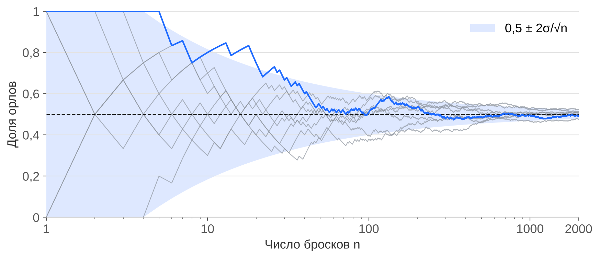

Каждая серия рано или поздно входит в коридор $0{,}5\pm2\sigma/\sqrt n$ и почти не выходит из него. Путь при этом не монотонный: на 500-м броске доля может быть дальше от 0,5, чем на 300-м. ЗБЧ говорит о вероятности, а не о каждом шаге.

**Задача «Сколько раз бросить монету».** Сколько раз нужно бросить монету, чтобы с вероятностью не меньше 0,95 частота орлов отличалась от 0,5 меньше чем на 0,05?

$$P\left(\left|\frac mn-0{,}5\right|\ge0{,}05\right)\le\frac{0{,}25}{n\cdot0{,}05^2}\le0{,}05\quad\Longrightarrow\quad n\ge\frac{0{,}25}{0{,}0025\cdot0{,}05}=2000.$$

Чебышёв гарантирует, что 2000 бросков достаточно. В части 3 увидим, что на самом деле хватит около 385.

### 2.4. Почему казино не рискует

Ставка 100 руб. на красное в рулетке (18 красных, 18 чёрных, зелёное зеро): $+100$ с вероятностью $18/37$, $-100$ с вероятностью $19/37$.

$$E=100\cdot\frac{18}{37}-100\cdot\frac{19}{37}=-\frac{100}{37}\approx-2{,}70\ \text{руб.}$$

* **Один игрок, 1000 ставок.** В среднем $-2\,700$ руб., но разброс около $3\,160$ руб. — больше среднего проигрыша. Примерно каждый пятый игрок уходит в плюсе.
* **Казино, 10 млн ставок.** В среднем $+27$ млн руб., разброс около $0{,}3$ млн. Результат почти точный.

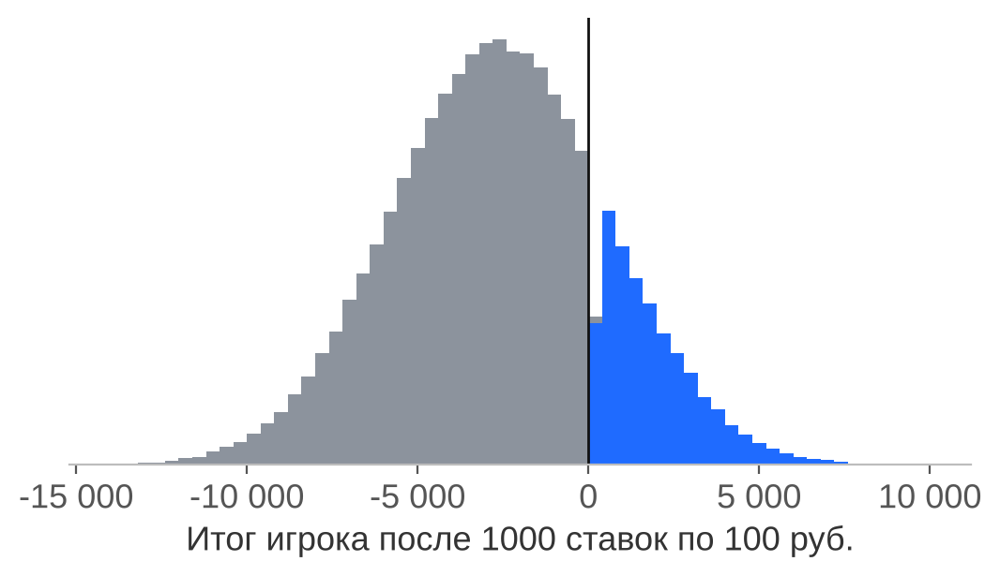

Ожидание суммы растёт как $n$, а разброс — как $\sqrt n$. Отношение разброса к ожиданию убывает как $1/\sqrt n$, поэтому для казино случайность почти исчезает.

### 2.5. «Ошибка игрока»: ЗБЧ — это разбавление, а не компенсация

**Вопрос.** На рулетке пять раз подряд выпало чёрное. На что ставить: А) на красное — оно «должно»; Б) на чёрное — оно «идёт»; В) всё равно?

18 августа 1913 года в Монте-Карло чёрное выпало 26 раз подряд. Игроки проиграли миллионы, ставя на красное: «уж теперь-то красное должно выпасть». Вероятность такой серии $(18/37)^{26}\approx7\cdot10^{-9}$ — один шанс из 137 млн.

**Ответ В.** Рулетка не помнит прошлого: после любой серии вероятность красного снова $18/37$. Но разве ЗБЧ не требует, чтобы красное «догнало» чёрное? Нет. Пусть мы начали с 10 орлов подряд, а дальше бросаем честную монету:

| Ещё бросков | 0 | 100 | 1 000 | 10 000 |
|---|---|---|---|---|
| Перевес орлов (в среднем) | +10 | +10 | +10 | +10 |
| Доля орлов | 10/10 = 1 | 60/110 ≈ 0,55 | 510/1010 ≈ 0,505 | 5010/10010 ≈ 0,5005 |

Лишние 10 орлов никто не отыгрывает. Они тонут в тысячах новых бросков, и доля стремится к 0,5 не потому, что монета «исправляется».

### 2.6. Орлы обгоняют решки, а доля сходится

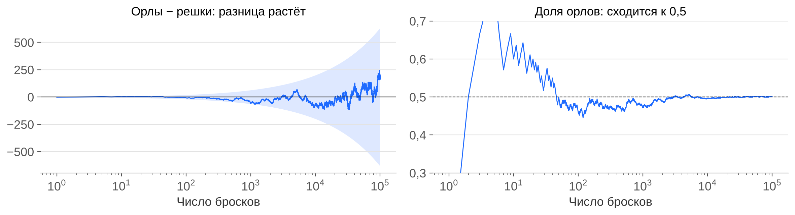

Разность «орлы − решки» — это сумма $n$ слагаемых $\pm1$, её разброс $\sigma=\sqrt n$: после 100 бросков около 10, после $10^6$ — около 1000. В штуках орлы и решки расходятся всё сильнее. А доля отклоняется от 0,5 на величину порядка $\sqrt n/n=1/\sqrt n\to0$. **Сходится доля, а не счёт.**

### 2.7. Когда ЗБЧ не работает: нет среднего

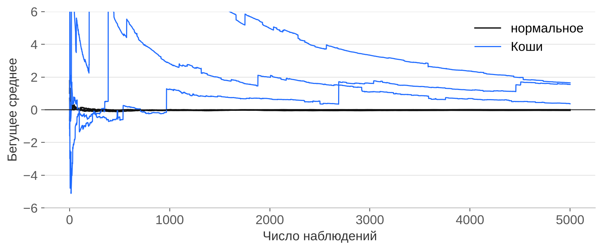

Чёрные линии — бегущее среднее нормальных величин: оно быстро успокаивается у нуля. Синие — закон Коши: рывки не прекращаются, потому что изредка выпадают гигантские значения. У закона Коши нет ни $E(X)$, ни $\mathrm{Var}(X)$, поэтому условие «дисперсия конечна» в ЗБЧ — не формальность. Вторая причина, по которой ЗБЧ подводит, — зависимость наблюдений: если соседние наблюдения похожи, они дают меньше информации, чем столько же независимых.

### 2.8. Вернёмся к районам

Частота болезни в районе — это доля заболевших среди $n$ жителей, то есть частота $m/n$ из теоремы Бернулли. Её разброс $\sigma/\sqrt n=\sqrt{p(1-p)/n}$: у маленьких районов большой, у больших — маленький.

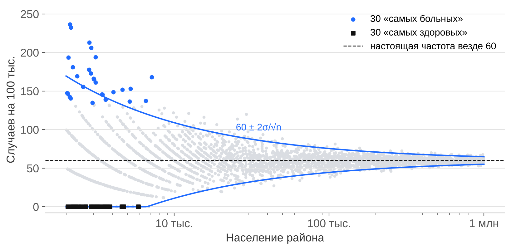

Коридор $60\pm2\sqrt{p(1-p)/n}$ широкий слева и узкий справа. Около 96% районов лежат внутри него. Разницы между районами нет, есть только шум маленьких выборок.

---

## Часть 3. Центральная предельная теорема

ЗБЧ говорит, **куда** сходится среднее. ЦПТ говорит, **как именно** оно разбросано вокруг $a$ при большом, но конечном $n$.

### 3.1. Доска Гальтона

Шарик падает через 12 рядов гвоздей и на каждом отскакивает влево или вправо с вероятностью ½. Внизу 13 ячеек с номерами 0–12. Номер ячейки — число отскоков вправо, то есть сумма 12 независимых слагаемых «0 или 1»: закон $\mathrm{Bin}(12;\ 1/2)$.

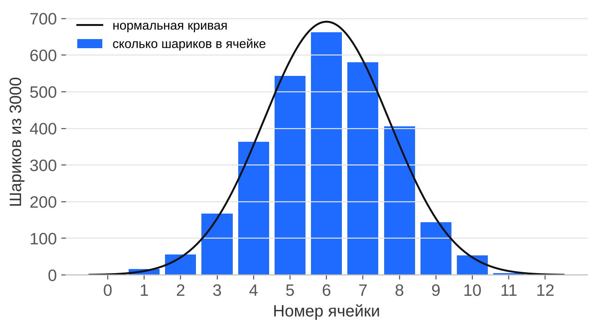

Каждый отскок — монета. Сумма многих монет даёт колокол.

### 3.2. Колокол из сложения

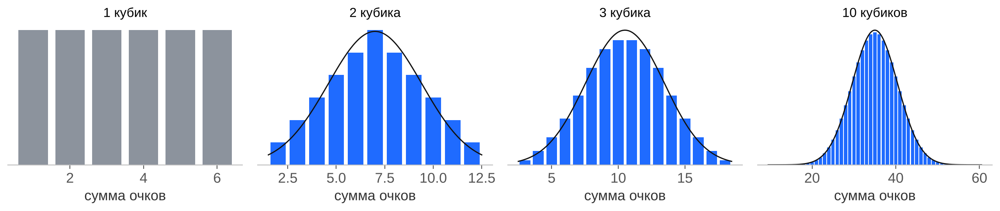

У одного кубика все значения равновероятны. Сумма двух — треугольник: 7 выпадает чаще всего. Сумма трёх — уже почти колокол, сумма десяти — колокол. Ни один кубик не «нормальный», колокол появляется из сложения.

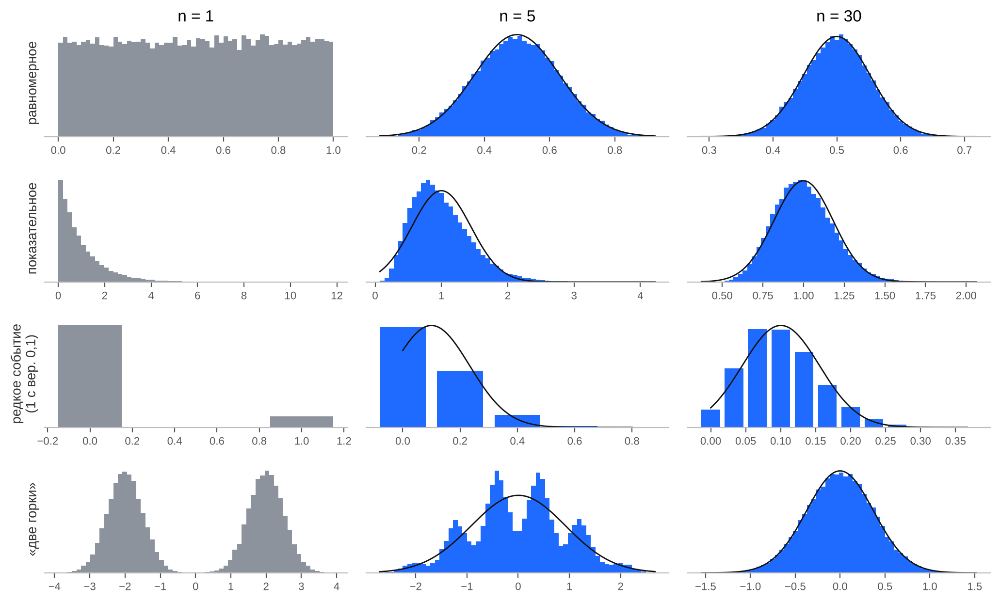

То же для других законов: слева исходные данные ($n=1$), дальше средние по 5 и по 30 наблюдений. Симметричные законы (равномерный, «две горки») становятся колоколом быстро. Перекошенные (показательный, редкое событие) — медленнее, но тоже. Форма исходного закона почти не важна.

### 3.3. Формулировка ЦПТ

Мы уже знаем центр и ширину распределения среднего: $E(\bar X)=a$, $\sigma(\bar X)=\sigma/\sqrt n$. Неизвестна только форма. Чтобы сравнивать средние при разных $n$, переведём среднее в «единицы стандартной ошибки»:

$$Z_n=\frac{\bar X-a}{\sigma/\sqrt n}$$

— на сколько стандартных ошибок среднее отошло от $a$. При любом $n$

$$E(Z_n)=\frac{E(\bar X)-a}{\sigma/\sqrt n}=0,\qquad \mathrm{Var}(Z_n)=\frac{\mathrm{Var}(\bar X)}{\sigma^2/n}=1.$$

Мы только сдвинули и растянули $\bar X$, поэтому форма у $Z_n$ та же, что у $\bar X$, а центр и масштаб стандартные.

**Центральная предельная теорема.** Если наблюдения $X_1,\dots,X_n$ независимы, одинаково распределены и $\sigma$ конечна, то при любых $z_1<z_2$

$$\boxed{P(z_1<Z_n<z_2)\xrightarrow[n\to\infty]{}\Phi(z_2)-\Phi(z_1)}.$$

Справа стоит вероятность того же интервала для стандартного нормального закона $N(0;1)$. Теорема верна, какой бы ни была форма распределения $X_i$. В общем виде её доказал А. М. Ляпунов в 1901 году.

### 3.4. Что значит «стремится к Φ»

Вероятность того, что среднее отошло от $a$ не больше чем на $z$ стандартных ошибок, при росте $n$ становится такой же, как у стандартного нормального закона. Например,

$$P(|Z_n|<2)\longrightarrow2\Phi(2)\approx0{,}954:$$

лишь в 4,6% выборок среднее оказывается дальше чем на $2\sigma/\sqrt n$ от $a$.

**На практике** при большом $n$ считают, что

$$\bar X\approx N\left(a,\ \frac{\sigma^2}{n}\right),\qquad S_n=X_1+\ldots+X_n=n\bar X\approx N\left(na,\ n\sigma^2\right).$$

Важно: это утверждение о форме распределения **среднего**. Сами данные нормальными не становятся.

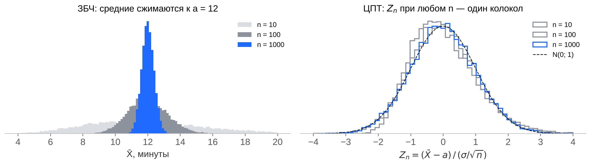

Слева средние по $n$ ожиданиям автобуса сжимаются к $a=12$ — это ЗБЧ. Справа те же средние в единицах стандартной ошибки, то есть $Z_n$: при любом $n$ получается один и тот же колокол $N(0;1)$ — это ЦПТ.

### 3.5. Как пользоваться: правило 68–95–99,7

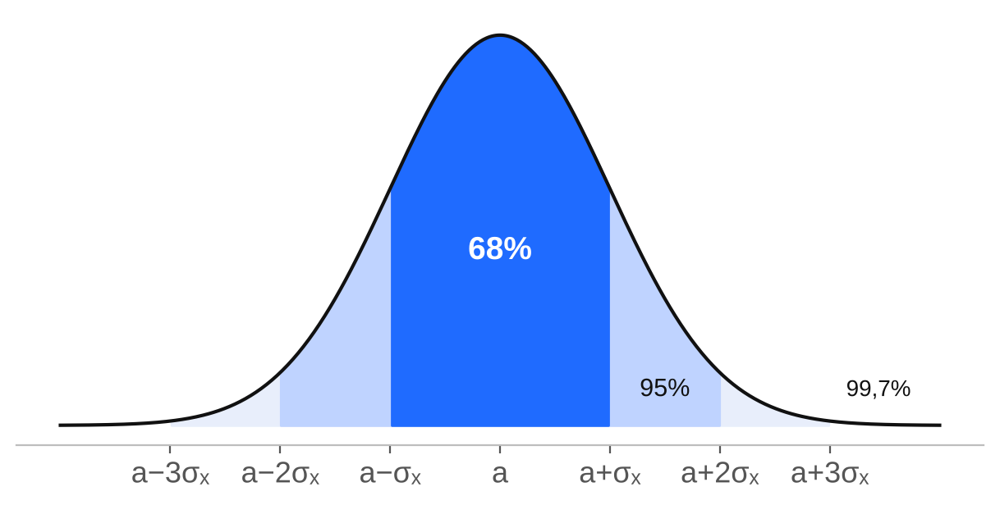

Среднее попадает в пределы $a\pm\sigma/\sqrt n$ примерно в 68% выборок, $a\pm2\sigma/\sqrt n$ — в 95%, $a\pm3\sigma/\sqrt n$ — в 99,7%. Рабочие формулы:

$$P(|\bar X-a|<\delta)\approx2\Phi\left(\frac{\delta\sqrt n}{\sigma}\right),\qquad P(\alpha<S_n<\beta)\approx\Phi\left(\frac{\beta-na}{\sigma\sqrt n}\right)-\Phi\left(\frac{\alpha-na}{\sigma\sqrt n}\right).$$

Вторая формула — это формула для нормального закона, в которую подставили $E(S_n)=na$ и $\sigma(S_n)=\sigma\sqrt n$.

### 3.6. Теорема Муавра — Лапласа — частный случай ЦПТ

Число успехов $m=I_1+\ldots+I_n$ — сумма индикаторов с $a=p$ и $\sigma^2=pq$. По ЦПТ

$$m\approx N(np,\ npq),\qquad P(k_1\le m\le k_2)\approx\Phi\left(\frac{k_2-np}{\sqrt{npq}}\right)-\Phi\left(\frac{k_1-np}{\sqrt{npq}}\right).$$

Это и есть интегральная теорема Муавра — Лапласа с семинаров.

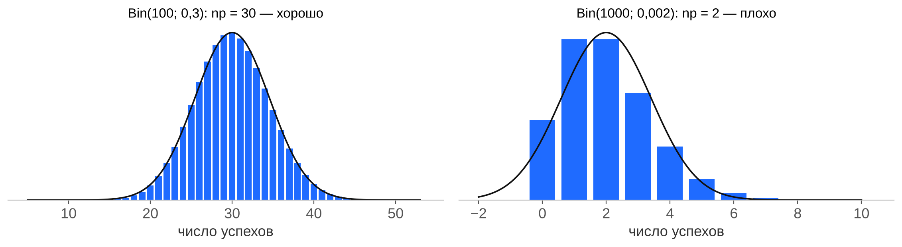

Слева $\mathrm{Bin}(100;\ 0{,}3)$, $np=30$: приближение отличное. Справа $\mathrm{Bin}(1000;\ 0{,}002)$, $np=2$: в среднем 2 успеха, закон сильно перекошен, нормальная кривая даже залезает в минус. **Правило:** нормальному приближению можно верить, если $np$ и $nq$ не меньше 10. Иначе для редких событий используют закон Пуассона.

### 3.7. Задачи

**Средний чек.** Средний чек в магазине $a=400$ руб., $\sigma=250$ руб. Владелец видит, что средний чек за 100 покупок — 450 руб. Повод радоваться?

Стандартная ошибка $\sigma_{\bar X}=250/\sqrt{100}=25$ руб. По ЦПТ

$$P(\bar X\ge450)\approx0{,}5-\Phi\left(\frac{450-400}{25}\right)=0{,}5-\Phi(2)\approx0{,}023.$$

Если ничего не менялось, такой средний чек бывает лишь в 2–3% дней — скорее всего, что-то изменилось. Сравним оценки вероятности отклониться на 50 руб. и больше:

| Метод | Ответ |
|---|---|
| Чебышёв: $P(\lvert\bar X-400\rvert\ge50)\le25^2/50^2$ | не больше 25% |
| ЦПТ: $1-2\Phi(2)$ | ≈ 4,6% |

Отдельные чеки сильно перекошены вправо, но при $n=100$ ЦПТ уже работает хорошо (в ноутбуке это проверено симуляцией).

**Сколько раз бросить монету: ответ ЦПТ.** Та же задача, что в пункте 2.3:

$$P\left(\left|\frac mn-0{,}5\right|<0{,}05\right)\approx2\Phi\left(\frac{0{,}05\sqrt n}{0{,}5}\right)=0{,}95\ \Longrightarrow\ \Phi(x)=0{,}475,\ x=1{,}96,$$

$$\frac{0{,}05\sqrt n}{0{,}5}=1{,}96\ \Longrightarrow\ n=\left(\frac{1{,}96\cdot0{,}5}{0{,}05}\right)^2\approx385.$$

| Метод | Сколько бросков нужно |
|---|---|
| Чебышёв (гарантия) | 2 000 |
| ЦПТ (приближение) | 385 |

Так рассчитывают объём опросов: при $n\approx1000$ погрешность доли около ±3 процентных пунктов. Чебышёв грубее, но это гарантия для любого закона; ЦПТ точнее, но это приближение при большом $n$.

### 3.8. Почему нормальный закон — везде

Любая величина, которая складывается из многих мелких независимых добавок, близка к нормальной.

* **Ошибка измерения** — сумма многих мелких помех: дрогнула рука, вибрация, нагрев прибора. Ни одна не главная. Гаусс получил нормальный закон именно как закон ошибок астрономических измерений.
* **Рост человека** — сумма вкладов многих генов, питания, болезней в детстве.
* **Урожай с большого поля** — сумма урожаев тысяч участков, у каждого своя случайность.

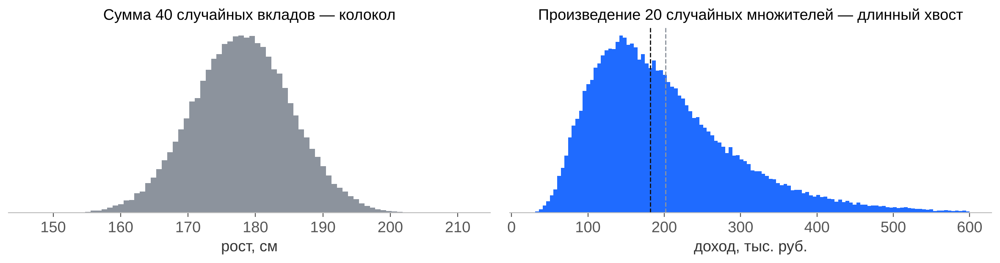

Если же величина складывается не из слагаемых, а из **множителей**, колокола не будет. Слева рост как сумма 40 случайных вкладов — колокол. Справа доход как 30 тыс. руб., 20 раз умноженные на случайный рост от −10% до +30%: длинный правый хвост, среднее больше медианы. Произведение — это сумма логарифмов, $\ln(a_1a_2\cdots a_n)=\ln a_1+\ldots+\ln a_n$, поэтому колоколом становится логарифм. Отсюда логнормальный закон из лекции 6.

### 3.9. Чего ЦПТ не утверждает

| Утверждение | На самом деле |
|---|---|
| Данные становятся нормальными | Нет. Колоколом становится распределение среднего, а гистограмма данных остаётся какой была. |
| Колокол наступает при $n=30$ | Нет. Скорость зависит от перекоса данных: для симметричных хватит 5, для редких событий нужно $np\ge10$. |
| Можно усреднять что угодно | Нет. Нужны конечная дисперсия (вспомните закон Коши) и независимость. |
| ЦПТ исправляет ошибку в данных | Нет. Если взвешивали на сбитых весах, колокол будет красивым, но вокруг неправильного центра. |

---

## Итоги

* **Марков и Чебышёв:** $P(X\ge a)\le E(X)/a$ для $X\ge0$; $P(|X-E(X)|\ge\varepsilon)\le\mathrm{Var}(X)/\varepsilon^2$. Гарантии, если известны только $E$ и $\mathrm{Var}$. Грубо, зато для любого закона.
* **Среднее:** $E(\bar X)=a$, $\sigma(\bar X)=\sigma/\sqrt n$. Вчетверо больше данных — вдвое точнее.
* **ЗБЧ:** $\bar X\to a$ и $m/n\to p$ по вероятности, если наблюдения независимы и дисперсия конечна. Это разбавление, а не компенсация.
* **ЦПТ:** $Z_n=(\bar X-a)/(\sigma/\sqrt n)$ распределено приближённо как $N(0;1)$. Считаем через функцию Лапласа: $P(|\bar X-a|<\delta)\approx2\Phi(\delta\sqrt n/\sigma)$.
* Любое среднее, посчитанное по данным, — случайная величина. Его точность растёт как $\sqrt n$.

## Вопросы для самопроверки

1. Почему в неравенстве Маркова нужно условие $X\ge0$? Приведите пример, где без него неравенство неверно.
2. Выведите неравенство Чебышёва из неравенства Маркова.
3. Почему $\mathrm{Var}(\bar X)=\sigma^2/n$? Где в выводе используется независимость наблюдений?
4. Сколько наблюдений нужно, чтобы стандартная ошибка среднего уменьшилась в 3 раза?
5. После 10 решек подряд какова вероятность орла? Как это согласуется с ЗБЧ?
6. Почему самые «здоровые» и самые «больные» районы в рейтинге оказываются маленькими?
7. Чем отличаются ответы Чебышёва и ЦПТ в задаче о монете и почему?
8. Можно ли пользоваться нормальным приближением для $\mathrm{Bin}(500;\ 0{,}004)$? Что использовать вместо него?
9. Почему рост людей близок к нормальному закону, а доходы — нет?
